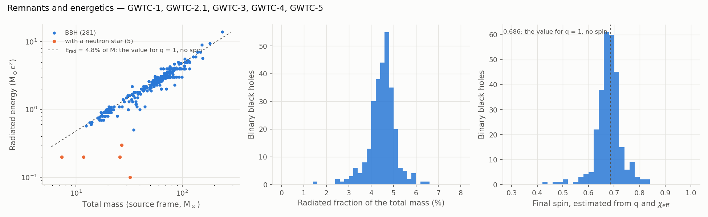
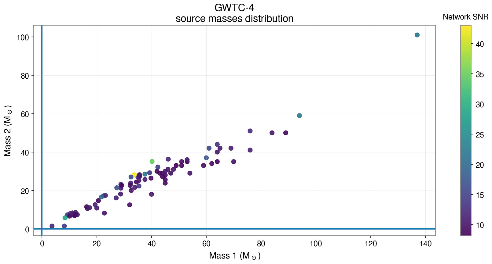
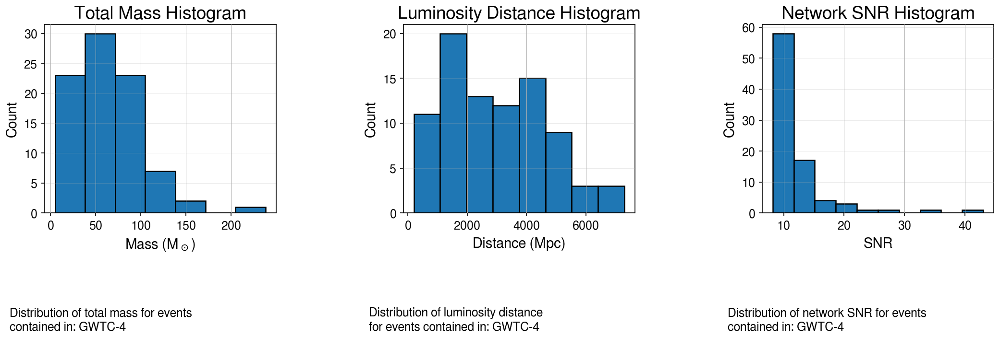
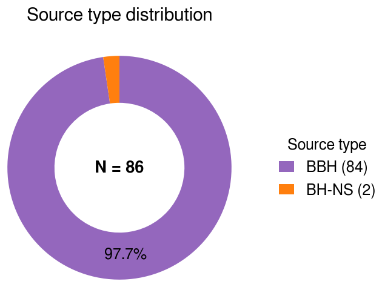
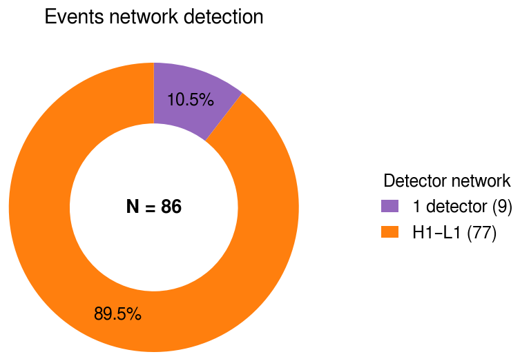
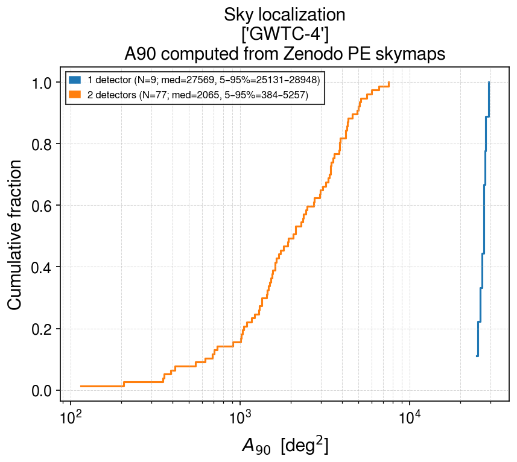

# catalog_statistics

Catalog-wide statistics of one or several catalogs: a table with one row per event, plots, and an
HTML report.

```bash
gwtc_analysis catalog_statistics --catalogs GWTC-4 GWTC-5 --include-detectors --include-area
```

**Inputs.** Event metadata from the GWOSC event lists (names, times, false-alarm rates, median
source-frame masses, distances, network SNR); with `--include-detectors`, the detector network of each
event from the GWOSC v2 API; with `--include-area`, the sky-localization area at the credible level
`--area-cred` (A90 by default), computed from the skymaps of `--data-repo`.

## Method

**The mode reads released catalog values and computes from them; it reads no strain and no PE samples.**
Every number per event is a GWOSC median (or a 90% bound), or arithmetic on these medians; the only
product it processes further is the LVK skymap, for the sky area.

### What it reads

| Input | Source | What is in it |
|---|---|---|
| event list | the GWOSC event API, `gwosc.org/eventapi/jsonfull/<list>/`, the confident list of each catalog (GWTC-1-confident, GWTC-2.1-confident, GWTC-3-confident, GWTC-4.0, GWTC-4.1, GWTC-5.0) | per event: name and version, GPS time, median source-frame masses (m₁, m₂, total, final, chirp), luminosity distance, redshift, χ_eff, χ_p, network matched-filter SNR, FAR, p_astro |
| detectors (`--include-detectors`) | the GWOSC v2 API, `gwosc.org/api/v2/event-versions/<name>-v<N>`, one call per event | the `detectors` list of the event version |
| skymaps (`--include-area`) | the skymap tarball of the catalog's Zenodo PE release (GWTC-1: that of GWTC-2.1), or its copy on the S3 mirror or Galaxy | HEALPix FITS maps built by the LVK from the PE samples, one per waveform analysis |

### What the mode does with them

1. **Fetch** the event list of each catalog, at every run (it is not cached).
2. **Clean.** Events without median source-frame m₁ and m₂ are dropped (the report counts them per
   catalog). When GWOSC lists m₂ > m₁, the two masses and their bounds are swapped. `total_mass_source`
   is the sum of the two medians; a missing chirp mass is computed from them,
   \((m_1 m_2)^{3/5}/(m_1 + m_2)^{1/5}\).
3. **Source type** from the median masses with a fixed 3 M☉ threshold: both below `NS-NS`, one below
   `BH-NS`, none `BBH` (the labels of the `binary_type` column and of the pie).
4. **Remnants**, as in [Remnants and energetics](#remnants-and-energetics): E_rad is kept only when
   positive, converted with 1 M☉c² = 1.7877 × 10⁵⁴ erg; the final-spin estimate is given for `BBH` only,
   with a missing χ_eff taken as 0.
5. **Detectors** (`--include-detectors`): the `detectors`, `n_det` and `has_V1` columns. The pie groups the
   networks into 1 detector, H1–L1, H1/L1–V1, H1–L1–V1 and H1–L1–V1–G1; other combinations are left out.
6. **Sky area** (`--include-area`). The tarball is downloaded once into `.cache_gwosc/` in the working
   directory. One map per event: `Mixed`, else IMRPhenomXPHM-SpinTaylor (the GWTC-5.0 case), else the
   other waveforms in a fixed order. The map is read with `ligo.skymap.io.read_sky_map`, its greedy credible
   levels come from `ligo.skymap.postprocess.find_greedy_credible_levels`, and the area is the number of
   pixels at or below `--area-cred` times 41 252.96 deg² / N_pix. With `s3` or `galaxy`, the maps of the
   selected release version come from the mirror when it holds them, the others from Zenodo.
7. **Report**: counts per catalog, source type and number of detectors; the loudest events (network SNR at
   or above the 90th percentile of the selection), listed as candidates for
   [parameters_estimation](parameters-estimation.md); the 10 largest E_rad; the 10%, 50% and 90% quantiles
   of the area.

The medians, FARs, SNRs, distances and redshifts are GWOSC's and are not recomputed; the skymaps are the
LVK's and are not rebuilt.

## Remnants and energetics

Every event with a final mass in GWOSC gets, in the TSV and the report:

- **the radiated energy** E_rad = (M_total − M_final) c², in M☉c² and in erg, and the radiated
  fraction E_rad / M_total c². It is the difference of the GWOSC medians, not the median of the
  difference, and the medians are rounded (to 0.1–1 M☉), so small values are coarse;
- **an estimate of the final spin** of the binary black holes. It uses the aligned-spin fit of Rezzolla
  et al. 2008 [\[76\]](../references.md#ref-76), with both spins set to χ_eff and the mass ratio of the
  medians. It gives 0.686 for equal masses without spin. The PE value (`final_spin` of the PE
  samples) and the peak luminosity, which GWOSC does not list, are read with
  [parameters_estimation](parameters-estimation.md).

The report lists the 10 events that radiated the most energy, with a figure:



*GWTC-1 to GWTC-5: 286 events radiated 4.6% of their total mass (median), close to the 4.8% of
equal masses without spin; the events with a neutron star radiate much less (orange). The estimated
final spins cluster near 0.69, as expected for mergers of similar masses with small spins.*

| Event | Total mass (M☉) | Final mass (M☉) | E_rad (M☉c²) | E_rad (erg) | Final spin (estimate) |
|---|---|---|---|---|---|
| GW231123_135430 | 236 | 222 | 14.0 | 2.5 × 10⁵⁵ | 0.77 |
| GW190426_190642 | 182.3 | 172.9 | 9.4 | 1.7 × 10⁵⁵ | 0.74 |
| GW231028_153006 | 153 | 144 | 9.0 | 1.6 × 10⁵⁵ | 0.80 |
| GW200220_061928 | 148 | 141 | 7.0 | 1.3 × 10⁵⁵ | 0.69 |
| GW150914 (for reference) | 64.5 | 61.5 | 3.0 | 5.4 × 10⁵⁴ | 0.67 |

Here the total mass is the GWOSC median of m₁ + m₂, the one E_rad = total − final uses; the `total_mass_source`
column of the mode's TSV and report is the sum of the two medians, slightly larger for the heaviest events.
GW150914 matches its published values (3.0 +0.5 −0.4 M☉c², final spin 0.67–0.69).

## Example

```bash
gwtc_analysis catalog_statistics --catalogs GWTC-4 --include-detectors --include-area
```

GWTC-4.0 (O4a), 86 events with a PE release; every figure below was produced by this command.



*Median source-frame masses, colored by network SNR. The heaviest event is GW231123; the two points
near the horizontal axis are the NSBH candidates.*



| Source types | Detector networks |
|---|---|
|  |  |

*84 BBHs and 2 NSBHs; 77 events seen by the two LIGO detectors, 9 by one only (Virgo did not observe
during O4a).*

{ width="560" }

*90% sky areas from the Zenodo PE skymaps: median 2 065 deg² with two detectors, about 27 600 deg²
with a single detector, which localizes an event only to a large part of the sky.*

## Outputs

- `--out-events` (TSV): one row per event;
- `--plots-dir`: the primary against secondary mass diagram colored by SNR, histograms of the main
  parameters, the fraction of each source type (BBH, BNS, NSBH), the detector networks, the cumulative
  distribution of the sky-localization areas and the remnants ([above](#remnants-and-energetics));
- `--out-report`: the HTML report with the tables and plots.

## Options

| Option | Default | Meaning |
|---|---|---|
| `--catalogs` | — | Catalog keys, space-separated (e.g. GWTC-1 GWTC-2.1 GWTC-3 GWTC-4 GWTC-4.1 GWTC-5). ALL takes them all except the updates (GWTC-4.1, update of GWTC-4), which are used only when named. |
| `--out-events` | `catalogs_statistics.tsv` | Output TSV path (per-event table). |
| `--out-report` | `catalogs_statistics.html` | Output HTML report path. |
| `--include-detectors` | off | Include detector network via GWOSC v2 calls. |
| `--include-area` | off | Compute sky localization area Axx if skymaps are available. |
| `--area-cred` | `0.9` | Credible level for sky area: 0.9→A90, 0.5→A50, 0.95→A95. |
| `--plots-dir` | `cat_plots` | Directory for plots (default: cat_plots). |
| `--data-repo {galaxy,zenodo,s3}` | `zenodo` | Where the skymaps are read from: zenodo (the release tarballs); s3 (the MinIO mirror, faster) or galaxy (staged collections, else the public usegalaxy.org history), when they hold the maps of the selected release version, else Zenodo. |
| `--zenodo-version CATALOG=VERSION` | — | Read an older Zenodo release version of a catalog instead of the latest, with any --data-repo (e.g. --zenodo-version GWTC-3=v2 GWTC-4=v1). Versions are numbered from the oldest (v1); list them with the zenodo_releases mode. |

Every report ends with the options of its run, defaults included. The same table with the help text
of all the modes: [CLI reference](../cli-reference.md#catalog_statistics).
