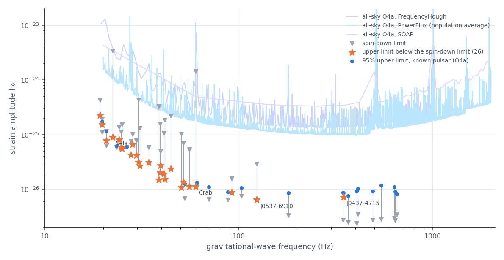
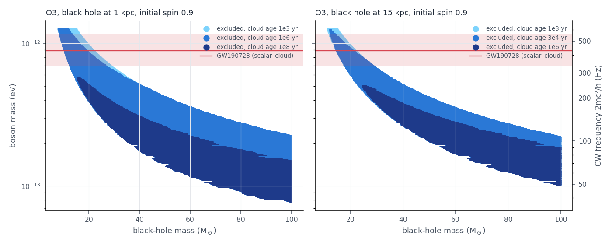
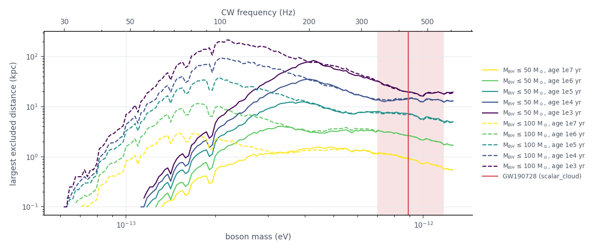

# continuous_waves

Continuous waves (CW) are long-lived, nearly monochromatic signals: from spinning neutron stars with a small
deformation (a "mountain", of ellipticity ε), or from clouds of ultralight bosons around spinning black holes, which
annihilate into gravitons at twice the boson's Compton frequency. **None has been detected.** The mode gathers the
upper limits of the LVK data releases and shows them as the papers do, with the boson mass found by
[scalar_cloud](scalar-cloud.md) for GW190728 drawn on the boson-cloud limits. It runs no search itself (see
[Method](#method)).

```bash
gwtc_analysis continuous_waves                                  # downloads 3 MB once
gwtc_analysis continuous_waves --boson-mass 2e-13 3e-13 4e-13 --boson-label "my band"
```

## Method

**The mode runs no continuous-wave search.** It reads no strain data and reruns none of the LVK pipelines: those
searches take months of detector data and large computing campaigns. It reads the **upper limits the LVK published**
with each paper (data releases on the LIGO DCC), draws them as the papers do, and derives from them the few numbers
of the [Results](#results), each compared with the paper.

### What the LVK searches did

| Search | Data | Pipelines | Upper limit |
|---|---|---|---|
| 45 known pulsars, O4a [\[105\]](../references.md#ref-105) | O4a, the two LIGO detectors | three independent **targeted** pipelines, which follow the phase of each pulsar from its radio or X-ray timing: the time-domain Bayesian method (CWInPy: a heterodyne removes the phase evolution of the source, then the amplitude is sampled), the 5n-vector method, and the time-domain \(\mathcal{F}\)/\(\mathcal{G}\)/\(\mathcal{D}\)-statistic; and the **5n-vector narrowband** pipeline for 16 of the pulsars, which lets the frequency and spin-down wander slightly around the timing values | on the strain amplitude h₀ at twice the rotation frequency (single-harmonic emission): a 95% credible upper limit from the posterior (Bayesian), 95% confidence from software injections (the other pipelines) |
| all-sky, isolated neutron stars, O4a [\[106\]](../references.md#ref-106) | O4a, 20–2000 Hz | three **semi-coherent** all-sky pipelines, which search every sky position, frequency and spin-down: PowerFlux (templated, with a loose-coherence follow-up), FrequencyHough (templated), SOAP (a hidden Markov model, without templates) | 95% confidence, frequentist, against frequency; PowerFlux averaged over the sky positions and orientations of the population |
| all-sky, boson clouds, O3 [\[107\]](../references.md#ref-107) | O3, the two LIGO detectors, 20–610 Hz | one **semi-coherent** search of the Band Sampled Data (BSD) framework, at several Fourier-transform lengths (a cloud's frequency rises slowly and may fluctuate); outliers found in both detectors, followed up with FrequencyHough or a hidden-Markov-model tracking | 95% confidence per 1 Hz band, from the analytic FrequencyHough sensitivity with the measured noise and the largest detection statistic (critical ratio) of each band. The paper then turns them into the **excluded black-hole and boson masses**, from the signal model, for a fixed distance (1 or 15 kpc), initial black-hole spin (0.5 or 0.9) and cloud age, and into the **largest distance** at which clouds are excluded, from a simulated population of black holes (masses with a Kroupa distribution, \(m^{-2.3}\), from 5 to 50 or 100 M☉; spins uniform from 0.2 to 0.9) |

The spin-down limit is the strain a pulsar would emit if all the rotational energy it loses went into
gravitational waves:
\(h_0^{\rm sd} = \frac{1}{d}\left(\frac{5 G I_{zz}}{2 c^3}\frac{|\dot f_{\rm rot}|}{f_{\rm rot}}\right)^{1/2}\),
for a distance \(d\), a moment of inertia \(I_{zz}\), a rotation frequency \(f_{\rm rot}\) and its derivative.
An upper limit below it is the first physically meaningful one: it says that gravitational waves carry only part
of the energy loss.

### What the mode does

1. **Download** the released files once (3 MB, listed under [Data](#data)), and the LaTeX source of the
   known-pulsar paper on arXiv, whose results table holds what the data release lacks: the spin-down limits, the
   distances and the ellipticity upper limits.
2. **Known pulsars.** Join the Bayesian upper limits of the release with that table, pulsar by pulsar, at the
   gravitational-wave frequency \(f = 2 f_{\rm rot}\). Count the pulsars below their spin-down limit, and find the
   lowest h₀ and ellipticity upper limits. Only the Bayesian pipeline is in the release, so the count is 26, against
   29 in the paper, where a pulsar counts if any of the three pipelines puts it below its spin-down limit. The
   narrowband limits are divided by the same spin-down limits.
3. **All-sky.** Draw the three curves as released (the SOAP file holds log₁₀ h₀) and find the lowest value of each.
4. **Boson clouds.** Convert a band of boson masses into a CW frequency band, \(f = 2 m c^2 / h\); read in it the
   O3 upper limits (the higher of the two values the release gives per 1 Hz band), the excluded black-hole masses
   and the largest excluded distance. These are read off the LVK's exclusion curves, not recomputed.

### Where scalar_cloud comes in

**Only on the boson-cloud plots and paragraph, and without running.** The band drawn there by default,
0.70–0.89–1.17 × 10⁻¹² eV (5%, 50%, 95%), is the boson mass that [scalar_cloud](scalar-cloud.md#gw190728_064510)
found for GW190728_064510 with the superradiance prior (cloud grown before the merger, delay τ_d = 10⁶ yr), from
the dephasing of the inspiral. It is written into the mode as a constant: `continuous_waves` neither runs
scalar_cloud nor reads its outputs, and takes seconds. `--boson-mass LOW MID HIGH` replaces it by any band, for
example the result of another scalar_cloud run or a boson mass from elsewhere. The known-pulsar and all-sky results
do not depend on it.

The comparison is between two independent probes of the same particle: scalar_cloud tests a cloud around a binary
through the inspiral, this mode the continuous wave of a cloud around an isolated black hole of the Galaxy (see
[Boson clouds and GW190728](#boson-clouds-and-gw190728)).

## Data

| Search | Paper | Data release (LIGO DCC, public) | What the mode reads |
|---|---|---|---|
| 45 known pulsars, O4a | [\[105\]](../references.md#ref-105) | [LIGO-G2402400](https://dcc.ligo.org/LIGO-G2402400/public) | the 95% upper limits on h₀ (Bayesian pipeline); the spin-down limits, distances and ellipticity limits from the paper's table (its arXiv LaTeX source); the narrowband upper limits of 16 of them (and 2 post-glitch analyses) |
| all-sky, isolated neutron stars, O4a | [\[106\]](../references.md#ref-106) | [LIGO-P2500416](https://dcc.ligo.org/LIGO-P2500416/public) | h₀ upper limits against frequency, 20–2000 Hz: FrequencyHough, PowerFlux (population average), SOAP |
| all-sky, boson clouds, O3 | [\[107\]](../references.md#ref-107) | [LIGO-P2100343](https://dcc.ligo.org/LIGO-P2100343/public) | h₀ upper limits per 1 Hz band (20–610 Hz); the excluded black-hole and boson masses (a distance of 1 or 15 kpc, an initial spin of 0.5 or 0.9, an age of the cloud); the largest excluded distance against the boson mass |

## Results

| Result | Value | Published |
|---|---|---|
| known pulsars with h₀ below the spin-down limit | 26 with the Bayesian pipeline; 29 with any of the three | 29 |
| narrowband search (the frequency allowed to wander around twice the rotation frequency) below the spin-down limit | 12 of 16; the Crab at 3% of it | the same (Crab 0.03) |
| lowest h₀ upper limit | 6.4 × 10⁻²⁷, J0537−6910 (LMC, 62 Hz rotation) | the same |
| lowest ellipticity upper limit | 8.8 × 10⁻⁹, J0437−4715 (millisecond pulsar at 160 pc) | the same |
| all-sky O4a, lowest population-averaged h₀ | 9.5 × 10⁻²⁶ at 401 Hz (single 1/16 Hz band); 9.8 × 10⁻²⁶ near 298 Hz | 9.7 × 10⁻²⁶ near 290 Hz: the curve is flat within a few per cent from about 250 to 400 Hz |



*Each known pulsar's 95% upper limit (blue) against its spin-down limit (grey triangle: the strain if all the
rotational energy it loses went into gravitational waves); the stars beat it, the Crab by a factor of 130. The open diamonds are the narrowband search, less sensitive than the
targeted one but robust to a mismatch between the GW and the radio or X-ray timing (the Crab at 3% of its spin-down
limit, about 0.1% of the spin-down energy in gravitational waves; the later O4 narrowband search of 34 pulsars brings
it to 2%, ApJ 1005, 221 (2026)). The
curves are the all-sky O4a sensitivity to unknown neutron stars, which must search every direction and spin-down.*

## Boson clouds and GW190728

A boson of mass \(m\) grows a cloud by superradiance around a black hole whose size matches its Compton
wavelength, \(\alpha = G M m / (\hbar c) \sim 0.1\), and the cloud then annihilates into a continuous wave at

\[
f = \frac{2 m c^2}{h} = 483.6\ \text{Hz}\ \frac{m}{10^{-12}\ \text{eV}} .
\]

The scalar cloud fitted to GW190728 ([scalar_cloud](scalar-cloud.md#gw190728_064510)) has
\(m_\phi = 0.89\) (0.70–1.17) × 10⁻¹² eV with the superradiance prior (0.73 (0.56–1.14) × 10⁻¹² eV agnostic), so
the same particle would make clouds around Galactic black holes radiate at **340–570 Hz**, inside the band of the
O3 boson-cloud search, whose h₀ upper limits there are 1.2–1.9 × 10⁻²⁵.



*O3 exclusions for a black hole of initial spin 0.9 at 1 and 15 kpc, for clouds of different ages, with the
GW190728 band. At these boson masses only light black holes are concerned, 8–28 M☉ at 1 kpc and 12–28 M☉ at
15 kpc for a young cloud: heavier ones are not superradiant for so heavy a boson. That is the mass range of
GW190728's own components (12 and 8 M☉).*



*In the GW190728 band, clouds younger than 10³ yr are excluded out to 16–32 kpc, 10⁴ yr 13–15 kpc,
10⁵ yr 5–8 kpc, 10⁶ yr 2–3 kpc, 10⁷ yr about 1 kpc, for black holes up to 50 or 100 M☉.*

**What it means.** The continuous-wave limits do not exclude the GW190728 boson: they say that no young cloud
around a light, fast-spinning black hole sits within a few kpc of the Earth. A boson of that mass is compatible with
them as long as such systems are rare or old; turning the limits into a constraint on the boson needs a model of the
Galactic black holes (their number, masses, spins and ages). This holds for the continuous-wave limits only: the
spins of black holes constrain the same boson more directly, and the scalar_cloud paper itself finds its main
tension there, with GW190517, whose spin disfavours boson masses below about 1.1 × 10⁻¹² eV, most of the GW190728
band ([scalar_cloud](scalar-cloud.md#the-same-boson-and-black-hole-spins)). The two probes are complementary: the merger tests a
cloud carried by a binary, the continuous wave a cloud around an isolated black hole. Isolated Galactic black holes
found by microlensing (one so far, many more expected with Rubin) come with a mass and a distance, the inputs of a directed
search for their clouds.

## Outputs

- `--out-report` (HTML): the summary, the known pulsars, the all-sky limits and the boson clouds, with the plots;
- `--out-summary` (TSV): the summary; `<name>.pulsars.tsv`, `<name>.narrowband.tsv` and `<name>.boson_reach.tsv`:
  the pulsar upper limits, the narrowband limits and the distance reach for boson clouds;
- `--plots-dir`: `cw_known_pulsars.png`, `cw_boson_exclusion.png`, `cw_boson_distance.png`.

## Options

| Option | Default | Meaning |
|---|---|---|
| `--boson-mass LOW MID HIGH` | GW190728, superradiance prior: 0.70e-12 0.89e-12 1.17e-12 | the band drawn on the boson plots, eV |
| `--boson-label` | `GW190728 (scalar_cloud)`, or `given band` with `--boson-mass` | its label |
| `--refresh` | off | download the data releases again (they are cached in `~/.cache_gwtc_analysis/continuous_waves`, or `$GWTC_CW_CACHE`) |
| `--out-report`, `--out-summary`, `--plots-dir` | `continuous_waves.html`, `continuous_waves.tsv`, `continuous_waves_plots` | outputs; the summary has three companions, `<name>.pulsars.tsv` (the 45 pulsars), `<name>.narrowband.tsv` and `<name>.boson_reach.tsv` (the largest excluded distance in the band) |
| `--data-repo {zenodo,s3,galaxy}` | `zenodo` | where the LVK upper-limit files are downloaded from: their public sources, or a mirror holding the same files, `s3` (the MinIO bucket, faster) or `galaxy` (the public usegalaxy.org history), else the public source ([S3 mirror of the public files](../data-sources.md#s3-mirror-of-the-public-files)) |
