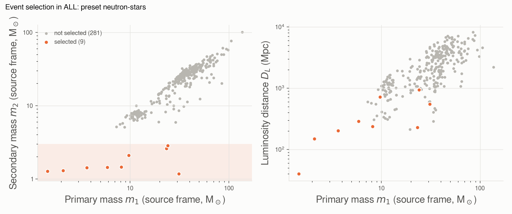
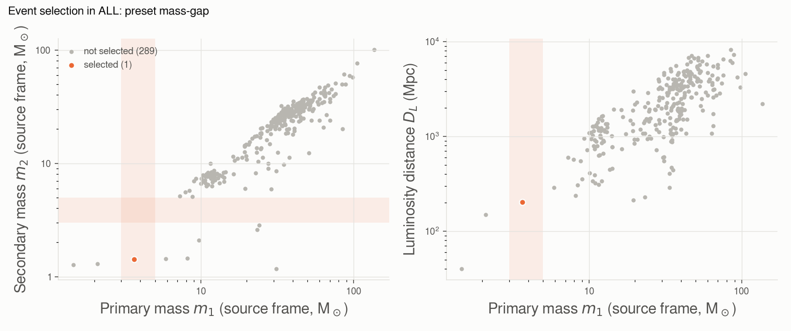
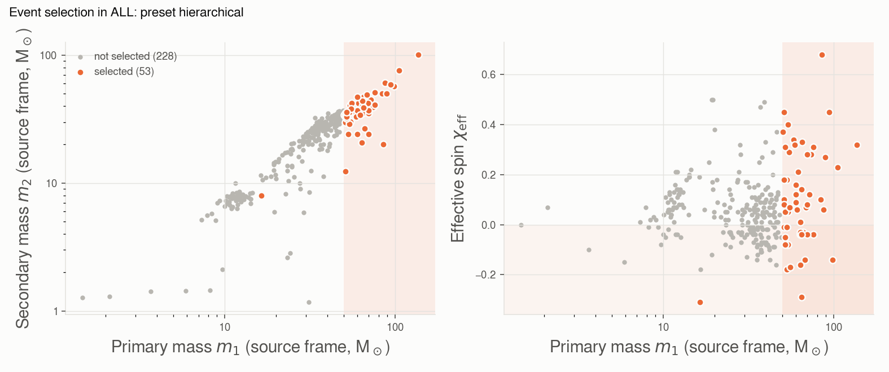
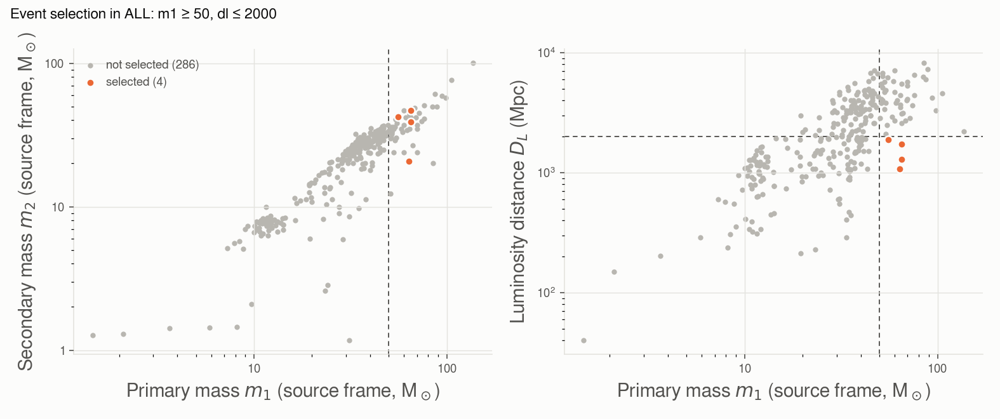
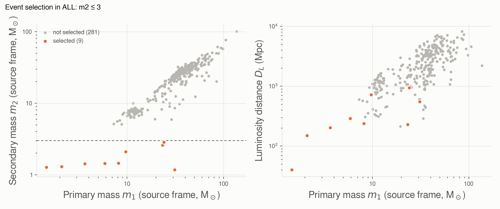

# event_selection

Events of the chosen catalogs whose median source-frame masses, luminosity distance and effective
spin χ_eff fall in given ranges, and/or that belong to a [class of sources](#presets-classes-of-sources):
neutron stars, the lower mass gap, hierarchical-merger candidates. Every bound is optional.

```bash
# heavy binaries within 2 Gpc
gwtc_analysis event_selection --catalogs ALL --m1-min 50 --dl-max 2000

# potential neutron-star companions
gwtc_analysis event_selection --catalogs ALL --m2-max 3
```

| Option | Selects on |
|---|---|
| `--m1-min`, `--m1-max` | primary mass, source frame (M☉) |
| `--m2-min`, `--m2-max` | secondary mass, source frame (M☉) |
| `--dl-min`, `--dl-max` | luminosity distance (Mpc) |
| `--chi-eff-min`, `--chi-eff-max` | effective spin χ_eff |
| `--preset` | a class of sources: `neutron-stars`, `mass-gap`, `hierarchical` |

The selection is written to `--out-selection` (TSV). It uses the GWOSC confident lists; for analyses
that need the marginal candidates as well, see [Known issues](../known-data-issues.md#gw200105-only-in-the-marginal-list).

## Presets: classes of sources

`--preset` selects a class of sources; the cuts (`--m1-min`, `--chi-eff-max`, …) apply on top of it. The
GWOSC values are medians: a median inside a range is not a probability of being in it, so each preset
adds the 90% intervals and a flag that requires the whole interval in the range (`*_confident`, or
`m2_below_ns_max_90` for neutron stars).

| Preset | Selects | Parameters | Added columns |
|---|---|---|---|
| `neutron-stars` | a component below the maximum neutron-star mass (median) | `--ns-max-mass` (3 M☉, the binary types of `catalog_statistics`) | `class` (BNS, NSBH), `mass_2_source_hi90`, `m2_below_ns_max_90` |
| `mass-gap` | a component in the lower mass gap between neutron stars and black holes (median) | `--mass-gap` (3 5 M☉) | `gap_component`, `gap_confident`, the 90% intervals of both masses |
| `hierarchical` | a primary in the pair-instability gap, or χ_eff < 0 at 90% | `--pisn-gap-min` (50 M☉) | `pisn_gap`, `pisn_gap_confident`, `negative_chi_eff`, χ_eff and its interval |

### Neutron stars

```bash
gwtc_analysis event_selection --catalogs ALL --preset neutron-stars --out-plot ns.png
```

The nine events of the m₂ < 3 M☉ example above, classified: two BNS (GW170817, GW190425) and seven
NSBH candidates. Only GW190917 and GW200210 have a 90% upper bound of m₂ above 3 M☉. GW190814 (m₂ =
2.6 M☉, 90% below 2.7) passes the mass cut, but whether its companion is the heaviest neutron star or
the lightest black hole is open: a mass alone cannot tell.



### The lower mass gap

```bash
gwtc_analysis event_selection --catalogs ALL --preset mass-gap --out-plot gap.png
```

Few compact objects have been seen between the heaviest neutron stars and the lightest black holes, at
about 3–5 M☉. One event has a median there: **GW230529_181500**, whose primary has 3.66 M☉ (90%:
2.45–4.48), so not confidently inside the gap (LVK 2024 [\[45\]](../references.md#ref-45)).
GW190814's companion (2.6 M☉) lies just below the gap with the default bounds; `--mass-gap 2.5 5`
includes it.



### Hierarchical-merger candidates

```bash
gwtc_analysis event_selection --catalogs ALL --preset hierarchical --out-plot hierarchical.png
```

Stellar evolution should not form black holes in the **pair-instability gap**, from about 50 to
130 M☉ (the lower edge is uncertain, 45–65 M☉ in the literature): such a black hole is more likely the
remnant of an earlier merger, in a dense star cluster or an AGN disk. Remnants of mergers spin with
χ ≈ 0.7 in random directions, so a **negative χ_eff**, spins anti-aligned with the orbit, is another
sign of dynamical assembly. A remnant is also about twice as heavy as the first-generation black holes
around it, so a hierarchical merger favors **unequal masses**: a mass ratio m₁/m₂ of about 2–3
(q = m₂/m₁ ≈ 0.3–0.5). The preset does not cut on q; m₁ and m₂ are in the TSV.

The preset selects 54 events of GWTC-1 to GWTC-5. 19 of them have their whole 90% interval of m₁ above
50 M☉; the heaviest are GW231123_135430 (137 M☉, 90% above 119), GW190426_190642 (105 M☉; a marginal
candidate, p_astro 0.75, FAR ≈ 4 yr⁻¹, outside the FAR < 1 yr⁻¹ cut of the LVK population analyses) and
GW190521_030229 (98 M☉). GW231123 is the only one with both fingerprints of a second-generation black
hole measured: a mass in the gap and high spins (≈ 0.9 and 0.8); its masses are nearly equal (q ≈ 0.74),
as expected if both components come from earlier mergers. For most others the spin magnitudes
return the prior, so they count only collectively: GWTC-5.0 finds a sub-population with χ ~ 0.7 above
m₁ ≈ 42 (+13 −7) M☉ [\[14\]](../references.md#ref-14), close to `--pisn-gap-min 45`.

Two have χ_eff < 0 at 90%: GW241110_124123 (χ_eff = −0.31, a 16 M☉ primary spinning against the orbit
at 97.7%, one of the two LVK hierarchical candidates [\[94\]](../references.md#ref-94), selected by its
spin alone) and GW241127_061008 (64 + 21 M☉). A negative χ_eff indicates isotropic spins, hence
dynamical assembly, but not by itself a black hole from an earlier merger.

**What the preset cannot see.** The other LVK candidate, **GW241011_233834** (19.5 + 6.0 M☉,
χ_eff = +0.50) [\[94\]](../references.md#ref-94), is not selected because it is not in the mass gap: its
primary has 19.5 M☉, below `--pisn-gap-min`, and its χ_eff is positive, so it meets neither criterion
of the preset. Its signature is a primary spin magnitude χ₁ ≈ 0.78 with unequal masses, m₁/m₂ ≈ 3
(q ≈ 0.3); spin magnitudes are not in the GWOSC lists, and are read from the PE samples with
[parameters_estimation](parameters-estimation.md).

Lowering the edge selects it, `--pisn-gap-min 15`, but the preset is then no longer a gap selection: it
keeps 228 of the 390 events, most of the binary black holes. To narrow it, add the unequal-mass
fingerprint on the TSV: with m₂/m₁ ≤ 0.35 as well, 13 events remain, GW241011 among them (with
GW190412, GW190814 and GW241127_061008); whether their primaries spin fast is then read from the PE
samples.



*The shaded areas are the pair-instability gap (m₁ ≥ 50 M☉) and negative χ_eff.*

## Method

**The mode reads the GWOSC event lists and filters them; it runs no analysis and reads no PE samples or
skymaps.** Every cut is made on the GWOSC medians, and the presets add their 90% bounds.

### What it reads

The confident list of each catalog from the GWOSC event API (`gwosc.org/eventapi/jsonfull/<list>/`, as for
[catalog_statistics](catalog-statistics.md#method)), fetched at every run. Per event it keeps the medians of
m₁, m₂, D_L, the redshift and χ_eff, and for m₁, m₂ and χ_eff the 90% bounds: GWOSC gives them as offsets
from the median, and the mode turns them into absolute bounds (median + offset).

### What the mode does

1. **Order.** When GWOSC lists m₂ > m₁, the two masses and their bounds are swapped.
2. **Cuts.** Each bound is inclusive (value ≥ min, value ≤ max). An event with a missing value fails any
   cut on that value; without any cut or preset, every event of the lists is kept.
3. **Presets** (combined with the cuts by a logical AND; defaults from `cli_defaults.py`):
    - `neutron-stars`: m₂ < `--ns-max-mass` (strict); `class` is BNS when m₁ is below it too, else NSBH;
      `m2_below_ns_max_90` when the 90% upper bound of m₂ is below it as well.
    - `mass-gap`: the median of m₁ or of m₂ in [lo, hi] of `--mass-gap`; `gap_confident` when the whole
      90% interval of that component is inside.
    - `hierarchical`: m₁ ≥ `--pisn-gap-min`, or the 90% upper bound of χ_eff below 0. No upper edge of the
      pair-instability gap is applied. `pisn_gap_confident` when the 90% lower bound of m₁ is at or above
      the edge.
4. **Output.** The TSV has `event_id`, `catalog_key`, the two masses, D_L and the redshift, plus χ_eff with
   the `hierarchical` preset or a χ_eff cut, plus the columns of the preset; rows are sorted by catalog and
   event id. The plot shows m₂ and D_L (χ_eff for `hierarchical`) against m₁ on logarithmic axes, the
   bounds as dashed lines and the regions of the preset shaded.

The medians, bounds and redshifts are GWOSC's ([Outputs](#outputs)); the mode does not compute a
probability of belonging to a class from the PE samples.

## Examples

### Heavy binaries within 2 Gpc

```bash
gwtc_analysis event_selection --catalogs ALL --m1-min 50 --dl-max 2000 --out-plot selection.png
```

Heavy binaries within 2 Gpc; the TSV (`event_selection.tsv`) lists:

| event_id | catalog_key | mass_1_source | mass_2_source | luminosity_distance | redshift |
|---|---|---|---|---|---|
| GW191109_010717-v1 | GWTC-3 | 65.0 | 47.0 | 1290 | 0.25 |
| GW240519_012815-v1 | GWTC-5 | 65.0 | 39.0 | 1740 | 0.32 |
| GW241127_061008-v1 | GWTC-5 | 63.8 | 20.8 | 1080 | 0.21 |
| GW241225_082815-v1 | GWTC-5 | 55.7 | 42.2 | 1880 | 0.34 |



*The 4 selected events (orange) among the 290 events of GWTC-1 to GWTC-5 with masses and distance;
the dashed lines are the bounds m₁ ≥ 50 M☉ and D_L ≤ 2000 Mpc.*

### Potential neutron-star companions

```bash
gwtc_analysis event_selection --catalogs ALL --m2-max 3 --out-plot selection.png
```

| event_id | catalog_key | mass_1_source | mass_2_source | luminosity_distance | redshift |
|---|---|---|---|---|---|
| GW191219_163120-v1 | GWTC-3 | 31.1 | 1.17 | 550 | 0.11 |
| GW170817-v3 | GWTC-1 | 1.46 | 1.27 | 40 | 0.01 |
| GW190425_081805-v3 | GWTC-2.1 | 2.1 | 1.3 | 150 | 0.03 |
| GW230529_181500-v2 | GWTC-4 | 3.66 | 1.42 | 203 | 0.04 |
| GW200115_042309-v2 | GWTC-3 | 5.9 | 1.44 | 290 | 0.06 |
| GW230518_125908-v1 | GWTC-4 | 8.17 | 1.45 | 236 | 0.05 |
| GW190917_114630-v1 | GWTC-2.1 | 9.7 | 2.1 | 720 | 0.15 |
| GW190814_211039-v3 | GWTC-2.1 | 23.3 | 2.6 | 230 | 0.05 |
| GW200210_092254-v1 | GWTC-3 | 24.1 | 2.83 | 940 | 0.19 |

Nine events: the two binary neutron stars (GW170817, GW190425), neutron star–black hole binaries,
and binaries whose lighter component lies between 2.5 and 3 M☉, at the edge of the neutron-star range
(GW190814, GW200210).



*The selected events lie below m₂ = 3 M☉ (dashed line), well apart from the binary black holes; they
are also among the nearest events (right).*

GW200105_162426, an NSBH, is absent:
GWOSC lists it only as a marginal candidate
([Known issues](../known-data-issues.md#gw200105-only-in-the-marginal-list)).

## Outputs

The mode writes the selection as a TSV (`--out-selection`, one row per event) and, with `--out-plot`, a
PNG of the selected events among all the events of the catalogs. The TSV gives, for each event, the median
source-frame masses, the luminosity distance and the **redshift**. The redshift is not measured: GWOSC
infers it from the luminosity distance for the
[Planck 2015 cosmology](../science/redshift.md#the-planck-2015-cosmology), and the source-frame masses
are the detector-frame ones divided by 1 + z, so the table shows which redshift they rely on.

## Options

| Option | Default | Meaning |
|---|---|---|
| `--catalogs` | — | Catalog keys, space-separated (e.g. GWTC-1 GWTC-2.1 GWTC-3 GWTC-4 GWTC-4.1 GWTC-5). ALL takes them all except the updates (GWTC-4.1, update of GWTC-4), which are used only when named. |
| `--out-selection` | `event_selection.tsv` | Output TSV path for the selected events. |
| `--m1-min` | — | Minimum primary mass (source frame). |
| `--m1-max` | — | Maximum primary mass (source frame). |
| `--m2-min` | — | Minimum secondary mass (source frame). |
| `--m2-max` | — | Maximum secondary mass (source frame). |
| `--dl-min` | — | Minimum luminosity distance (Mpc). |
| `--dl-max` | — | Maximum luminosity distance (Mpc). |
| `--chi-eff-min` | — | Minimum effective spin chi_eff. |
| `--chi-eff-max` | — | Maximum effective spin chi_eff. |
| `--preset {neutron-stars,mass-gap,hierarchical}` | — | Class of sources (the cuts apply on top): neutron-stars (a component below --ns-max-mass), mass-gap (a component in --mass-gap), hierarchical (primary above --pisn-gap-min, or chi_eff < 0 at 90%: earlier-generation black holes). |
| `--ns-max-mass` | `3.0` | Maximum neutron-star mass (M_sun). |
| `--mass-gap LO HI` | `3.0 5.0` | Lower mass gap between neutron stars and black holes (M_sun). |
| `--pisn-gap-min` | `50.0` | Lower edge of the pair-instability mass gap (M_sun; ~45-65 in the literature). |
| `--out-plot` | — | Optional PNG of the selected events among all the events of the catalogs (m2 and D_L against m1). |

The same table with the help text of all the modes: [CLI reference](../cli-reference.md#event_selection).
