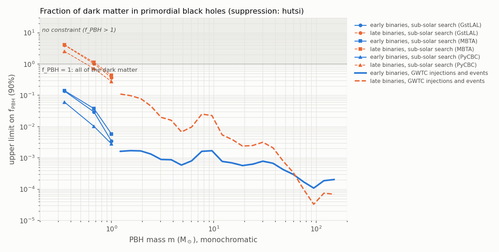
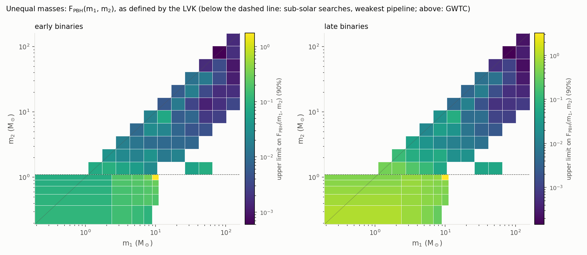
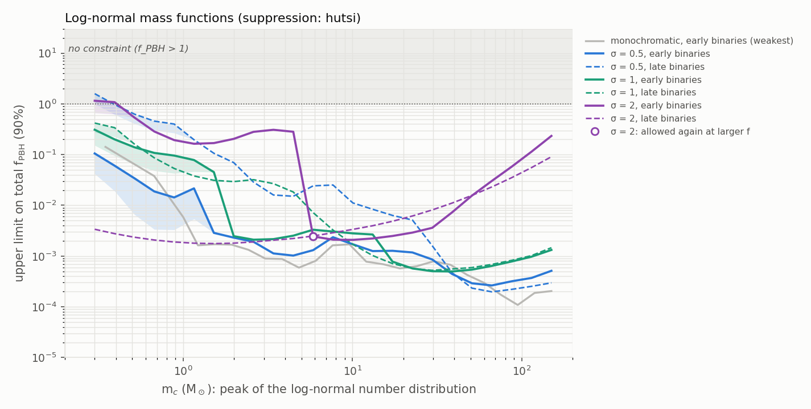

# primordial_black_holes

Upper limits on **f_PBH**, the fraction of the dark matter in primordial black holes, from the merger rates: a PBH
population merges at a rate that grows with f_PBH, and that rate may not exceed what the data allow. The main limits
are for PBHs of a single mass (a monochromatic mass function, equal-mass binaries); the mode also gives the
**unequal-mass** limits: the LVK map F_PBH(m₁, m₂), one limit per pair of masses, and the limit on the total f_PBH
of **log-normal mass functions**. The physics is explained in
[Primordial black holes and sub-solar masses](../science/primordial-black-holes.md).

```bash
gwtc_analysis primordial_black_holes                       # 0.35-150 Msun, the default choices
gwtc_analysis primordial_black_holes --suppression lvk     # the suppression fit of the LVK sub-solar papers
gwtc_analysis primordial_black_holes --attribute none      # the observed events taken as astrophysical
gwtc_analysis primordial_black_holes --lognormal-widths 0.3 1.5   # other log-normal widths
gwtc_analysis primordial_black_holes --no-extended         # monochromatic limits only (about 2 min instead of 5)
```

## Method

### Merger rates of a PBH population

For PBHs of mass m, a fraction f of the dark matter, the mode uses two formation channels.

**Early binaries**, formed in the radiation era and merging today (Raidal et al. 2019
[\[123\]](../references.md#ref-123); Hütsi et al. 2021 [\[124\]](../references.md#ref-124), eq. 2.1), with
M = 2m and η = 1/4:

\[
R_\text{early} = 1.6\times10^{6}\ \text{Gpc}^{-3}\,\text{yr}^{-1}\; f^{53/37}
\left(\frac{t}{t_0}\right)^{-34/37} \left(\frac{M}{M_\odot}\right)^{-32/37} \eta^{-34/37}\, S(f).
\]

S < 1 is the **suppression**: binaries disrupted by other PBHs (S₁, through the number N̄ of PBHs around the pair)
or by later encounters (S₂). Two choices, `--suppression`:

| `--suppression` | S | Where it holds |
|---|---|---|
| `hutsi` (default) | S₁ S₂ of [\[124\]](../references.md#ref-124): eqs. 2.2, 2.3, A.5 for S₁ (monochromatic: ⟨m²⟩/⟨m⟩² = 1, N̄ = 2f / (f + σ_M), σ_M = 0.004) and the z = 0 fit 2.7 for S₂ | every f |
| `lvk` | 2.3 × 10⁻³ f^−0.65, the fit of the LVK sub-solar papers [\[101\]](../references.md#ref-101), [\[122\]](../references.md#ref-122) | equal to S₁ S₂ at f = 1; 1.3 times smaller at f = 0.1, 2.9 times at f = 0.01; above 1, which is unphysical, below f ≈ 10⁻⁴ |

The two give the same limits near f = 1 and differ by up to ~6 at f ~ 0.01: the LVK numbers for the sub-solar
searches are reproduced with `lvk`, while the catalog limits, at f ~ 10⁻⁵–10⁻³, need `hutsi`.

**Late binaries**, formed by capture in PBH clusters (Phukon et al. 2021 [\[125\]](../references.md#ref-125),
eq. 2; Clesse & García-Bellido [\[126\]](../references.md#ref-126)):
R_late = f × 420 Gpc⁻³ yr⁻¹ (2m)^(10/7) / (m²)^(5/7), linear in f and taken constant in time.

The limit on f is where the PBH rate equals the rate limit R₉₀ (solved in closed form for `lvk` and for the late
binaries, numerically for `hutsi`). Values above 1 mean no constraint.

### Rate limits from the data

| Masses | Data | Rate limit |
|---|---|---|
| 0.35–1 M☉ | the sensitive volume-time of the LVK sub-solar-mass searches, O4a + O4b combined, per pipeline (GstLAL, MBTA, PyCBC) and chirp-mass bin (`results-PBH.zip` of [Zenodo 23346454](https://zenodo.org/records/23346454), [\[122\]](../references.md#ref-122)); m = 2^(1/5) × the bin's chirp mass | no significant candidate: R₉₀ = −ln(1 − 0.9) / VT = 2.30 / VT, as in the LVK papers |
| above 1 M☉ | the search-sensitivity injections of [rates](rates.md) (`--sensitivity-release`), reweighted to binaries with both masses log-uniform in [m e^−w, m e^w] (w = `--mass-window`); the GWOSC events with FAR ≤ `--far-threshold` whose median chirp mass lies in 2^(−1/5) [m e^−w, m e^w] | the 90% Poisson upper limit for n events, Γ⁻¹(0.9; n + 1) / VT (2.30 / VT for none) |

- **Only the sub-solar bins up to 1 M☉** are used, as in the LVK papers: the searches require a secondary below
  1 M☉, so their higher chirp-mass bins hold unequal binaries, not the equal-mass binaries of a single PBH mass.
- **Events are matched by chirp mass**, the best-measured mass. The mass ratio is poorly measured and its median is
  pulled away from 1 by the priors, so a window on both component masses would miss equal-mass sources and give
  limits too tight by up to ~10. An unequal binary with the right chirp mass also counts, which is conservative for
  an upper limit.
- **`--attribute window`** (default) lets every such event be primordial; **`--attribute none`** takes n = 0, i.e.
  all the observed events are astrophysical: a tighter limit (early binaries down to 8.3 × 10⁻⁵ at 50 M☉ with the
  default injections, late binaries ~3 × 10⁻⁵) and a much stronger
  assumption.
- The early-binary volume includes the rate evolution (t/t₀)^(−34/37) (Planck15), so that VT × R(z = 0) is the
  expected number of detections; spins as in `rates` (|a| < 0.4 below 2.5 M☉, else 0.99).

### Unequal masses

With a spread of masses, black holes of different masses pair up, and the rate of a pair (m₁, m₂) involves the mass
function at both masses. Two outputs, computed with the same rates for unequal masses as the LVK script of the
sub-solar release (`rateEB_m1m2`, `rateLB_m1m2`).

**The map F_PBH(m₁, m₂)**, exactly as defined by the LVK: in each (m₁, m₂) bin, the rate is
F × Δln m₁ Δln m₂ × R(m₁, m₂; F = 1), with, at the centre of the bin,

\[
R_\text{early} = 1.6\times10^{6} \times 2.3\times10^{-3}\ \text{Gpc}^{-3}\,\text{yr}^{-1}\,
M^{-32/37}\, \eta^{-34/37}, \qquad
R_\text{late} = 420\ \text{Gpc}^{-3}\,\text{yr}^{-1}\, \frac{M^{10/7}}{(m_1 m_2)^{5/7}},
\]

so that F ≤ R₉₀ / (Δln m₁ Δln m₂ R). The suppression is fixed at its value for f = 1 whatever `--suppression`
(the LVK definition). Each bin is tested alone, and **F is not a fraction of the dark matter**: for a mass function
ψ it is about f^(53/37) ψ(m₁) ψ(m₂) m₁m₂/⟨m⟩² (early binaries), a pair-by-pair constraint that holds whatever the
shape of ψ.

| Masses | Data | Bins |
|---|---|---|
| m₂ < 1.1 M☉ | the (m₁, m₂) tables of the sub-solar release, O4a + O4b, per pipeline; R₉₀ = 2.30 / VT | the LVK bins: m₁ from 0.19 to 11.1 M☉ in steps of 2.18 M☉, m₂ from 0.19 to 1.1 M☉ in steps of 0.18 M☉ (arithmetic centres, as in the LVK script); one bin without injections |
| m₂ ≥ 1.1 M☉ | the injections, reweighted log-uniform in each bin (m₁ ≥ m₂); the events counted in the bin of their median masses | 11 log bins per mass from 1.1 to 160 M☉ (geometric centres); a bin with an effective sample size below 20 is left out |

**Log-normal mass functions**: the limit on the **total** f_PBH of the mass function of Hütsi et al.
[\[124\]](../references.md#ref-124) (eq. 3.6), for the number of PBHs per ln m:

\[
\psi(m) = \frac{1}{\sqrt{2\pi}\,\sigma} \exp\!\left(-\frac{\ln^2(m/m_c)}{2\sigma^2}\right),
\qquad \langle m\rangle = m_c\, e^{\sigma^2/2}, \quad \frac{\langle m^2\rangle}{\langle m\rangle^2} = e^{\sigma^2},
\]

with σ from `--lognormal-widths` (default 0.5, 1, 2) and m_c from `--lognormal-masses` (default 24 values from 0.3
to 150 M☉). The mass density per ln m, m ψ/⟨m⟩, is a log-normal of the same width peaking at m_c e^(σ²).

- **Early binaries**: eq. 2.1 of [\[124\]](../references.md#ref-124),
  dR/(dln m₁ dln m₂) = 1.6 × 10⁶ f^(53/37) M^(−32/37) η^(−34/37) S ψ(m₁) ψ(m₂) m₁m₂/⟨m⟩², whose integral over the
  whole (m₁, m₂) plane is the total rate (a δ function gives back the monochromatic rate). With `hutsi`, S₁ is that of
  the mass function: N̄ = (M/⟨m⟩) f/(f + σ_M) and ⟨m²⟩/⟨m⟩² in eqs. 2.2 and A.5, checked against the paper.
- **Late binaries**: the LVK rate above times the mass fractions per ln m of the two black holes, m ψ(m)/⟨m⟩,
  linear in f as for one mass.
- **Expected detections**: the rate summed against the sensitive volume-time of every pair: the sub-solar (m₁, m₂)
  tables below m₂ = 1.1 M☉ (a 16 × 16 grid in each bin, a bin's VT taken uniform inside it), the injections above
  (with the rate evolution (t/t₀)^(−34/37) for early binaries). Pairs with m₂ < 1.1 M☉ and m₁ > 11.1 M☉, outside the
  sub-solar tables, are left out, which is conservative. One limit per sub-solar pipeline.
- **Events, `--attribute window`**: as for one mass, the population is tested in each chirp-mass window of width
  2w in ln M_c (w = `--mass-window`) against the events seen there, every one possibly primordial; the sub-solar
  searches, without a candidate, form one more window. The limit is set by the tightest window, so that it tends to
  the monochromatic limit as σ → 0 (a test checks it). Counting every event within the reach of a broad mass function
  instead would allow ~250 events and no useful limit. **`--attribute none`** pools all the detections with n = 0.
- **Where larger f is allowed again**: for a broad mass function, the pairs much heavier than ⟨m⟩ are disrupted once
  f exceeds σ_M ≈ 0.004 (S₁ ∝ e^(−N̄), N̄ ≈ M/⟨m⟩), so the expected count of early binaries can *fall* as f grows.
  The limit given is the smallest excluded f, found by scanning f (6 points per decade, then refined); if a larger f
  is allowed again, the first such value is in the column `f_early_reallowed` and the point is circled in the plot.

## Results

With the defaults (`gwtc5` injections, 259 events with FAR ≤ 1/yr):



The shaded band, f_PBH > 1, is where the data set no constraint: a population making up all of the dark matter
would give fewer mergers than the searches can detect. How to read the curves (a weak limit is not a sign of PBHs,
one mass at a time, and whether PBHs could be most of the dark matter) is in
[Primordial black holes](../science/primordial-black-holes.md#reading-the-limits-could-pbhs-be-most-of-the-dark-matter).

| PBH mass | Early binaries, `hutsi` | Early binaries, `lvk` | Published |
|---|---|---|---|
| 0.35 M☉ (sub-solar) | 0.061–0.142 | **0.096–0.178** | 0.10–0.18 [\[122\]](../references.md#ref-122) (LVK fit) |
| 1 M☉ (sub-solar) | 0.0028–0.0059 | **0.018–0.032** | 0.018–0.032 [\[122\]](../references.md#ref-122) (LVK fit) |
| 1.2–2.5 M☉ (catalog) | 0.0013–0.0017 | 0.004–0.007 | ~2 × 10⁻³ at 1.5 M☉ [\[102\]](../references.md#ref-102) (astrophysics only) |
| 12–38 M☉ (catalog) | 0.0006–0.0008 | 0.0007–0.0015 | ~1.5–2 × 10⁻⁴ [\[102\]](../references.md#ref-102) (astrophysics only) |
| ~100 M☉ (catalog) | 1.1 × 10⁻⁴ | (S > 1: not valid) | ~1 × 10⁻⁴ at 50–90 M☉ [\[102\]](../references.md#ref-102) (astrophysics only) |

Ranges over the three pipelines for the sub-solar searches. Two checks:

- **The LVK sub-solar limits are reproduced exactly** with their suppression fit (`--suppression lvk`): 0.0183–0.0324
  at 1 M☉, 0.0958–0.178 at 0.35 M☉; late binaries cross f = 1 at 0.62–0.74 M☉ (linear interpolation between the
  bins, as in the LVK script), the paper's 0.62–0.74 M☉.
- **The two data sets agree where they meet**: at 1–2.6 M☉ the sub-solar VT (unequal binaries, not used above
  1 M☉) and the GWTC injections give the same early-binary limit, 0.0013–0.0028.

Late binaries give weaker limits below ~50 M☉ and tighter ones above: for equal masses their rate,
420 × 2^(10/7) f ≈ 1130 f Gpc⁻³ yr⁻¹, does not depend on m, while the early-binary rate falls as M^(−32/37).

### Unequal masses



The map: below the dashed line the sub-solar bins (the weakest of the three pipelines; the TSV has all three), with
the weak bin at m₁ ≈ 10 M☉, m₂ ≈ 1 M☉ of the LVK tables; above it the GWTC bins. The bins far from the diagonal are
missing above 1.1 M☉: the injections hold few very unequal binaries there.

**The LVK map is reproduced exactly.** Recomputed independently from the tables of the release with the steps of
the LVK script, the 24 sub-solar bins with injections agree in every pipeline (to the 4 digits of the TSV). The
median over the pipelines, the quantity of Fig. 11 of [\[122\]](../references.md#ref-122) (early binaries only),
agrees with the values printed there to their two decimals (m₁ bins 0.19–2.37, 2.37–4.55, 4.55–6.74, 6.74–8.92,
8.92–11.1 M☉):

| m₂ bin (M☉) | [\[122\]](../references.md#ref-122), Fig. 11 | this mode (median) |
|---|---|---|
| 0.92–1.10 | 0.07, 0.16, 0.20, 0.29, — | 0.071, 0.165, 0.197, 0.292, 1.17 |
| 0.74–0.92 | 0.07, 0.16, 0.18, 0.20, 0.27 | 0.074, 0.158, 0.185, 0.199, 0.272 |
| 0.55–0.74 | 0.08, 0.14, 0.16, 0.18, 0.21 | 0.085, 0.141, 0.164, 0.178, 0.206 |
| 0.37–0.55 | 0.09, 0.14, 0.15, 0.17, 0.16 | 0.091, 0.136, 0.148, 0.168, 0.163 |
| 0.19–0.37 | 0.10, 0.13, 0.10, 0.10, blank | 0.102, 0.130, 0.105, 0.098, blank |

The last bin of the top row, the weak bin of the tables, lies above the colour scale of their figure (to ~0.29),
and its value is not legible in the text of the paper. The bin (6.74–8.92, 0.19–0.37) M☉, left out of their rate
limits (Fig. 8) for its Monte Carlo variance (~19%, ~25 effective injections), is kept in the map, there and here;
its effective sample size is in the TSV. The late-binary map, and the map above m₂ = 1.1 M☉, have no published
counterpart: the paper maps early binaries only, the late-binary models being more uncertain.



| σ | Early binaries, sub-solar (m_c = 0.3 M☉) | Early binaries, tightest | Late binaries, tightest |
|---|---|---|---|
| 0.5 | 0.04–0.11 | 2.6 × 10⁻⁴ at m_c = 67 M☉ | 2.0 × 10⁻⁴ at 67 M☉ |
| 1 | 0.15–0.31 | 5.0 × 10⁻⁴ at 30–39 M☉ | 5.2 × 10⁻⁴ at 30 M☉ |
| 2 | 0.67–1.15 | 2.1 × 10⁻³ at 8–10 M☉ | 1.8 × 10⁻³ at 1–2 M☉ |

(`hutsi`, ranges over the sub-solar pipelines.) For σ = 0.5 the limits follow the monochromatic curve. Broader mass
functions spread the PBHs over masses the data constrain unequally: at small m_c the heavy tail adds detectable
mergers, at large m_c it reaches masses beyond the injections. For σ = 2 the early-binary limits are weaker
(≥ 2 × 10⁻³): the heavy pairs that dominate the detections are the most suppressed (N̄ ∝ M/⟨m⟩), and at m_c = 5.9 M☉
f is excluded from 0.0024 but allowed again around 0.01. The late-binary curves of a wide mass function sit low at
small m_c because their mass fractions, m ψ/⟨m⟩, peak at m_c e^(σ²), 55 m_c for σ = 2.

## Relation to Andrés-Carcasona et al.

The catalog limits of [\[102\]](../references.md#ref-102) (O1–O4a, 161 events with FAR < 1/yr) use the **same
early-binary rate and the same suppression**: their eq. A.1 is eq. 2.1 of Hütsi et al.
[\[124\]](../references.md#ref-124), with the suppression "from the analytical prescriptions" of that paper, i.e.
`--suppression hutsi`. The rest differs:

| | [\[102\]](../references.md#ref-102) | `primordial_black_holes` |
|---|---|---|
| PBH channels | early two-body + early three-body (γ = 1, K = 4) | early two-body; late binaries in clusters |
| Mass function | monochromatic and log-normal | monochromatic; log-normal and the LVK map F_PBH(m₁, m₂) |
| Detection probability | semi-analytic, single-detector SNR > 8 with representative noise spectra | the LVK search-sensitivity injections, FAR ≤ 1/yr (as in [rates](rates.md)) |
| Statistics | hierarchical Bayesian likelihood (dynesty, bilby) | Poisson upper limit in a chirp-mass window |

They treat the observed events in three ways:

1. **Astrophysics only**: all events are astrophysical; the 95 % bound is where the expected number of PBH detections
   N < 3. These are the solid curves of their Fig. 1 and the [102] values in the tables (~10⁻² at 0.5 M☉, ~2 × 10⁻³
   at 1 M☉, ~2 × 10⁻⁴ at 10 M☉, ~1 × 10⁻⁴ at 50–90 M☉; their text's "between 10⁻² and 10⁻⁴" spans 0.5–90 M☉). Counterpart here: `--attribute none` (2.30 / VT, 90 %).
2. **Agnostic**: any subset of events may be primordial (10⁵ random subsets, or a subset-marginalised likelihood);
   slightly weaker at 2–20 M☉. Rough counterpart: `--attribute window` (every event in the window may be primordial).
3. **Astrophysically informed**: a joint fit of a power law + 2 peaks (Multi Peak) astrophysical population and a
   log-normal PBH population. No counterpart.

**Why the mode does not reproduce their analysis.** It extends the method of the LVK sub-solar searches, a rate
limit from the published search sensitivity, which it reproduces exactly below 1 M☉, to the catalog masses with the
same LVK injections as `rates`: one framework from 0.35 to 150 M☉, from public data, in minutes. Their case 1 is a
comparable computation (and the three-body channel could be added at little cost);
cases 2 and 3 need the posterior samples of all events and nested sampling over ~16 population parameters, or 10⁵
subsets, hours to days of computing.

**Comparison with their case 1.** `--attribute none` with `--sensitivity-release gwtc4` (O3 + O4a, their data
period) against the monochromatic constraint of their Fig. 1 (read from the figure, ±20–30 %):

| PBH mass | this mode, `none`, `gwtc4` (90 %) | [\[102\]](../references.md#ref-102), astrophysics only (95 %) |
|---|---|---|
| 1.5 M☉ | 1.8 × 10⁻³ | ~1.8 × 10⁻³ |
| 3 M☉ | 9.1 × 10⁻⁴ | ~8 × 10⁻⁴ |
| 10 M☉ | 3.2 × 10⁻⁴ | ~2.3 × 10⁻⁴ |
| 20 M☉ | 1.8 × 10⁻⁴ | ~1.5 × 10⁻⁴ |
| 30 M☉ | 1.3 × 10⁻⁴ | ~1.2 × 10⁻⁴ |
| 50 M☉ | 1.1 × 10⁻⁴ | ~1.0 × 10⁻⁴ |
| 90 M☉ | 1.4 × 10⁻⁴ | ~1.1 × 10⁻⁴ |
| 120 M☉ | 2.0 × 10⁻⁴ | ~1.5 × 10⁻⁴ |

Agreement within a factor 1.0–1.4, despite the different detection probability (injections against SNR > 8), the
missing three-body channel and 90 % against 95 %. The ~10⁻⁵ level of their Fig. 1 is the dashed "sensitivity floor"
(expected detections N > 0.05), not a constraint. The default `--attribute window` is 2–4 times weaker at
10–50 M☉, where events fall in the window, as their agnostic case is weaker than their case 1.

## Limitations

- **Not the analysis of Andrés-Carcasona et al. [\[102\]](../references.md#ref-102)**; see the section below.
  No three-body channel, and the catalog part is a Poisson count in a mass window, not a hierarchical fit.
- **Extended mass functions: log-normal only**, with S₂ that of the f alone and the analytic S₁ of
  [\[124\]](../references.md#ref-124) (accurate within 7% for σ ≤ 2). The log-normal limits take the most
  constraining chirp-mass window, without a correction for testing several windows.
- **No search**: the mode uses the published search sensitivities and the catalog; a sub-solar candidate below the
  catalog threshold, or an alert (HasSSM), does not enter.
- **A sub-solar merger need not be primordial**: collapsar disks may fragment into sub-solar neutron stars that merge
  (Metzger et al. 2024 [\[103\]](../references.md#ref-103)); unlike PBHs, that channel shines.
- The S₂ fit of [\[124\]](../references.md#ref-124) is for z = 0; its redshift dependence is not included.

## Options

| Option | Default | What it provides | When to change it |
|---|---|---|---|
| **Masses** | | | |
| `--masses` | 22 values from e^w to 150 M☉ | the PBH masses of the catalog part; each must satisfy m e^−w ≥ 1 M☉, where the injections start | a finer grid, or a few masses of interest |
| `--mass-window` | 0.2 | w, the half-width of the window in ln m: binaries in [m e^−w, m e^w] for the VT, chirp masses in 2^(−1/5) [m e^−w, m e^w] for the events | smaller for a sharper mass function (fewer injections: the effective sample size is in the TSV) |
| `--no-sub-solar` | off | leave out the sub-solar searches (0.35–1 M☉, and m₂ < 1.1 M☉ for unequal masses) | to skip the download of the sub-solar release |
| **Unequal masses** | | | |
| `--lognormal-widths` | 0.5 1 2 | the widths σ (in ln m) of the log-normal mass functions | other widths; one value for a faster run |
| `--lognormal-masses` | 24 values from 0.3 to 150 M☉ | the peaks m_c of the log-normal number distributions | a finer grid, or a few masses of interest |
| `--no-extended` | off | leave out the unequal masses: the map and the log-normal limits | for the monochromatic limits alone, about 2 min instead of 5 |
| **Physics choices** | | | |
| `--suppression` | `hutsi` | the suppression of the early-binary rate: S₁ S₂ of Hütsi et al. 2021, or the LVK fit 2.3 × 10⁻³ f^−0.65 | `lvk` to reproduce the LVK sub-solar papers |
| `--attribute` | `window` | which observed events may be primordial: those with their chirp mass in the window, or none | `none` for the limit if all the events are astrophysical |
| **Data** | | | |
| `--far-threshold` | 1 | FAR threshold [1/yr] for the found injections and the events | as in `rates` |
| `--sensitivity-release` | `gwtc5` | the LVK search-sensitivity injections of the catalog part, as in `rates` | `gwtc4` for O3 + O4a only |
| `--sensitivity-file` | — | a local injection file instead of the release | offline runs |
| `--data-repo` | `zenodo` | where the injections and the sub-solar release are downloaded from: zenodo, s3 (the MinIO mirror) or galaxy | `s3` for faster downloads |
| **Outputs** | | | |
| `--out-limits` | `pbh_limits.tsv` | one row per mass (and pipeline): VT, effective sample size, events counted, R₉₀, the early- and late-binary limits; next to it `pbh_limits.map.tsv` (one row per (m₁, m₂) bin and pipeline: VT, events, R₉₀, F_early, F_late) and `pbh_limits.lognormal.tsv` (one row per σ, m_c and pipeline: ⟨m⟩, the peak of the mass density, f_early, f_early_reallowed, f_late) | — |
| `--out-report` | `pbh_limits.html` | the HTML report | — |
| `--plots-dir` | `pbh_plots` | the plots: limits against the mass (`f_pbh.png`), the map (`f_pbh_map.png`), the log-normal limits (`f_pbh_lognormal.png`) | — |
