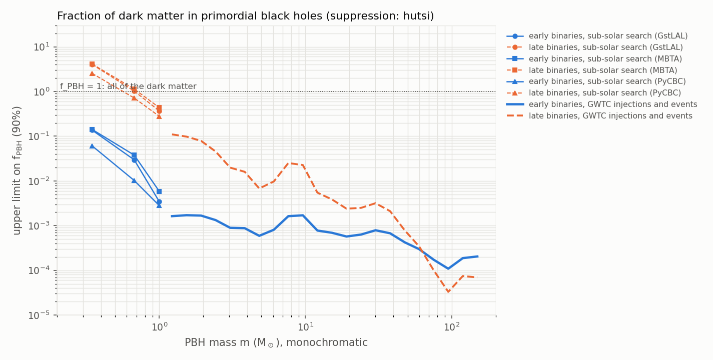

# primordial_black_holes

Upper limits on **f_PBH**, the fraction of the dark matter in primordial black holes of a single mass, from the
merger rates: a PBH population merges at a rate that grows with f_PBH, and that rate may not exceed what the data
allow. The physics is explained in [Primordial black holes and sub-solar masses](../science/primordial-black-holes.md).

```bash
gwtc_analysis primordial_black_holes                       # 0.35-150 Msun, the default choices
gwtc_analysis primordial_black_holes --suppression lvk     # the suppression fit of the LVK sub-solar papers
gwtc_analysis primordial_black_holes --attribute none      # the observed events taken as astrophysical
```

## Method

### Merger rates of a PBH population

For PBHs of mass m, a fraction f of the dark matter, the mode uses two formation channels.

**Early binaries**, formed in the radiation era and merging today (Raidal et al. 2019
[\[123\]](../references.md#ref-123); Hütsi et al. 2021 [\[124\]](../references.md#ref-124), eq. 2.1), with
M = 2m and η = 1/4:

\[
R_\text{early} = 1.6\times10^{6}\ \text{Gpc}^{-3}\,\text{yr}^{-1}\; f^{53/37}
\left(\frac{t}{t_0}\right)^{-34/37} \left(\frac{M}{M_\odot}\right)^{-32/37} \eta^{-34/37}\, S(f).
\]

S < 1 is the **suppression**: binaries disrupted by other PBHs (S₁, through the number N̄ of PBHs around the pair)
or by later encounters (S₂). Two choices, `--suppression`:

| `--suppression` | S | Where it holds |
|---|---|---|
| `hutsi` (default) | S₁ S₂ of [\[124\]](../references.md#ref-124): eqs. 2.2, 2.3, A.5 for S₁ (monochromatic: ⟨m²⟩/⟨m⟩² = 1, N̄ = 2f / (f + σ_M), σ_M = 0.004) and the z = 0 fit 2.7 for S₂ | every f |
| `lvk` | 2.3 × 10⁻³ f^−0.65, the fit of the LVK sub-solar papers [\[101\]](../references.md#ref-101), [\[122\]](../references.md#ref-122) | equal to S₁ S₂ at f = 1; 1.3 times smaller at f = 0.1, 2.9 times at f = 0.01; above 1, which is unphysical, below f ≈ 10⁻⁴ |

The two give the same limits near f = 1 and differ by up to ~6 at f ~ 0.01: the LVK numbers for the sub-solar
searches are reproduced with `lvk`, while the catalog limits, at f ~ 10⁻⁵–10⁻³, need `hutsi`.

**Late binaries**, formed by capture in PBH clusters (Phukon et al. 2021 [\[125\]](../references.md#ref-125),
eq. 2; Clesse & García-Bellido [\[126\]](../references.md#ref-126)):
R_late = f × 420 Gpc⁻³ yr⁻¹ (2m)^(10/7) / (m²)^(5/7), linear in f and taken constant in time.

The limit on f is where the PBH rate equals the rate limit R₉₀ (solved in closed form for `lvk` and for the late
binaries, numerically for `hutsi`). Values above 1 mean no constraint.

### Rate limits from the data

| Masses | Data | Rate limit |
|---|---|---|
| 0.35–1 M☉ | the sensitive volume-time of the LVK sub-solar-mass searches, O4a + O4b combined, per pipeline (GstLAL, MBTA, PyCBC) and chirp-mass bin (`results-PBH.zip` of [Zenodo 23346454](https://zenodo.org/records/23346454), [\[122\]](../references.md#ref-122)); m = 2^(1/5) × the bin's chirp mass | no significant candidate: R₉₀ = −ln(1 − 0.9) / VT = 2.30 / VT, as in the LVK papers |
| above 1 M☉ | the search-sensitivity injections of [rates](rates.md) (`--sensitivity-release`), reweighted to binaries with both masses log-uniform in [m e^−w, m e^w] (w = `--mass-window`); the GWOSC events with FAR ≤ `--far-threshold` whose median chirp mass lies in 2^(−1/5) [m e^−w, m e^w] | the 90% Poisson upper limit for n events, Γ⁻¹(0.9; n + 1) / VT (2.30 / VT for none) |

- **Only the sub-solar bins up to 1 M☉** are used, as in the LVK papers: the searches require a secondary below
  1 M☉, so their higher chirp-mass bins hold unequal binaries, not the equal-mass binaries of a single PBH mass.
- **Events are matched by chirp mass**, the best-measured mass. The mass ratio is poorly measured and its median is
  pulled away from 1 by the priors, so a window on both component masses would miss equal-mass sources and give
  limits too tight by up to ~10. An unequal binary with the right chirp mass also counts, which is conservative for
  an upper limit.
- **`--attribute window`** (default) lets every such event be primordial; **`--attribute none`** takes n = 0, i.e.
  all the observed events are astrophysical: a tighter limit (down to ~10⁻⁵ at 30–100 M☉) and a much stronger
  assumption.
- The early-binary volume includes the rate evolution (t/t₀)^(−34/37) (Planck15), so that VT × R(z = 0) is the
  expected number of detections; spins as in `rates` (|a| < 0.4 below 2.5 M☉, else 0.99).

## Results

With the defaults (`gwtc5` injections, 259 events with FAR ≤ 1/yr):



| PBH mass | Early binaries, `hutsi` | Early binaries, `lvk` | Published |
|---|---|---|---|
| 0.35 M☉ (sub-solar) | 0.061–0.142 | **0.096–0.178** | 0.10–0.18 [\[122\]](../references.md#ref-122) (LVK fit) |
| 1 M☉ (sub-solar) | 0.0028–0.0059 | **0.018–0.032** | 0.018–0.032 [\[122\]](../references.md#ref-122) (LVK fit) |
| 1.2–2.5 M☉ (catalog) | 0.0013–0.0017 | 0.004–0.007 | ~10⁻² at 1 M☉ [\[102\]](../references.md#ref-102) (astrophysics only) |
| 12–38 M☉ (catalog) | 0.0006–0.0008 | 0.0007–0.0015 | ~10⁻³ [\[102\]](../references.md#ref-102) (astrophysics only) |
| ~100 M☉ (catalog) | 1.1 × 10⁻⁴ | (S > 1: not valid) | ~10⁻⁴ near 90 M☉ [\[102\]](../references.md#ref-102) (astrophysics only) |

Ranges over the three pipelines for the sub-solar searches. Two checks:

- **The LVK sub-solar limits are reproduced exactly** with their suppression fit (`--suppression lvk`): 0.0183–0.0324
  at 1 M☉, 0.0958–0.178 at 0.35 M☉; late binaries cross f = 1 at 0.62–0.74 M☉ (linear interpolation between the
  bins, as in the LVK script), the paper's 0.62–0.74 M☉.
- **The two data sets agree where they meet**: at 1–2.6 M☉ the sub-solar VT (unequal binaries, not used above
  1 M☉) and the GWTC injections give the same early-binary limit, 0.0013–0.0028.

Late binaries give weaker limits below ~50 M☉ and tighter ones above: for equal masses their rate,
420 × 2^(10/7) f ≈ 1130 f Gpc⁻³ yr⁻¹, does not depend on m, while the early-binary rate falls as M^(−32/37).

## Relation to Andrés-Carcasona et al.

The catalog limits of [\[102\]](../references.md#ref-102) (O1–O4a, 161 events with FAR < 1/yr) use the **same
early-binary rate and the same suppression**: their eq. A.1 is eq. 2.1 of Hütsi et al.
[\[124\]](../references.md#ref-124), with the suppression "from the analytical prescriptions" of that paper, i.e.
`--suppression hutsi`. The rest differs:

| | [\[102\]](../references.md#ref-102) | `primordial_black_holes` |
|---|---|---|
| PBH channels | early two-body + early three-body (γ = 1, K = 4) | early two-body; late binaries in clusters |
| Mass function | monochromatic and log-normal | monochromatic |
| Detection probability | semi-analytic, single-detector SNR > 8 with representative noise spectra | the LVK search-sensitivity injections, FAR ≤ 1/yr (as in [rates](rates.md)) |
| Statistics | hierarchical Bayesian likelihood (dynesty, bilby) | Poisson upper limit in a chirp-mass window |

They treat the observed events in three ways:

1. **Astrophysics only**: all events are astrophysical; the 95 % bound is where the expected number of PBH detections
   N < 3. These are the solid curves of their Fig. 1 and the numbers in the table above (~10⁻² at 1 M☉ down to
   ~10⁻⁴ near 90 M☉). Counterpart here: `--attribute none` (2.30 / VT, 90 %).
2. **Agnostic**: any subset of events may be primordial (10⁵ random subsets, or a subset-marginalised likelihood);
   slightly weaker at 2–20 M☉. Rough counterpart: `--attribute window` (every event in the window may be primordial).
3. **Astrophysically informed**: a joint fit of a power law + 2 peaks (Multi Peak) astrophysical population and a
   log-normal PBH population. No counterpart.

**Why the mode does not reproduce their analysis.** It extends the method of the LVK sub-solar searches, a rate
limit from the published search sensitivity, which it reproduces exactly below 1 M☉, to the catalog masses with the
same LVK injections as `rates`: one framework from 0.35 to 150 M☉, from public data, in minutes. Their case 1 is a
comparable computation (and the three-body channel or a log-normal mass function could be added at little cost);
cases 2 and 3 need the posterior samples of all events and nested sampling over ~16 population parameters, or 10⁵
subsets, hours to days of computing.

**Open point.** The table above compares their case 1 with the default `--attribute window`, which assumes
something different; the like-for-like `--attribute none` gives limits down to ~10⁻⁵ at 30–100 M☉, tighter than their
~10⁻⁴ near 90 M☉ by up to ~10 (90 % vs 95 % accounts for only ~1.3, and their three-body channel would tighten
theirs). The detection probability (injections vs SNR > 8) and the window construction are the candidates; not yet
resolved.

## Limitations

- **Not the analysis of Andrés-Carcasona et al. [\[102\]](../references.md#ref-102)**; see the section below.
  Monochromatic mass function only, no three-body channel, and the catalog part is a Poisson count in a mass window,
  not a hierarchical fit.
- **No search**: the mode uses the published search sensitivities and the catalog; a sub-solar candidate below the
  catalog threshold, or an alert (HasSSM), does not enter.
- **A sub-solar merger need not be primordial**: collapsar disks may fragment into sub-solar neutron stars that merge
  (Metzger et al. 2024 [\[103\]](../references.md#ref-103)); unlike PBHs, that channel shines.
- The S₂ fit of [\[124\]](../references.md#ref-124) is for z = 0; its redshift dependence is not included.

## Options

| Option | Default | What it provides | When to change it |
|---|---|---|---|
| **Masses** | | | |
| `--masses` | 22 values from e^w to 150 M☉ | the PBH masses of the catalog part; each must satisfy m e^−w ≥ 1 M☉, where the injections start | a finer grid, or a few masses of interest |
| `--mass-window` | 0.2 | w, the half-width of the window in ln m: binaries in [m e^−w, m e^w] for the VT, chirp masses in 2^(−1/5) [m e^−w, m e^w] for the events | smaller for a sharper mass function (fewer injections: the effective sample size is in the TSV) |
| `--no-sub-solar` | off | leave out the sub-solar searches (0.35–1 M☉) | to skip the download of the sub-solar release |
| **Physics choices** | | | |
| `--suppression` | `hutsi` | the suppression of the early-binary rate: S₁ S₂ of Hütsi et al. 2021, or the LVK fit 2.3 × 10⁻³ f^−0.65 | `lvk` to reproduce the LVK sub-solar papers |
| `--attribute` | `window` | which observed events may be primordial: those with their chirp mass in the window, or none | `none` for the limit if all the events are astrophysical |
| **Data** | | | |
| `--far-threshold` | 1 | FAR threshold [1/yr] for the found injections and the events | as in `rates` |
| `--sensitivity-release` | `gwtc5` | the LVK search-sensitivity injections of the catalog part, as in `rates` | `gwtc4` for O3 + O4a only |
| `--sensitivity-file` | — | a local injection file instead of the release | offline runs |
| `--data-repo` | `zenodo` | where the injections and the sub-solar release are downloaded from: zenodo, s3 (the MinIO mirror) or galaxy | `s3` for faster downloads |
| **Outputs** | | | |
| `--out-limits` | `pbh_limits.tsv` | one row per mass (and pipeline): VT, effective sample size, events counted, R₉₀, the early- and late-binary limits | — |
| `--out-report` | `pbh_limits.html` | the HTML report | — |
| `--plots-dir` | `pbh_plots` | the plot of the limits against the mass | — |
