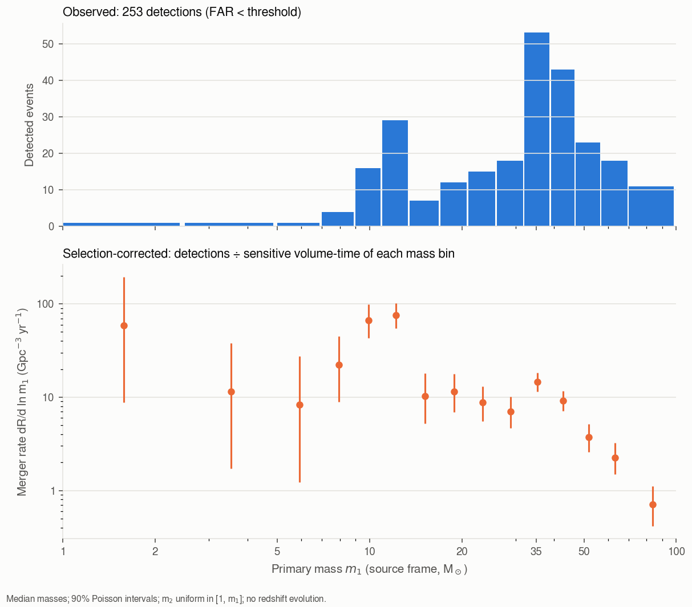

# rates

Merger rates of binary neutron stars (BNS), neutron star–black hole binaries (NSBH) and binary black
holes (BBH), per Gpc³ per year, as R = N / ⟨VT⟩. The method is explained in
[Merger rates](../science/merger-rates.md).

```bash
gwtc_analysis rates                               # GWTC-5.0 injections (O3 + O4a + O4b)
gwtc_analysis rates --sensitivity-release gwtc4   # GWTC-4.0 injections (O3 + O4a)
```

## What is counted

- **N:** the GWOSC candidates of GWTC-1, GWTC-2.1, GWTC-3, GWTC-4.0 and GWTC-5.0 (the confident and
  marginal lists of GWTC-2.1 and GWTC-3, the single list of the others), inside the observing periods
  covered by the injections and with a false-alarm rate at most `--far-threshold` (1 per year by default;
  inclusive, the published values being rounded). GWTC-1 events count only with `--catalogs GWTC-1`, as
  the default injections start with O3. They are classified by their median source-frame masses,
  neutron stars being below `--ns-max-mass` (2.5 M☉). Candidates without masses are left out.
- **⟨VT⟩:** the sensitive volume-time of each population, from the LVK injections, downloaded
  automatically (`--sensitivity-release gwtc5` by default, or `gwtc4`; `--sensitivity-file` for a
  local file).

The observing periods are those of the injections (their times split at gaps longer than a week), so
candidates of the engineering run ER15, just before O4a, are not counted.

## Selecting catalogs

`--catalogs` restricts the rates to the observing runs of some catalogs, for the events **and** the
injections, so that the counts and the sensitive volume-time describe the same observing time:

| Catalog | Runs |
|---|---|
| `GWTC-1` | O1, O2 |
| `GWTC-2.1` | O3a |
| `GWTC-3` | O3b |
| `GWTC-4` | O4a |
| `GWTC-5` | O4b |

```bash
gwtc_analysis rates --catalogs GWTC-5          # O4b only
gwtc_analysis rates --catalogs GWTC-4 GWTC-5   # O4a + O4b
gwtc_analysis rates --catalogs ALL             # O1 to O4b
```

Without `--catalogs`, the rates cover the runs of the real-injection mixture of the release (O3 onward).
Selecting GWTC-1 uses the release's mixture with semi-analytic O1+O2 injections, found above
`--snr-threshold` (10). The restriction keeps the importance sums of the selected runs: with the
mixture weights, they are the ⟨VT⟩ of those runs, and the ⟨VT⟩ of separate catalogs add up to that of
all of them. An event listed in two catalogs (the O1–O2 events of GWTC-1 and GWTC-2.1) is counted
once.

BBH rates of each catalog (GWTC-5.0 injections, R ∝ (1+z)^2.9, at z = 0.2, Gpc⁻³ yr⁻¹, median [90%]):

| Catalog | BBH candidates | BBH rate |
|---|---|---|
| GWTC-2.1 (O3a) | 37 | 31.1 [23.5, 40.3] |
| GWTC-3 (O3b) | 23 | 20.9 [14.5, 28.8] |
| GWTC-4 (O4a) | 84 | 25.2 [21.0, 30.0] |
| GWTC-5 (O4b) | 104 | 24.8 [21.0, 29.0] |
| O3a–O4b | 248 | 25.2 [22.7, 27.9] |

The catalogs agree with one another. O4b has no BNS or NSBH candidate below 1 per year: its BNS and
NSBH rates are upper limits (90%: 113 and 40 Gpc⁻³ yr⁻¹).

## Population models

| Population | Mass model | Spins | Redshift |
|---|---|---|---|
| BNS | both masses uniform in [1, 2.5] M☉ | isotropic, \|χ\| < 0.4 | constant rate |
| NSBH | black hole ∝ m^−2.35 on [2.5, 40] M☉, neutron star uniform in [1, 2.5] M☉ | BH \|χ\| < 0.99, NS \|χ\| < 0.4 | constant rate |
| BBH | GWTC-3 Power Law + Peak [\[12\]](../references.md#ref-12) | isotropic, \|χ\| < 0.99 | R ∝ (1+z)^κ, reported at z = 0.2 (`--bbh-kappa`, `--bbh-z-ref`), and constant |
| all, `--mass-model fullpop4` | FullPop-4.0 [\[29\]](../references.md#ref-29): one distribution for BNS, NSBH and BBH, split at 2.5 M☉ ([below](#fullpop-40-all-compact-binaries-in-one-model)) | isotropic, \|χ\| < 0.4 below 2.5 M☉, < 0.99 above | Madau–Dickinson, reported at z = 0 (and z = 0.2 for BBH) |

## Method

**The mode runs no parameter estimation and no sampler.** It counts the published candidates, computes ⟨VT⟩
itself by reweighting the LVK injections, and takes the rate posterior in closed form, as explained in
[Merger rates](../science/merger-rates.md) and [Selection effects](../science/selection-effects.md#reweighting-one-set-of-injections-for-every-population).

### Inputs

- **Candidates:** the GWOSC event lists (`eventapi/jsonfull`) of GWTC-1, GWTC-2.1 and GWTC-3 (confident and
  marginal), GWTC-4.0 and GWTC-5.0, fetched at each run. Of each candidate only the GPS time, the published FAR and
  the median source-frame masses are used: no PE samples are read.
- **Injections:** the cumulative mixture file of the release, from the latest version of its Zenodo record
  (`gwtc5`: 19500052, `gwtc4`: 16740128): `mixture-real_…cartesian_spins…hdf5`, or with GWTC-1 in `--catalogs`
  `mixture-semi_o1_o2-real_…`. It is downloaded once into the Zenodo cache and checked against its MD5. The mode
  reads, per injection, the source-frame masses, redshift, Cartesian spins, mixture weight \(w_i\), draw density
  \(p_\text{draw}\) in (m₁, m₂, z, spins), the FAR of each search and, for O1–O2, the semi-analytic network SNR;
  and the total analysis time \(T\) and number of generated injections \(N_\text{gen}\).

### What the mode does

1. **Found injections:** lowest FAR over the searches below `--far-threshold`; for O1–O2, network SNR above
   `--snr-threshold`. With `--catalogs`, injections outside the GPS spans of the selected runs are dropped.
2. **Events:** kept when inside the injection periods ([above](#what-is-counted)) with a published FAR at most
   the threshold (inclusive: the published values are rounded). An event found twice within 1 s keeps its lowest
   FAR. Classes from the median masses.
3. **⟨VT⟩** of a population density \(p_\text{pop}\):
   \(\langle VT\rangle = \frac{T}{N_\text{gen}} \sum_\text{found} w_i\, p_\text{pop}(m_1, m_2)\, p(\vec a_1)\, p(\vec a_2)\,
   \frac{dV_c}{dz}\,(1+z)^{\kappa - 1} / p_\text{draw}\), with Planck15 \(dV_c/dz\) (full sky, Gpc³), \(1/(1+z)\)
   for source-frame time, and isotropic spins of magnitude uniform up to 0.4 (neutron stars) or 0.99 (black holes).
   The mass densities are normalized numerically. Power Law + Peak takes the GWTC-3 values α = 3.4, β = 1.1,
   m_min = 5.1, m_max = 87, δ_m = 4.8 M☉, λ = 0.04, μ = 34, σ = 3.6 M☉; its peaks are truncated at μ + 5σ, as in
   icarogw. The effective number \((\sum x)^2 / \sum x^2\) of the terms is written as `n_eff`.
4. **Rate:** the 5, 50 and 95% quantiles of Gamma(N + ½) / ⟨VT⟩; the evolving BBH rate is then multiplied by
   \((1+z_\text{ref})^\kappa\).
5. **`--population-posterior`:** `--n-draws` rows drawn without replacement (fixed seed). For each, ⟨VT⟩ with the
   Madau–Dickinson shape ψ(z) (normalized to 1 at z = 0) in place of \((1+z)^\kappa\), and 50 draws of
   Gamma(N + ½) / ⟨VT⟩; all draws are pooled before taking the quantiles. The reported ⟨VT⟩ is the median over the
   draws, `n_eff` the smallest.
6. **`fullpop4`:** N is the number of classified events of all classes; each draw gives a total rate, multiplied
   by the class fractions (1-D integrals on a 40 000-point grid). Without a posterior, the fixed parameters are the
   GWTC-4.0 spectral-siren medians stored in the package (γ = 3.57, κ = 2.97, z_p = 2.59 for ψ).
7. **Mass-distribution plot:** the same ⟨VT⟩ in 15 bins of m₁ from 1 to 100 M☉, uniform in ln m₁ inside a bin,
   m₂ uniform in [1, m₁], no redshift evolution.

Nothing about the events is recomputed: their masses and FARs are the GWOSC values, and the injections' detection
statistics are those of the release.

## Results

| Release | Candidates | BNS | NSBH | BBH at z = 0.2 | BBH at z = 0 |
|---|---|---|---|---|---|
| `gwtc5` (O3–O4b, 2.59 yr) | 259 | 26 [4, 87] | 33 [13, 67] | 25 [23, 28] | 15 [13, 17] |
| `gwtc4` (O3–O4a, 1.7 yr) | 155 | 43 [6, 143] | 54 [21, 109] | 26 [23, 30] | 15 [13, 18] |

Rates in Gpc⁻³ yr⁻¹, median [90%]; the candidates include a few without published masses, which are not
classified. The BBH rate at z = 0 is the same evolving rate, R ∝ (1+z)^κ, taken at z = 0; it is given for
comparison with local rates. The constant-rate row is a different assumption: without evolution, the
rate is in effect averaged over the redshifts of the detected binaries (z ≈ 0.3–0.5), hence its
higher value (41 [37, 46] with `gwtc5`).

### Comparison with the LVK, model by model

The headline LVK rates are the **union of the 90% intervals of two models**: FullPop-4.0 and a binned Gaussian
process (BGP) in GWTC-4.0 [\[13\]](../references.md#ref-13) (BNS 7.6–250, NSBH 9.1–84, BBH 14–26 at z = 0), FullPop
and PixelPop in GWTC-5.0 [\[14\]](../references.md#ref-14) (BBH 27.5–49.4 at z = 0.2, masses 2.5–200 M☉). A rate
depends on the population model through ⟨VT⟩, so each result here is compared with the LVK model closest to it
(Table 2 of both papers; GWTC-4.0 from arXiv:2508.18083v2, whose published version revises the merged intervals
slightly):

| This mode | Release | Here | LVK, closest model |
|---|---|---|---|
| BNS, masses uniform in [1, 2.5] M☉, spins < 0.4, constant rate | `gwtc4` | 43 [6, 143] | GWTC-4.0 *Simple Uniform BNS*, the same model: 13–170 |
| | `gwtc5` | 26 [4, 87] | none in GWTC-5.0 (no new neutron star) |
| NSBH, BH ∝ m^−2.35 on [2.5, 40] M☉ | `gwtc4` | 54 [21, 109] | no fixed NSBH model; the NSBH region of FullPop-4.0: 23 [10, 43], of BGP: 30 [9, 84] |
| | `gwtc5` | 33 [13, 67] | the NSBH region of FullPop: 14 [7, 26], of PixelPop: 16 [7, 33] |
| BBH at z = 0.2, GWTC-3 Power Law + Peak | `gwtc4` | 26 [23, 30] | GWTC-4.0 *Broken Power Law + 2 Peaks*, Power Law Redshift: 29 [22.5, 37.5] |
| | `gwtc5` | 25 [23, 28] | GWTC-5.0 *Default BBH*: 30 [25, 37] |
| FullPop-4.0 ([below](#fullpop-40-all-compact-binaries-in-one-model)), its posterior, z = 0: BNS, NSBH, BBH | `gwtc4` | 68 [7, 670], 21 [6, 73], 22 [12.5, 35] | GWTC-4.0 *FullPop-4.0*, the same model: 89 [22, 248], 23 [10, 43], 19 [14, 26] |
| FullPop-4.0, GWTC-4.0 medians: BNS, NSBH (z = 0), BBH (z = 0.2) | `gwtc5` | 98 [88, 103], 22 [20, 23], 36.5 [33, 39] | GWTC-5.0 *FullPop*, refitted: 59 [15, 155], 14 [7, 26], 36 [27.5, 47] |

- **The same model agrees**: the uniform BNS with *Simple Uniform BNS*, and FullPop-4.0 with the paper's
  FullPop-4.0 in every class. Our FullPop-4.0 intervals are wider: the posterior is that of the spectral siren
  (H₀ free, 141 events with FAR < 0.25/yr), not of a population fit at fixed cosmology.
- **The fixed BBH model is close, not identical**: Power Law + Peak with the GWTC-3 values and R ∝ (1+z)^2.9
  against the BBH-only models of each paper fitted to the same events. Its rate sits at their low edge and its
  interval is much narrower (Poisson only); with the population uncertainty
  ([next section](#population-uncertainty-and-the-multi-peak-model)) it agrees.
- **The fixed NSBH model has no LVK counterpart**: its rate is about twice that of the NSBH region of the
  population models. Its black holes follow m^−2.35 from 2.5 M☉, so most are light and hard to detect (a small
  ⟨VT⟩, hence a high rate for the four events); the population models put them near the 9 M☉ peak.

## Population uncertainty and the Multi Peak model

With fixed population shapes the intervals are Poisson only, and the BBH rate depends on the mass
model through ⟨VT⟩: light binaries are hard to detect, so a model with more of them (the peak near
10 M☉ found since GWTC-4.0) has a smaller ⟨VT⟩ and gives a higher rate. `--population-posterior`
takes a posterior of the BBH mass model and of the rate evolution (γ, κ, z_p), for instance a
`hubble_constant` work directory, and computes ⟨VT⟩ for `--n-draws` posterior samples (200 by
default), mixing the Poisson posterior of each: the interval then includes the population uncertainty.
`--mass-model` chooses Power Law + Peak (`plp`, default) or Multi Peak (`mltp`: the power law with two
Gaussian peaks near 10 and 35 M☉, the model of the LVK cosmology papers); `mltp` needs a posterior.

```bash
gwtc_analysis rates --mass-model mltp --population-posterior h0_mltp_workdir            # a hubble_constant work directory
gwtc_analysis rates --mass-model mltp --population-posterior posterior_reweighted.tsv   # or its posterior file
```

### The population posterior

`--population-posterior` takes posterior samples of the BBH population: the mass-model parameters and
the rate-evolution parameters. A `hubble_constant` run of the same `--mass-model` produces them.

**What to give.** Either the `hubble_constant` work directory, in which case `posterior_reweighted.tsv` is
read (or `posterior.tsv` if the run was not reweighted), or a TSV file directly.

**Columns the file must contain**, one row per sample:

| `--mass-model` | Mass-model columns | Rate-evolution columns |
|---|---|---|
| `plp` | `alpha beta mmin mmax delta_m mu_g sigma_g lambda_peak` | `gamma kappa zp` |
| `mltp` | `alpha beta mmin mmax delta_m mu_g_low sigma_g_low mu_g_high sigma_g_high lambda_g lambda_g_low` | `gamma kappa zp` |
| `fullpop4` | `alpha_1 alpha_2 beta_bottom beta_top mmin mmax bottomsmooth topsmooth mu_g_low sigma_g_low mu_g_high sigma_g_high lambda_g lambda_g_low leftdip rightdip leftdipsmooth rightdipsmooth deep` | `gamma kappa zp` |

These are the names `hubble_constant` writes. Other columns, such as `H0`, are ignored. A missing
column stops the run with its name.

| BBH mass model | ⟨VT⟩ (Gpc³ yr) | BBH at z = 0.2 | BBH at z = 0 |
|---|---|---|---|
| Power Law + Peak, GWTC-3 values, R ∝ (1+z)^2.9 | 16.7 | 25 [23, 28] | 15 [13, 17] |
| Multi Peak, 200 posterior draws, Madau–Dickinson evolution | 14.4 | 31 [21, 51] | 17 [9, 28] |
| LVK, GWTC-5.0 *Default BBH* (BBH-only) / GWTC-4.0 *FullPop-4.0* and *BGP* | | 30 [25, 37] | 19 [14, 26] |

*GWTC-5.0 injections, O3 to O4b, 248 BBH candidates. The Multi Peak posterior is that of a
spectral-siren run on the GWTC-4.0 events, with H₀ free; a posterior of the same events, with the
cosmology fixed, would be the self-consistent choice. With the population uncertainty the BBH rate
agrees with the LVK intervals.*

### FullPop-4.0: all compact binaries in one model

FullPop-4.0, the fiducial population of the GWTC-4.0 cosmology paper [\[29\]](../references.md#ref-29), describes
neutron stars and black holes with one mass distribution (a broken power law with a dip between them, two
peaks, and a pairing function in the mass ratio; the same density as the [bright siren](hubble-constant-bright.md)
and the [spectral siren](hubble-constant.md#mass-models)). With `--mass-model fullpop4`, `rates` fits **one rate to
the events of all classes**, with ⟨VT⟩ over the whole distribution, and splits it into the BNS (both masses below
2.5 M☉, `--ns-max-mass`), NSBH and BBH regions by the fraction of the population in each. The fractions are
exact integrals of the factorized density. The rate evolves as Madau–Dickinson; the classes are reported at z = 0
and the BBH also at `--bbh-z-ref`. Without `--population-posterior`, the parameters are the GWTC-4.0
spectral-siren medians; with a `hubble_constant --mass-model fullpop4` run, its posterior draws.

```bash
gwtc_analysis rates --mass-model fullpop4                                   # GWTC-4.0 medians, Poisson only
gwtc_analysis rates --mass-model fullpop4 --population-posterior h0_fullpop4 --sensitivity-release gwtc4
```

| Rates (Gpc⁻³ yr⁻¹), median [90%] | BNS, z = 0 | NSBH, z = 0 | BBH, z = 0 | BBH, z = 0.2 |
|---|---|---|---|---|
| GWTC-4.0 medians, `gwtc5` injections (O3–O4b, 253 events) | 98 [88, 103] | 22 [20, 23] | 19 [17, 20] | 36.5 [33, 39] |
| 200 draws of the FullPop-4.0 spectral-siren posterior, `gwtc4` injections (O3–O4a, 149 events) | 68 [7, 670] | 21 [6, 73] | 22 [12.5, 35] | 40 [27, 60] |
| LVK *FullPop-4.0*, GWTC-4.0 (z = 0) | 89 [22, 248] | 23 [10, 43] | 19 [14, 26] | — |
| LVK *FullPop*, GWTC-5.0 (BNS, NSBH at z = 0; BBH at z = 0.2) | 59 [15, 155] | 14 [7, 26] | — | 36 [27.5, 47] |

*With fixed parameters the intervals are Poisson only, from the 253 events of all classes: the BNS rate is the
BBH-dominated total times the model's BNS fraction (70%), not a measurement of the one BNS. The posterior
(the [FullPop-4.0 spectral siren](hubble-constant.md#mass-models), H₀ free, 141 events) carries the uncertainty
of the shape, and the classes then agree with the LVK intervals. The neutron-star spins stop at 0.4, as the O3
injections do.*

## Example

```bash
gwtc_analysis rates
```

The HTML report shows, with the rates table, the observed and the selection-corrected primary-mass
distributions:

{ width="640" }

*O3 to O4b, GWTC-5.0 injections. Top: detected candidates per bin of primary mass. Bottom: merger
rate per logarithmic mass interval, the counts divided by the sensitive volume-time of each bin. The
peaks near 10 and 35 M☉ stand out once the heavy binaries' larger detection volume is removed.*

All options: [CLI reference](../cli-reference.md#rates).

## Outputs

- `--out-rates` (TSV): one row per population model, with N, ⟨VT⟩, the effective number of
  injections and the rate quantiles; the evolving BBH rate appears twice, at `--bbh-z-ref` and at
  z = 0 (the `stochastic` mode uses the first, at `--bbh-z-ref`);
- `--out-events` (TSV): the events counted, with their class;
- `--out-report` (HTML): the tables, and the observed and selection-corrected primary-mass
  distributions.

## Options

| Option | Default | Meaning |
|---|---|---|
| `--sensitivity-release` | `gwtc5` | LVK injections downloaded from Zenodo: `gwtc5` = O3 + O4a + O4b (~900 MB), `gwtc4` = O3 + O4a (~400 MB) |
| `--sensitivity-file` | none | a local LVK search-sensitivity injection file (same format as the release files), read instead of downloading the `--sensitivity-release` file from Zenodo, which is then ignored; with `--catalogs GWTC-1` it must be the mixture that includes the semi-analytic O1+O2 injections |
| `--catalogs` | the runs of the real-injection mixture (O3 onward) | catalog keys (GWTC-1 … GWTC-5, GWTC-4.1, or ALL): events and injections restricted to their observing runs (see [Selecting catalogs](#selecting-catalogs)) |
| `--far-threshold` | 1 per year | events at or below this false-alarm rate (the published values are rounded), injections below it |
| `--snr-threshold` | 10 | semi-analytic O1+O2 injections above this network SNR (with GWTC-1) |
| `--ns-max-mass` | 2.5 M☉ | neutron stars below it, black holes above, for the classification and the BNS and NSBH models |
| `--mass-model` | `plp` | `plp` (Power Law + Peak, GWTC-3 values unless `--population-posterior`), `mltp` (Multi Peak, two peaks near 10 and 35 M☉; needs `--population-posterior`) or `fullpop4` (FullPop-4.0, all compact binaries, split into BNS, NSBH and BBH; GWTC-4.0 medians unless `--population-posterior`) |
| `--population-posterior` | none | samples of the population (a `hubble_constant` run, or a TSV file): the BBH rate (with `fullpop4`, all the rates) is then computed over them, see [The population posterior](#the-population-posterior) |
| `--n-draws` | 200 | posterior draws with `--population-posterior` |
| `--bbh-kappa` | 2.9 | BBH rate evolution R ∝ (1+z)^κ, for the fixed Power Law + Peak (not used with `--population-posterior`, whose evolution is fitted) |
| `--bbh-z-ref` | 0.2 | redshift at which the evolving BBH rate is reported (also at z = 0) |
| `--out-rates`, `--out-events`, `--out-report` | `merger_rates.tsv`, `merger_rates_events.tsv`, `merger_rates.html` | output files ([above](#outputs)) |
| `--plots-dir` | `rates_plots` | directory of the plots |
| `--data-repo {zenodo,s3,galaxy}` | `zenodo` | where the search-sensitivity injections are downloaded from: their public sources, or a mirror holding the same files, `s3` (the MinIO bucket, faster) or `galaxy` (the public usegalaxy.org history), else the public source ([S3 mirror of the public files](../data-sources.md#s3-mirror-of-the-public-files)) |
