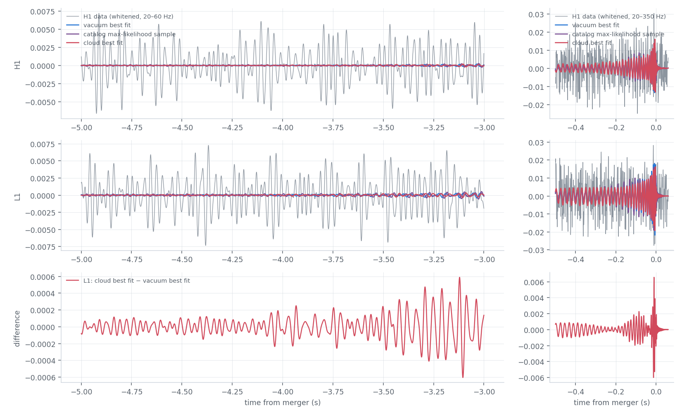
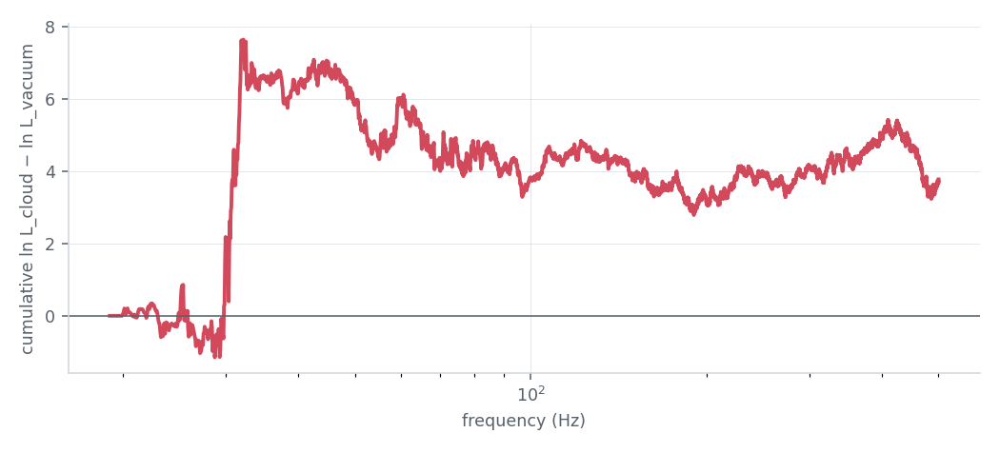
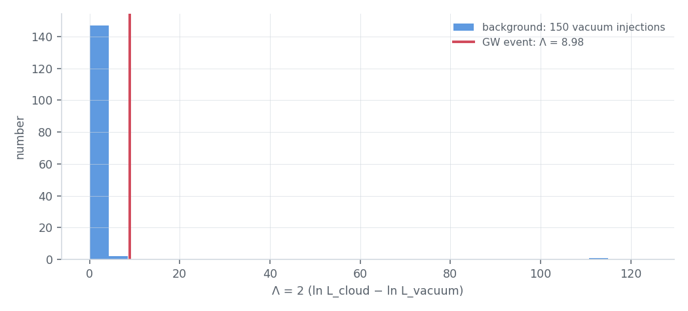
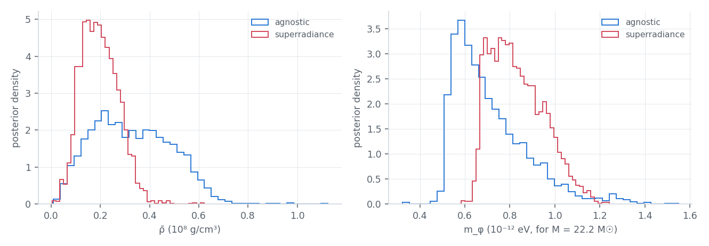

# scalar_cloud

Is a binary black hole better fitted with a cloud of an ultralight scalar field around it? The mode refits the
public strain of an event with the **IMRPhenomXPHM_Scalar** waveform of Roy, Vicente, Aurrekoetxea, Clough and
Ferreira [\[100\]](../references.md#ref-100), against the vacuum IMRPhenomXPHM of the catalog, and calibrates the
improvement on off-source noise. It reproduces their analysis of **GW190728_064510**, the event for which they report
tentative evidence for a scalar environment.

```bash
gwtc_analysis scalar_cloud                                     # GW190728: prepare, best fit, report (laptop, ~2 h)
gwtc_analysis scalar_cloud --stages sample --executor slurm --submit \
    --python /path/to/env/bin/python --slurm-option=--partition=htc --slurm-option=--licenses=sps
gwtc_analysis scalar_cloud --stages seeded --executor slurm --submit ...   # once the superradiance sampling is done
gwtc_analysis scalar_cloud --stages report                     # once the jobs are done
```

## The model

An ultralight boson of mass \(m_\phi\) around a binary of total mass \(M\) forms a bound structure of radius
\(r_\phi = M/\alpha^2\), with \(\alpha = G M m_\phi / (\hbar c)\) (the black-hole size over the boson's wavelength;
\(\alpha = 0.1\) is \(m_\phi \approx 6.5 \times 10^{-13}\) eV for \(M = 20\,M_\odot\)). In the late inspiral the
orbit is well inside it (\(\beta = R / r_\phi \ll 1\)) and the binary ionizes it: it loses angular momentum to the
field at the rate (the paper's Eq. 2 and Eq. 6 of its Supplemental Material, \(G = c = 1\))

\[
\dot L_\phi = 4\pi \bar\rho_\phi M^3 \frac{I(v, \alpha, q)}{v^4},
\qquad
I = \sum_{\ell, m > 0} \pi^2 \beta^{\frac14 + \frac{\ell}{2}}
\left[\frac{2(1+q_2)}{m}\right]^{\frac12 - \ell}
\left[1 + (-1)^\ell q_2^{\ell - 1}\right]^2
\left[\frac{Y_{\ell m}(\pi/2, 0)}{\Gamma(\ell + 3/2)}\right]^2 ,
\]

with \(\bar\rho_\phi\) the mean density of the field within \(r_\phi\), \(v = (M\Omega)^{1/3}\),
\(\beta = \alpha^2/v^2\), \(q_2 = m_2/M\), and the sum up to \(\ell = 4\) (the \(\ell = 2\) term dominates). Against
the gravitational-wave loss \(\dot L_\text{GW} = \frac{32}{5}\eta^2 M v^7\) the orbit shrinks faster by the factor
\(1 + \delta\), \(\delta = \frac{5\pi}{8}\,\bar\rho_\phi M^2 I/(\eta^2 v^{11})\), which grows as about
\(v^{-13.5}\): the effect sits at the lowest frequencies. In the stationary-phase approximation the phase of the
(2, 2) mode changes by

\[
\Delta\Psi_{22}(f) = 2\pi \int_f^{f_c} (f' - f)\, \Delta\!\left(\frac{dt}{df}\right)\!(f')\, df',
\qquad
\Delta\!\left(\frac{dt}{df}\right) = \left(\frac{dt}{df}\right)_\text{GW}\left[\frac{1}{1+\delta} - 1\right],
\]

zero, with its derivative, at the end of the inspiral \(f_c\) (\(M f_c = 0.018\)): only the inspiral changes. Each
\((\ell, m)\) mode gets \(\frac{|m|}{2}\Delta\Psi_{22}(2f/|m|)\).

| Choice | Here | Note |
|---|---|---|
| vacuum model | IMRPhenomXPHM of bilby, as the catalog | \(\bar\rho_\phi = 0\) reproduces it exactly (tested) |
| where the correction is applied | each mode of `SimInspiralChooseFDModes` (J frame, seen at θ_JN), rotated into the polarization frame of `SimInspiralChooseFDWaveform` by a fitted angle | the paper uses the co-precessing frame: identical for aligned spins, an approximation for precessing ones |
| \(1/(1+\delta)\) | kept, not linearised | identical while \(\delta \ll 1\); finite when the torque exceeds the GW loss |
| masses in \(\delta\) | source frame (\(\bar\rho_\phi\) is a physical density), redshift from the distance (Planck15) | the kinematics use the detector-frame masses |

The dephasing scales roughly as \(\bar\rho_\phi\, \alpha^{2.5}\), i.e. as \(\bar\rho_\phi\, m_\phi^{2.5}\) whatever the
mass of the binary. For GW190728 (\(M \approx 20\,M_\odot\)), \(\bar\rho_\phi = 10^6\) g/cm³ and \(\alpha = 0.1\)
dephase the (2, 2) mode by about 1.6 rad at 20 Hz and 0.13 rad at 30 Hz.

## The test

**Best fit.** The vacuum model is fitted from the catalog's best samples (Nelder–Mead in coordinates whitened by
the covariance of the 2000 highest-likelihood samples: the likelihood is too narrow for a plain optimizer). The cloud
model has a separate mode at a lower chirp mass (the paper's Fig. 8), which fits started from the vacuum best fit do
not reach: they stay within a few tenths of ln L of vacuum. The cloud fits therefore start from the 4 best samples of
the nested sampling of the event with the superradiance prior (the merger time of each set by a scan of the
fixed-time likelihood, the sampling marginalizes it), and are run twice with the binary and the cloud free. The
statistic is

\[
\Lambda = 2\,(\ln L_\text{cloud} - \ln L_\text{vacuum}) \;\ge\; 0 .
\]

The cloud model contains vacuum, so Λ is positive even without a cloud, and its distribution is not the textbook
χ² with two degrees of freedom: the density sits at the edge of its range, and α does nothing when it vanishes.
A first version profiled the cloud on a grid of α and of the dephasing at 20 Hz from the vacuum best fit (still in
the code, the `profile` and `polish` stages): Λ = 0.96 for GW190728, the cloud mode missed.

**Background.** The vacuum best fit is injected into off-source GWOSC noise, within an hour of the event, and the
same procedure is run on each segment, from the same starting points moved to the time of the injection. The
fraction of the background with Λ at least the event's is its p-value. The starting points come from the event's
own posterior: the background measures how often noise produces, in that region of the parameter space, an
improvement as large as the event's, not how often it does so anywhere (the event's sampling searched the whole
prior). The p-value is in that sense optimistic.

**Bayes factor.** Nested sampling (bilby, dynesty, acceptance-walk, naccept 60, dlogz 0.1) of the vacuum model
and of the cloud model with two priors on the field:

| Prior | α | \(\bar\rho_\phi\) |
|---|---|---|
| agnostic | uniform, \(0.008 \le \alpha \le (1+q)/2\) | uniform up to \(10^9\) g/cm³ (the paper does not give its upper end), cloud mass \(\bar\rho_\phi r_\phi^3 < 0.1\,M\) |
| superradiance, delay \(\tau_d\) | \(0.02\,x^{1/9} \le \alpha/(1+q) \le 0.11\,x^{1/15}\), \(x = \frac{m_1}{10 M_\odot}\frac{1\,\text{Myr}}{\tau_d}\): the cloud grew before the merger and did not decay | below the saturation mass, \(1.3 \times 10^8\,\text{g/cm}^3\, \frac{(1+q)^3}{8} \left[\frac{\alpha/(1+q)}{0.07}\right]^7 \left[\frac{10 M_\odot}{m_1}\right]^2\) |

The binary priors are those of the GWTC-2.1 analysis. The merger time is marginalized; the distance is sampled
(the correction depends on the redshift, so the waveform is not simply proportional to \(1/d_L\)).

## GW190728_064510

CC-IN2P3 (`--executor slurm`): the vacuum sampling with 1000 live points, the two cloud samplings with 500 (64 CPUs,
about a day each), 151 jobs of about an hour for the event and the background, 150 for the injections of the cloud
best fit (`scalar_cloud.py seeded --inject cloud`).

| | ln L ratio | Note |
|---|---|---|
| catalog maximum-likelihood sample | 89.60 | 96.8 in the PE file (see Limits) |
| vacuum best fit | 91.81 | Mc = 10.07 M☉, q = 0.55 (detector frame) |
| cloud best fit | **96.30** | Mc = 10.11 M☉, q = 0.58, \(\bar\rho_\phi\) = 5.8 × 10⁶ g/cm³, α = 0.19 (\(m_\phi\) = 1.1 × 10⁻¹² eV), cloud mass 10⁻⁴ M, 38 rad of dephasing at 20 Hz |

| Result | Here | Roy et al. |
|---|---|---|
| Λ | **8.98** | |
| background | 2 of 151 at Λ ≥ 8.98 (the event and one segment with a loud transient, Λ = 112), p = 0.013; 0.007 without that segment; 147 of 150 below 4.1 | |
| injections of the cloud best fit (sensitivity) | Λ = 25 (5–95%: 9.9–44); 4.7% at or below the event's 8.98 | |
| ln B, superradiance prior (τ_d = 10⁶ yr) | **1.34 ± 0.30** | 3.5 |
| ln B, agnostic prior (\(\bar\rho_\phi \le 10^9\) g/cm³) | **−0.82 ± 0.31** | 0.4 (upper end of the prior not given) |
| \(\bar\rho_\phi\), agnostic (90%) | 3.2 (0.9–5.9) × 10⁷ g/cm³ | ≈ 0.7 × 10⁸ |
| \(\bar\rho_\phi\), superradiance | (0.18 ± 0.08) × 10⁸ g/cm³ | |

The agnostic Bayes factor depends on the upper end of the uniform prior on \(\bar\rho_\phi\), which the paper does not
give. The posterior lies below \(6 \times 10^7\) g/cm³; lowering the upper end (the prior fraction drawn from the
prior itself, the cloud-mass cap barely acts there):

| upper end of \(\bar\rho_\phi\) (g/cm³) | 10⁹ | 5 × 10⁸ | 3 × 10⁸ | 2 × 10⁸ | 10⁸ | 5 × 10⁷ |
|---|---|---|---|---|---|---|
| ln B, agnostic | −0.82 | −0.16 | 0.34 | 0.73 | 1.40 | 1.90 |

The paper's 0.4 corresponds to an upper end near \(3 \times 10^8\) g/cm³.





**Where the improvement comes from.** ln L cloud − ln L vacuum by detector and band:

| | 20–30 Hz | 30–35 Hz | 35–60 Hz | > 60 Hz | total |
|---|---|---|---|---|---|
| H1 | +2.15 | +0.31 | −0.59 | −0.91 | +0.96 |
| L1 | −0.55 | **+4.69** | −0.40 | −0.77 | +2.96 |
| V1 | −0.15 | +0.17 | +0.42 | +0.12 | +0.57 |
| all | +1.45 | **+5.17** | −0.57 | −1.56 | +4.49 |

The gain does not accumulate over the inspiral, as a dephasing growing towards low frequencies would: it sits in a
few bins between 29.8 and 31.9 Hz, mostly in L1, and the cloud fit is slightly worse than vacuum above 35 Hz. The
noise spectra have no line there. A concentration at low frequency is what this cloud would give: with 38 rad of
dephasing at 20 Hz, the cloud and vacuum fits are nearly orthogonal below 35 Hz, where the signal has only about 10
of its ≈ 200 units of SNR², and that is where they differ most. Half their squared distance, \(\frac12\lVert h_\text{cloud}
- h_\text{vacuum}\rVert^2\), the gain expected from noise-free data holding the cloud signal, is per band:

| | 20–30 Hz | 30–35 Hz | 35–60 Hz | > 60 Hz | total |
|---|---|---|---|---|---|
| H1 | 0.89 | 1.33 | 0.50 | 1.69 | 4.42 |
| L1 | 3.95 | 4.03 | 1.07 | 1.74 | 10.79 |
| V1 | 0.06 | 0.08 | 0.62 | 2.02 | 2.77 |

The observed gain follows it in L1 between 30 and 35 Hz only, not below 30 Hz nor in H1. Whether the data around
30 Hz hold a noise fluctuation or the signal is the open question; the background says that noise rarely gives as
much near this mode.



**Between two distributions.** The same procedure on the event's cloud best fit injected into the 150 off-source
segments gives Λ around 25, the density and α recovered without bias (median 8.4 × 10⁶ g/cm³ and 0.16 for 5.8 × 10⁶
and 0.19 injected): 4.7% of these injections give Λ ≤ 8.98. The event is above what noise gives around vacuum
(p ≈ 0.01) and below what this cloud would give (≈ 5%): a weaker effect, or a noise fluctuation at 30 Hz on a
vacuum signal, fits both better than the best-fit cloud.



**Against the paper.** Same mode (a lower chirp mass compensated by the dephasing, a density of 10⁷ g/cm³, α of a
few 0.1), a likelihood gain of 4.5 against their 4–5, an agnostic Bayes factor that matches theirs for a prior up
to about \(3 \times 10^8\) g/cm³, but a smaller Bayes factor with the superradiance prior (1.3 against 3.5) and a
density 2 to 4 times lower. Differences that can contribute: the frame of the correction (J
frame here, co-precessing there), the PSDs and the likelihood (ln L 7 below the PE file's), 500 live points instead
of 1000, and the normalisation of the torque, which sets the density for a given dephasing.

### The same boson in continuous waves

Per sample (each with its own source-frame mass), the scalar mass is \(m_\phi = 0.89\) (90%: 0.70–1.17) × 10⁻¹² eV
with the superradiance prior and 0.73 (0.56–1.14) × 10⁻¹² eV with the agnostic one. A cloud of such bosons around
an isolated spinning black hole would annihilate into a continuous wave at \(2 m_\phi c^2/h\) = **340–570 Hz**,
inside the band of the LVK all-sky search for boson clouds in O3 (20–610 Hz). That search excludes, at these masses,
young clouds around light black holes (8–28 M☉) out to some kpc, but says nothing of a cloud carried by a binary,
and its limits constrain the boson only together with a model of the Galactic black holes. The
[continuous_waves](continuous-waves.md#boson-clouds-and-gw190728) mode draws its exclusions with this band.

## Limits

- The torque is Newtonian and valid for \(\beta \ll 1\); close to the merger the model is extrapolated, and the
  correction is switched off there.
- A large Λ means that the vacuum model fits the inspiral worse than usual. Eccentricity, waveform systematics,
  calibration or a noise feature at low frequency can do the same: Λ is a screening statistic, the Bayes factor
  under a physical prior the actual claim.
- This likelihood gives ln L = 89.6 at the catalog's best sample of GW190728, against 96.8 in the PE file: the phases
  agree in every detector, the difference comes from the noise-spectrum, window and calibration handling. Both
  models use the same likelihood, so the comparison is not affected.

## Options

| Option | Default | Meaning |
|---|---|---|
| `--event` | `GW190728_064510` | the event (name of the GWTC PE releases) |
| `--pe-file`, `--pe-label` | the event's Zenodo file, `C01:IMRPhenomXPHM` | settings, noise spectra and starting points |
| `--workdir` | `scalar_cloud` | work directory |
| `--stages` | `prepare fit report` | among `prepare fit background sample seeded report` (`seeded`: the event and the background with the cloud fits started from the superradiance sampling, which it needs) |
| `--sampling-frequency` | 2048 | Hz |
| `--n-background` | 150 | off-source injections |
| `--jobs` | 1 | local parallel processes (fit, background, seeded), sampler pool (sample) |
| `--sample-models` | `vacuum agnostic superradiance` | models of the sample stage |
| `--tau-d` | 10⁶ | superradiance prior: years between black-hole formation and merger |
| `--executor` | `local` | `slurm`: the heavy stages as sbatch scripts in `<workdir>/slurm`, `<workdir>/slurm_sample` and `<workdir>/slurm_seeded` |
| `--python`, `--slurm-option`, `--slurm-env-setup`, `--submit`, `--npool` | | Slurm: the jobs' interpreter, extra #SBATCH options, setup lines, submission, CPUs of each sampling job |
| `--out-report`, `--out-summary` | `scalar_cloud.html`, `scalar_cloud.tsv` | report and table of the fits |

Cost for GW190728 (16 s at 2048 Hz): a vacuum likelihood 0.035 s, a cloud likelihood 0.2 s (the modes of LAL). The
best fit takes about 2 CPU-hours, each background injection about 2 (1 with `seeded`), the nested sampling of the
cloud models about a day on 64 CPUs with 500 live points (a cluster job).
