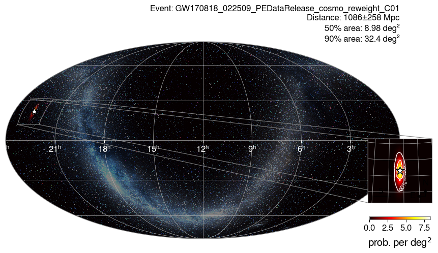
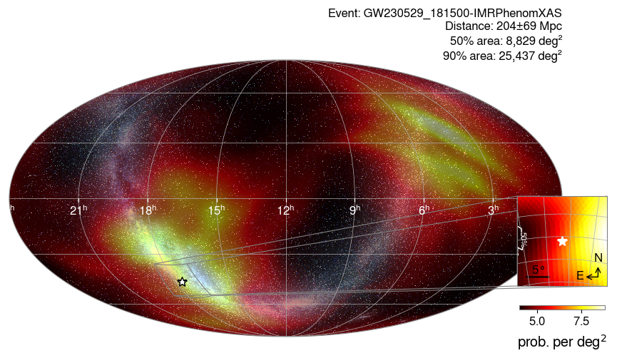
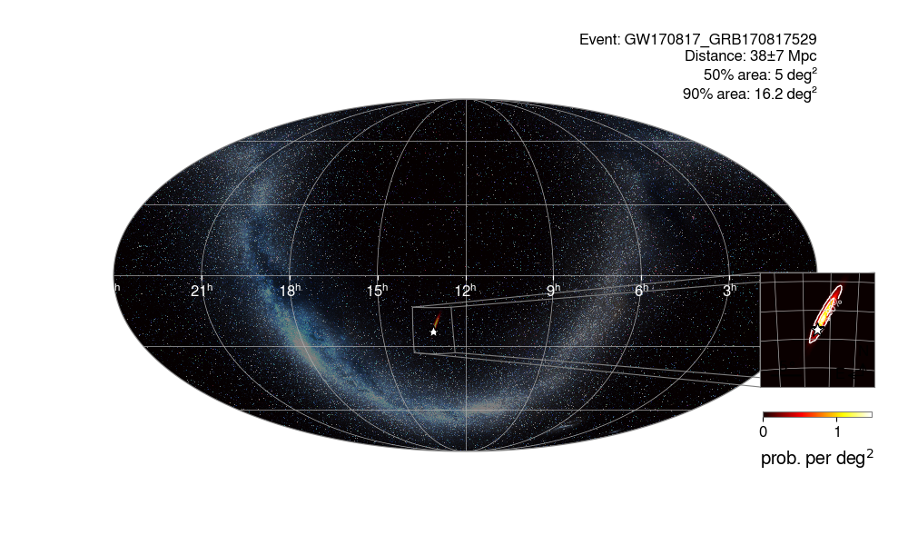

# search_skymaps

Which events could come from a given direction? For each event of the chosen catalogs, the mode
reads its sky localization (HEALPix FITS skymap) and tests whether the position (`--ra-deg`,
`--dec-deg`) lies inside the credible region `--prob` (0.9 for the 90% region). With `--counterparts`, it
searches instead for gamma-ray bursts and neutrinos coincident with each event
([multi-messenger coincidences](#multi-messenger-coincidences)).

```bash
gwtc_analysis search_skymaps --catalogs GWTC-4 --ra-deg 265.0 --dec-deg -46.0 --prob 0.9
```

- `--skymap-label` chooses the analysis whose skymap is used, one map per event: `Mixed`, the combined
  samples, by default. An event without a map for that label falls back to `Mixed`, then to
  `IMRPhenomXPHM_SpinTaylor`: GWTC-5.0 has no `Mixed` maps, so its events use the IMRPhenomXPHM-SpinTaylor
  map, the only waveform run on all of them. `any` searches every map of every event.
- GWTC-1 events are covered by the GWTC-2.1 skymap release; `ALL` expands to GWTC-2.1, GWTC-3,
  GWTC-4 and GWTC-5.
- Skymaps come from `--data-repo`: the Zenodo tarballs (a given version with `--zenodo-version`), the
  S3 bucket, or Galaxy collections.

The catalog skymaps are built by the LVK from the PE posterior samples; see
Singer et al. 2016 [\[56\]](../references.md#ref-56) for the three-dimensional skymap format.

## Example: an event seen by three detectors

```bash
gwtc_analysis search_skymaps --catalogs GWTC-1 --ra-deg 341.28 --dec-deg 21.66 --prob 0.9
```

The position is the most probable point of GW170818_022509, a binary black hole observed by H1, L1 and
Virgo in August 2017. GWTC-1 has no skymap release of its own: the mode reads the GWTC-2.1 skymaps and
keeps the 10 GWTC-1 events they contain (GW170817, a binary neutron star, is not in the GWTC-2.1
re-analysis). Only GW170818 contains the position in its 90% region, at the 0.03% credible level, its
peak; for the 9 others it lies outside the 99.9% region.



*GW170818_022509: with three detectors, the 90% region of the PE skymap covers 32 deg², the small red
area around the star (upper left), enlarged in the zoom (right); two detectors give thousands of deg².*

For comparison, a single-detector event:

```bash
gwtc_analysis search_skymaps --catalogs GWTC-4 --ra-deg 265.0 --dec-deg -46.0 --prob 0.9
```



*GW230529_181500, seen by L1 alone: its 90% region covers 25 400 deg², more than half of the sky, and
contains the position (star) at the 16% credible level. The same position is inside the 90% region of
13 of the 86 GWTC-4.0 skymaps.*

## Multi-messenger coincidences

```bash
gwtc_analysis search_skymaps --counterparts grb neutrino --catalogs ALL          # every catalog event
gwtc_analysis search_skymaps --counterparts grb --skymap bayestar.multiorder.fits  # a GraceDB alert map
```

An offline version of what the LVK's RAVEN does within minutes for each public alert: for every GW sky map, the
gamma-ray bursts and neutrinos recorded within a time window of the merger, scored by how well their position
overlaps the GW localization. The external catalogs are public and downloaded once a week:

| `--sources` | Messenger | Catalog | Covers | Localization | Window |
|---|---|---|---|---|---|
| `gbm` | GRB | Fermi-GBM burst catalog (HEASARC `fermigbrst`) | July 2008 onwards, about 240 bursts per year | statistical 1σ and a 3.7° systematic in quadrature | −1 to +5 s, RAVEN's |
| `swift` | GRB | Swift bursts of the burst advocates (HEASARC `swiftgrbba`) | December 2004 onwards, about 90 per year | the best of UVOT, XRT and BAT (90% radii), with the redshift and host galaxy when measured | −1 to +5 s |
| `icecube-alerts` | neutrino | IceCube Gold and Bronze alert tracks (GCN) | from the start of the stream, 17 June 2019, about 27 per year | 90% statistical radius | ±500 s |
| `icecube-events` | neutrino | IceCube point-source event list (HEASARC `icecubepsc`) | 2008 to July 2018: O1 and O2 | 1σ | ±500 s |

`--grb-window` and `--neutrino-window` change the windows; `--skymap FILE` searches given maps (a GraceDB
alert during a run, or GW170817's GWTC-1 map, which no PE release holds) instead of, or besides, `--catalogs`.

**Statistic.** For a counterpart at (ra, dec) with localization σ:

- the credible level of the GW map at its position;
- the overlap \(I_\Omega = N_\text{pix} \sum p_\text{GW}\, p_\text{ext}\): the GW probability its localization
  covers, relative to a uniform sky (1 for an unrelated direction, \(N_\text{pix}\, p_\text{GW}\) for a point),
  computed by smoothing the GW map with a Gaussian of width σ;
- \(q\), the fraction of isotropic positions (same σ) with a larger overlap, from the same smoothed map;
- the chance probability \(p = 1 - e^{-R\,\Delta t\, q}\): that the catalog, at its rate R, puts a counterpart this
  well placed in the window Δt by chance; for the best counterpart of a map, the map's chance probability;
- RAVEN's coincidence false-alarm rate \(\text{FAR}_\text{GW}\, R\, \Delta t / I_\Omega\), when the GW FAR is in the
  GWOSC lists;
- for a gamma-ray burst, the **speed of gravity** it implies if it is the same source: the gamma rays left 0 to 10 s
  after the merger and travelled at least \(D\), the 5% quantile of the GW distance along their line of sight (the
  distance layers of the 3D sky map), so \(c(\Delta t - 10\,\text{s})/D \le (v_\text{GW} - c)/c \le c\,\Delta t / D\),
  the method of the GW170817 paper (ApJL 848, L13).

The report counts the maps with \(p < 1\%\) against the number expected by chance, and corrects the smallest
\(p\) for the number of maps searched.

**Result for GWTC-2.1 to GWTC-5.0 and GW170817** (281 maps):

| Source | Maps covered | With a counterpart in the window | Result |
|---|---|---|---|
| Fermi-GBM | 281 | 1 | GRB 170817A, 2.0 s after GW170817, at its 36% credible level: overlap 3.7 × 10³, \(p = 4 \times 10^{-9}\), RAVEN FAR 1.2 × 10⁻¹⁵ per year |
| Swift | 281 | 0 | |
| IceCube alerts | 252 (from June 2019) | 0 | no alert track within ±500 s of any merger |
| IceCube events | 11 (O1, O2) | 11 | 2 to 7 events per window, the background rate; none inside a 90% region, the best at the 97% level of GW170104 (\(p = 0.12\)) |

GW170817 remains the only multi-messenger event, as published. The absence of neutrinos agrees with IceCube's own
searches, made with its internal data, which are deeper than the public lists: none for GW170817 (its jet seen
off-axis), none for the O3 candidates (joint IceCube–LVK LLAMA search, ApJ 1003, 41 (2026)), none for the 1030 O4a
alerts (IceCube, arXiv:2606.13762).

**Speed of gravity from GW170817.** The burst arrived 2.05 s after the merger in the catalog (the GBM trigger time;
the GW170817 paper's 1.74 s is the delay to the onset of the burst), from at least 28 Mpc along its line of sight:
\(-2.8 \times 10^{-15} \le (v_\text{GW} - c)/c \le +7.2 \times 10^{-16}\), against \(-3 \times 10^{-15}\) to
\(+7 \times 10^{-16}\) published (1.74 s and 26 Mpc; with 1.74 s, the mode gives \(+6.1 \times 10^{-16}\)).



*GW170817 (GWTC-1 map, 16 deg² at 90%) and the position of GRB 170817A in the Fermi-GBM catalog.*

**Caveats.**

- The Fermi-GBM catalog replaces the GBM position by the counterpart's when one was localized: GRB 170817A
  carries the position of AT2017gfo, error 0. Its overlap is therefore that of the kilonova, not of the
  GBM localization: with GBM's own region (about 1100 deg² at 90%, σ ≈ 9°) the overlap would be about 80 and
  \(p \approx 3 \times 10^{-8}\), still a clear coincidence.
- The public neutrino lists are the alert tracks (O3, O4) and the point-source events (O1, O2); IceCube's own
  coincidence searches use deeper samples, so a null here is weaker than theirs.
- **Sub-threshold triggers are not in the catalogs.** RAVEN, in low latency, also uses the sub-threshold triggers of
  Swift-BAT and Fermi-GBM, which no public burst catalog lists. S241125n (GW241125_010116 in GWTC-5.0), a binary
  black hole candidate with a sub-threshold Swift trigger and a RAVEN joint FAR of about 1 per 1000 yr (1 per 6 yr
  with the rate of binary black holes folded in; GCN 38315, 38356; arXiv:2505.10395), is found here with no
  burst, as it should be: such candidates come only from the alert stream.
- The catalog trigger time is not the onset of the burst: for GRB 170817A, 2.05 s against 1.74 s.
- The windows suit prompt emission (GRBs, −1 to +5 s) and the neutrinos of the jets (±500 s); longer delays
  (choked jets, flares of an AGN disk) need wider windows.

**From a coincidence to a bright siren.** A Swift burst with an afterglow, inside the GW map, gives a position to
arcseconds and, when measured, the redshift of its host (columns `redshift` and `host_galaxy`). The event can then
be run as a bright siren with that counterpart, and the jet seen nearly on-axis as a viewing-angle constraint:
`hubble_constant --method bright --event <name> --ra ... --dec ... --redshift Z SIGMA --viewing-angle 10 5`
([bright siren](hubble-constant-bright.md#registered-events)).

## Outputs

`--out-events` (TSV) lists every event with the credible level of the position; the
events that contain it are plotted in `--plots-dir` and gathered in `--out-report`.

With `--counterparts`: `coincidences.tsv` (one row per coincident burst or neutrino), `coincidences.events.tsv`
(one row per event), `coincidences.html` and `coincidence_plots/`.

## Options

| Option | Default | Meaning |
|---|---|---|
| `--catalogs` | — | Catalog keys, space-separated (e.g. GWTC-1 GWTC-2.1 GWTC-3 GWTC-4 GWTC-4.1 GWTC-5). ALL takes them all except the updates (GWTC-4.1, update of GWTC-4), which are used only when named. |
| `--ra-deg` | — | Right ascension (deg); not with --counterparts. |
| `--dec-deg` | — | Declination (deg); not with --counterparts. |
| `--counterparts {grb,neutrino}` | — | Search the GRB and/or neutrino coincidences of each GW map instead of a position. |
| `--sources {gbm,swift,icecube-alerts,icecube-events}` | — | With --counterparts: the external catalogs (default: all those of the messengers). |
| `--grb-window START END` | — | With --counterparts: GRB time window around the merger, s (default -1 5, as RAVEN). |
| `--neutrino-window START END` | — | With --counterparts: neutrino time window around the merger, s (default -500 500). |
| `--skymap FILE` | — | With --counterparts: GW sky map files (FITS) to search, e.g. a GraceDB alert map. |
| `--refresh-catalogs` | off | With --counterparts: download the external catalogs again (otherwise weekly). |
| `--prob` | `0.9` | Credible-level threshold (0–1). Common values: 0.9, 0.5, 0.95. |
| `--skymap-label` | `Mixed` | Analysis whose skymap is used, one per event (default: Mixed; without one, Mixed then IMRPhenomXPHM_SpinTaylor, the GWTC-5.0 case). 'any': every map of every event. |
| `--out-events` | `search_skymaps.tsv` (`coincidences.tsv` with `--counterparts`) | Output TSV file. |
| `--out-report` | `search_skymaps.html` (`coincidences.html` with `--counterparts`) | Output HTML report path for hits. |
| `--plots-dir` | `sky_plots` (`coincidence_plots` with `--counterparts`) | Directory for hit plots. |
| `--data-repo {galaxy,zenodo,s3}` | `zenodo` | Where the skymaps are read from: zenodo (the release tarballs); s3 (the MinIO mirror, faster) or galaxy (staged collections, else the public usegalaxy.org history), when they hold the maps of the selected release version, else Zenodo. |
| `--zenodo-version CATALOG=VERSION` | — | Read an older Zenodo release version of a catalog instead of the latest, with any --data-repo (e.g. --zenodo-version GWTC-3=v2 GWTC-4=v1). Versions are numbered from the oldest (v1); list them with the zenodo_releases mode. |

Every report ends with the options of its run, defaults included. The same table with the help text
of all the modes: [CLI reference](../cli-reference.md#search_skymaps).
