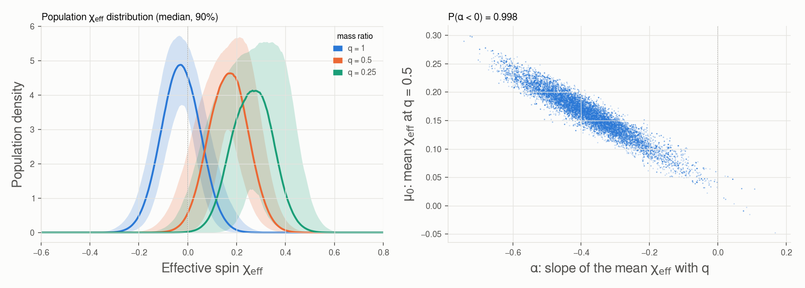

# spin_population

The **population of binary-black-hole effective spins**: the distribution of χ_eff and how it changes with
the mass ratio, inferred hierarchically from the catalog with the selection effects of the LVK
search-sensitivity injections.

```bash
gwtc_analysis spin_population                     # chi_eff - q correlated model
gwtc_analysis spin_population --no-correlation    # Gaussian chi_eff
```

## What it measures

The effective spin \(\chi_\text{eff} = (m_1 \chi_{1z} + m_2 \chi_{2z})/(m_1 + m_2)\) is the mass-weighted spin
along the orbital angular momentum, the best-measured spin combination. Its distribution separates
formation channels: binaries formed in isolation tend to have spins aligned with the orbit
(\(\chi_\text{eff} > 0\)), binaries assembled dynamically in clusters have isotropic spins, as many negative
as positive.

The model (Callister et al. 2021 [\[89\]](../references.md#ref-89)) is

\[
\chi_\text{eff} \mid q \sim \mathcal{N}\big(\mu_0 + \alpha\,(q - 0.5),\ \sigma\big) \quad\text{on } [-1, 1],
\]

with \(q = m_2/m_1 \le 1\): \(\mu_0\) is the mean at \(q = 0.5\), \(\alpha\) its slope with the mass ratio
(\(\alpha < 0\): unequal-mass binaries spin more), σ the width. `--no-correlation` sets \(\alpha = 0\).

## Method

- **Events:** the 137 binary black holes of the `hubble_constant` selection (GWTC-4.0 setup: lowest FAR
  ≤ 0.25 /yr, both masses ≥ 3 M☉, GW231123 and GW200105 left out), each with 5000 PE samples of its
  IMRPhenomXPHM analysis (χ_eff, masses, distance).
- **Spins:** the other spin degrees of freedom are isotropic with magnitude uniform on [0, 1], reweighted
  in χ_eff only. The spin factor of a PE sample or an injection is \(\mathcal{N}(\chi_\text{eff}) /
  \pi_\text{iso}(\chi_\text{eff} \mid q)\), with \(\pi_\text{iso}\) the χ_eff density of isotropic spins,
  computed exactly: \(a\cos\theta\) has density \(-\ln|s|/2\) on [−1, 1], and χ_eff is the convolution of
  two of them. The PE spin priors are isotropic too, so this factor is all their spin part.
- **Masses and redshifts:** a fixed population, that of the [rates](rates.md) mode (Power Law + Peak,
  R ∝ (1+z)^2.9, Planck15).
- **Selection:** 250,000 of the found O1–O4a injections (a random subset of the 849,000; the detectable
  fraction is unbiased), weighted by the population over their full draw density.
- **Likelihood:** marginalized over the rate,
  \(\ln\mathcal{L} = \sum_\text{events} \ln\langle w f\rangle_\text{PE} - N \ln\langle w f\rangle_\text{inj}\).
  A posterior point is kept only with at least 4N effective injections and 10 effective PE samples for
  every event (the icarogw and GWTC-4.0 cosmology criteria). Sampler: emcee.

**The injections were not drawn with isotropic spins.** Within narrow bins of mass and redshift, their
draw density minus an isotropic, uniform-magnitude spin part still correlates with the spin magnitude
(−0.34) and the tilt (+0.37). The mode therefore uses the full draw density. This does not affect
`hubble_constant`: dividing by the full draw density with an isotropic spin population makes the
population spins isotropic, whatever the draw.

### What the mode does

**The mode runs its own hierarchical inference**: its own likelihood (the one above, not icarogw) and the emcee
sampler. It reuses the event selection, the PE-file choice and the injection reader of `hubble_constant`.

1. **Events:** the GWOSC lists of the release's catalogs (`gwtc4`: GWTC-1 to GWTC-4.0), each event with its
   lowest published FAR at most `--far-threshold` (inclusive, the values being rounded), inside a run of the
   release, both median masses at least `--min-mass`, and not in `--exclude`.
2. **PE samples:** the file given by [Which PE file is read](../data-sources.md#which-pe-file-is-read), from
   `--data-repo`. From its analysis `C00:IMRPhenomXPHM-SpinTaylor`, else `C01:IMRPhenomXPHM`, else
   `C00:IMRPhenomXPHM`, else another IMRPhenomXPHM label, the mode keeps `mass_1`, `mass_2`,
   `luminosity_distance`, `chi_eff` and the recorded distance prior in `<pe-cache>/samples_spin/<event>.h5`, and
   deletes the file it downloaded. `--pe-samples` samples are then drawn without replacement (fixed seed).
3. **Mass-redshift weight of a PE sample:**
   \(w = p_\text{PLP}(m_1^s, m_2^s)\,\frac{dV_c}{dz}\,(1+z)^{\kappa-1} \big/ \big[(1+z)^2\,\frac{dD_L}{dz}\,\pi(D_L)\big]\),
   κ = 2.9, z from D_L with Planck15. The PE mass prior is uniform in detector-frame masses, so only the distance
   prior π(D_L) divides: D_L² or uniform in comoving or source-frame volume, as recorded in the file (if not
   recorded, D_L² up to O3 and uniform in source-frame volume from O4).
4. **Injections:** the release's mixture with semi-analytic O1+O2 injections (`gwtc4`: Zenodo 16740128,
   `mixture-semi_o1_o2-real_o3_o4a-cartesian_spins…`), found with the lowest search FAR below `--far-threshold`,
   or for O1–O2 a network SNR above `--snr-threshold`. π is their draw density, divided by the isotropic,
   uniform-magnitude spin density and by the mixture weight, carried to the detector frame. Injections with
   w > 0 are kept; with `--max-injections`, a random subset, \(N_\text{gen}\) scaled by the same fraction.
5. **Spin factor:** \(\pi_\text{iso}\) is tabulated on 50 mass ratios (0.02 to 1) × 801 values of χ_eff and
   interpolated bilinearly.
6. **Likelihood:** \(\langle w f\rangle_\text{PE}\) is the mean over the samples of each event,
   \(\langle w f\rangle_\text{inj}\) the sum over the found injections divided by \(N_\text{gen}\); a point failing
   the effective-sample criteria gets \(\ln\mathcal{L} = -\infty\).
7. **Priors:** uniform, μ₀ in [−1, 1], σ in [0.005, 1], α in [−5, 5].
8. **Sampler:** emcee `EnsembleSampler`, `--walkers` started at (μ₀, σ, α) = (0.05, 0.1, 0) with a 0.01 scatter,
   seeded; `--steps` steps, the first third discarded. The report gives the acceptance, the autocorrelation time
   and the effective numbers at the posterior median.
9. **Fraction with χ_eff < 0:** for 300 posterior draws, the truncated-normal probability below 0, averaged over
   20 000 mass ratios drawn from the fixed Power Law + Peak population.

The masses, redshifts and rate are not fitted, and the PE analyses are not rerun.

## Results

| Parameter | Correlated model, median (90%) | Gaussian model (α = 0) |
|---|---|---|
| μ₀, mean χ_eff at q = 0.5 | 0.165 (0.095–0.225) | 0.035 (0.014–0.056) |
| σ, width | 0.079 (0.068–0.100) | 0.094 (0.077–0.121) |
| α, slope with q | **−0.39 (−0.56 to −0.18)** | — |
| P(α < 0) | 0.998 (of 16,000 samples) | — |
| fraction with χ_eff < 0 | **0.39 (0.30–0.48)** | 0.36 (0.27–0.45) |

The mean effective spin falls with the mass ratio: 0.24 (0.13–0.34) at q = 0.3, 0.13 (0.08–0.17) at
q = 0.6, −0.03 (−0.07 to 0.01) for equal masses. **Unequal-mass binaries have larger effective spins**,
as Callister et al. found at 98.7% credibility with GWTC-2 [\[89\]](../references.md#ref-89); GWTC-4.0 also
finds evidence for a χ_eff–q correlation [\[13\]](../references.md#ref-13). Most formation models predict the
opposite trend.

Averaged over the astrophysical mass ratios of the fixed Power Law + Peak population (median q = 0.89, more equal
than the detected binaries, median 0.84), a fraction **0.39 (0.30–0.48)** of the binaries have χ_eff < 0, against
0.24–0.42 in GWTC-4.0 [\[13\]](../references.md#ref-13): a substantial population consistent with dynamical
assembly. The fraction comes mostly from the near-equal-mass binaries, where the linear trend puts the mean just
below zero; it depends on the assumed q distribution and on the linear form of the trend, which GWTC-4.0 does not
assume. Until October 2026 the mode averaged over the detected mass ratios, with 0.35 (0.26–0.43) from an
earlier run (before the fixes of the October 2026 reviews). The run of 14 October 2026, 0.42 (0.32–0.52), read the
O1–O3 events from the cosmologically reweighted PE files, dividing by the prior these files record (D_L²) while
their samples follow the cosmological one, and GWTC-4.0 from its earlier release version; the rule of
[Which PE file is read](../data-sources.md#which-pe-file-is-read) corrects both.



*Left: the population χ_eff distribution at three mass ratios (median and 90%). Right: the posterior of the
mean at q = 0.5 against the slope; 99.8% of the samples have α < 0.*

Diagnostics of the correlated run (15 October 2026; PE files: 62 `nocosmo` for O1–O3, 75 combined of GWTC-4.0
v3): at the posterior median 16,164 effective injections (threshold 548) and at least 18 effective PE samples per
event (threshold 10); 20 walkers × 1200 steps, acceptance 0.62, autocorrelation time 40 steps, about 400
independent samples.

## Validation

`tests/test_spin_population.py`: the isotropic χ_eff density integrates to 1 and matches a Monte Carlo of
10⁶ isotropic spins at q = 1, 0.5 and 0.1; on a mock population of 120 events (μ₀ = 0.06, σ = 0.1,
α = −0.5) with PE samples drawn from the isotropic prior times a Gaussian measurement, the three
parameters are recovered inside their 90% intervals, with P(α < 0) > 0.9.

## Limits

- The mass and redshift population is fixed, not fitted with the spins; a joint fit would widen the
  intervals somewhat.
- Only the mean of χ_eff varies with q; GWTC-4.0 notes that the data cannot yet tell whether the mean or
  the width varies [\[13\]](../references.md#ref-13).
- χ_p (precession) is not modeled: the other spin components follow the isotropic distribution.

## Outputs

- The HTML report ends with the **PE files of this run**: for each event the file read, its type (`nocosmo`, `cosmo`, `combined` or the GW170817 bundle) and where it was taken from (Zenodo, the S3 mirror, Galaxy, a PE cache), then the options of the run; see [Which PE file is read](../data-sources.md#which-pe-file-is-read);
- `--out-report` (HTML): the posterior, the fraction with χ_eff < 0, the diagnostics and the plot;
- `--out-summary` (TSV): the posterior quantiles; `<name>.posterior.tsv`: the samples;
- `--plots-dir`: `spin_population.png`.

## Options

| Option | Default | Meaning |
|---|---|---|
| `--no-correlation` | off | Gaussian chi_eff model without the q slope. |
| `--sensitivity-release {gwtc4,gwtc5}` | — | Injections and catalogs (default: gwtc4). |
| `--sensitivity-file` | — | Local sensitivity file instead of the release. |
| `--far-threshold` | `0.25` | Events: FAR at or below this (the published values are rounded); found injections: below it. |
| `--snr-threshold` | `10.0` | Found semi-analytic O1+O2 injections. |
| `--min-mass` | `3.0` | Both source-frame masses above it. |
| `--exclude` | `GW231123_135430 GW200105_162426` | Events left out. |
| `--pe-cache` | — | PE cache (default: that of hubble_constant). |
| `--pe-samples` | `5000` | PE samples per event. |
| `--data-repo {zenodo,s3,galaxy}` | `zenodo` | Where the PE files are downloaded from: zenodo, s3 (the MinIO mirror, faster) or galaxy (the public usegalaxy.org history). The files are the same, those of the latest Zenodo versions (`nocosmo` up to GWTC-3): a file the mirror does not have comes from Zenodo ([Which PE file is read](../data-sources.md#which-pe-file-is-read)). |
| `--max-injections` | `250000` | Random subset of the found injections (0: all). |
| `--walkers` | `20` | emcee walkers. |
| `--steps` | `1200` | emcee steps (the first third is burn-in). |
| `--out-report` | `spin_population.html` | Output HTML report path. |
| `--out-summary` | `spin_population.tsv` | Output TSV of the posterior quantiles (the samples go to &lt;name&gt;.posterior.tsv). |
| `--plots-dir` | `spin_population_plots` | Directory for the plots. |

Every report ends with the options of its run, defaults included. The same table with the help text
of all the modes: [CLI reference](../cli-reference.md#spin_population).
