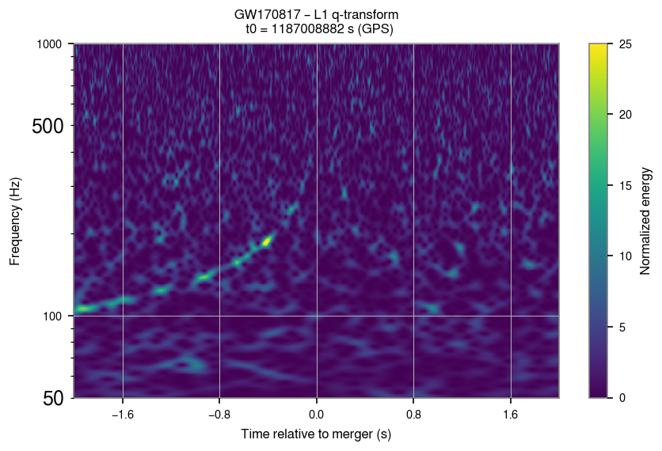
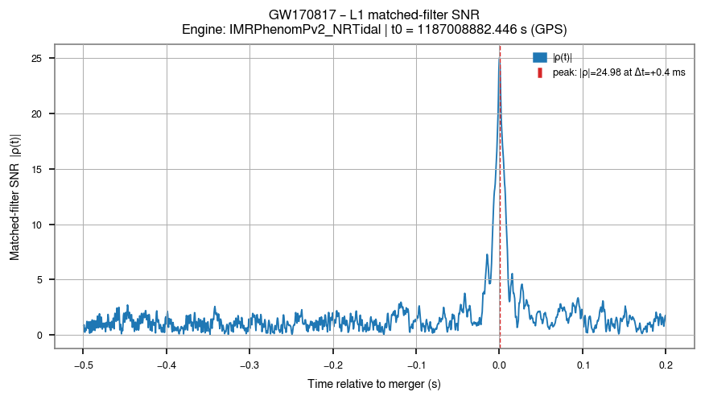

# build_unofficial_pe: GW170817

GW170817, the binary neutron star seen with its electromagnetic counterpart
(Abbott et al. 2017 [\[40\]](../references.md#ref-40)), has no PESummary file in the catalog
releases. `build_unofficial_pe` builds a PESummary-compatible `PEDataRelease` bundle for it, from
public GWTC-1 products only, so that `parameters_estimation` can treat it like any other event.

```bash
gwtc_analysis build_unofficial_pe --src-name GW170817          # build, or reuse the cache
gwtc_analysis build_unofficial_pe --src-name GW170817 --force  # rebuild
```

## Sources

The files are downloaded into `~/.gwcache` the first time they are needed:

| Product | DCC release | File |
|---|---|---|
| Posterior samples (IMRPhenomPv2_NRTidal, low and high spin) | [LIGO-P1800370](https://dcc.ligo.org/LIGO-P1800370/public) | `GW170817_GWTC-1.hdf5` |
| PSDs (H1, L1, V1) | [LIGO-P1900011](https://dcc.ligo.org/LIGO-P1900011/public) | `GWTC1_GW170817_PSDs.dat` |
| Calibration uncertainty envelopes | [LIGO-P1900040](https://dcc.ligo.org/LIGO-P1900040/public) | `GWTC1_GW170817_CalEnv/GWTC1_GW170817_{H,L,V}_CalEnv.txt` |
| Skymap | [LIGO-P1800381](https://dcc.ligo.org/LIGO-P1800381/public) | `GW170817_skymap.fits.gz` |

## Reconstructing the missing parameters

The public samples carry no polarization angle, phase, coalescence time or likelihood. The builder:

1. draws the polarization `psi` and the phase from their priors, sets `geocent_time` to the trigger
   time, and derives a synthetic ranking `log_likelihood`;
2. for the sample ranked first (the maximum-likelihood sample used by the strain overlay), fits
   `geocent_time`, `phase` and `psi` to the GWOSC strain by maximizing the coherent network
   likelihood with the public PSDs, keeping the intrinsic parameters and the sky position. The build
   log reports the recovered matched-filter SNRs: about 18 in H1, 25 in L1 and 31 for the network;
3. derives the detector arrival times (`H1_time`, `L1_time`, `V1_time`) from `geocent_time`, `ra`
   and `dec` with the LAL detector delays.

All other samples keep their prior-drawn extrinsic values. If the strain fit fails (it needs network
access to GWOSC), the bundle is still built and the log warns that the overlay will not be coherent.

## Method

**The mode runs no parameter estimation.** The posterior samples are those of the two GWTC-1
IMRPhenomPv2_NRTidal analyses of GW170817. The mode repackages them, with the public PSDs, calibration
envelopes and skymap, into one PESummary file, and fills in the columns the public release lacks. Only one
step uses the strain: the fit of the time, phase and polarization of a single sample.

### Inputs

The four products of [Sources](#sources), downloaded once into `~/.gwcache` (from the DCC, or the mirror
of `--data-repo`), and for the fit the GWOSC strain of H1, L1 and V1.

### What the mode does with them

1. **Samples.** The datasets `IMRPhenomPv2NRT_lowSpin_posterior` and `IMRPhenomPv2NRT_highSpin_posterior`
   become the labels `C02:IMRPhenomPv2_NRTidal-LowSpin` and `C02:IMRPhenomPv2_NRTidal-HighSpin`, with
   PESummary's standard parameter names and the derived parameters PESummary can compute.
2. **Missing columns** (see [above](#reconstructing-the-missing-parameters)): `geocent_time` is the trigger
   time, GPS 1187008882.429464; `phase`, `phi_jl` and `phi_12` are uniform on [0, 2π) and `psi` on [0, π),
   from a random generator seeded with the GPS time, so that rebuilds are identical. The synthetic
   `log_likelihood` is \( -\sum_k \left((x_k - \tilde x_k)/\sigma_k\right)^2 \) over those of the masses,
   distance, sky position, spins, inclination and tidal parameters present (median \(\tilde x_k\), standard
   deviation \(\sigma_k\)): it ranks first the sample closest to the medians, not a likelihood maximum.
3. **Fit of the first-ranked sample.** 256 s of strain at 4096 Hz, ending 16 s after the trigger, are
   fetched with gwpy, tapered over 0.5 s at each end and Fourier transformed. The plus and cross
   polarizations come from PESummary's `fd_waveform` (IMRPhenomPv2_NRTidal, 23 Hz to 2048 Hz, reference
   frequency 20 Hz), with the sample's intrinsic parameters and sky position. The fit maximizes
   \( \ln L = \left|\sum_d F_{+,d} Z_{+,d}(t_d) + F_{\times,d} Z_{\times,d}(t_d)\right| - \tfrac12 \sum_d \langle h_d|h_d\rangle \),
   where \(Z_{+,d}\), \(Z_{\times,d}\) are the correlations of the data of detector \(d\) with the two
   polarizations, weighted by the public PSD, at its arrival time \(t_d\). The grid is the geocentre time
   within ±0.1 s of the trigger (steps of 1/16384 s) and 180 values of `psi`; the phase is maximized
   analytically, then checked with the full waveform. The log gives the SNR
   \(\langle d|h\rangle/\sqrt{\langle h|h\rangle}\) of each detector and \(\sqrt{2 \ln L}\) for the network.
4. **Detector times** of every sample from `geocent_time`, `ra` and `dec` (`lal.TimeDelayFromEarthCenter`);
   for the fitted sample, recomputed from the fitted time.
5. **PSDs, calibration, skymap.** The same PSDs (one column per detector), calibration envelopes (as
   released) and skymap are attached to both labels. Only the `PROB` column of the FITS skymap is kept: the
   bundle's skymap has no distance layer.
6. **Write** the bundle with PESummary's `write_pesummary`. A failed fit marks the bundle incomplete in its
   recipe file, so the next run rebuilds it.

## Example

```bash
gwtc_analysis parameters_estimation --src-name GW170817 \
    --overlay-start 0.2 --overlay-stop 0.2 --overlay-fmax 1000 --q-start 2 --q-stop 2 --q-fmax 1000
```

`parameters_estimation` uses the rebuilt bundle transparently:



*L1 q-transform: the binary-neutron-star chirp, visible for about 2 s as it rises from 100 to about
300 Hz, much longer than a BBH signal.*



*Matched-filter SNR with the maximum-likelihood IMRPhenomPv2_NRTidal waveform: 25.0 in L1 and 18.0 in
H1 at the coalescence time, recovered from the public samples, PSDs and the fitted extrinsic
parameters.*

## Outputs

- `<cache-dir>/unofficial_pe/<bundle>.h5`: the PESummary bundle, read by `parameters_estimation`, `counterpart`,
  `hubble_constant --method bright` and `neutron_star_eos`.

The bundle is cached with a fingerprint of its recipe (`<bundle>.recipe.json`) and rebuilt when the
recipe or a source file changes. A missing source that cannot be downloaded stops the build, and the
overlays of this special case are then not produced.

## Options

| Option | Default | Meaning |
|---|---|---|
| `--src-name` | — | Source event name (e.g. GW170817). |
| `--cache-dir` | `.cache_gwosc` | Cache root where unofficial_pe/&lt;bundle&gt;.h5 will be written. |
| `--force` | off | Force rebuilding the unofficial bundle even if a cached copy already exists and is up to date. |
| `--data-repo {zenodo,s3,galaxy}` | `zenodo` | where the GWTC-1 products of GW170817 are downloaded from: their public sources, or a mirror holding the same files, `s3` (the MinIO bucket, faster) or `galaxy` (the public usegalaxy.org history), else the public source ([S3 mirror of the public files](../data-sources.md#s3-mirror-of-the-public-files)) |

The same table with the help text of all the modes: [CLI reference](../cli-reference.md#build_unofficial_pe).
