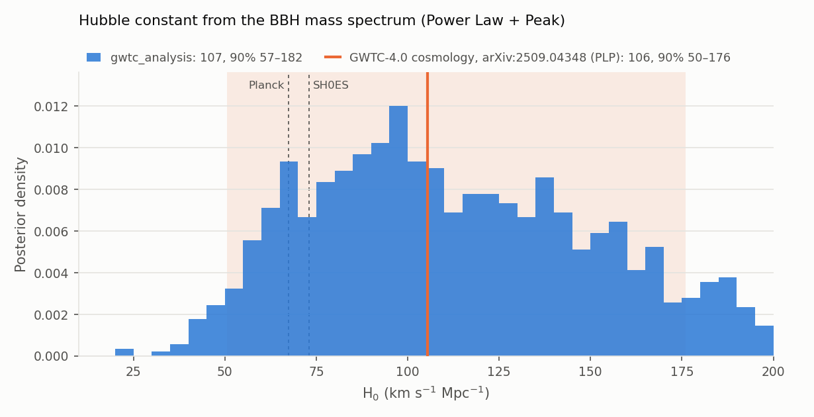
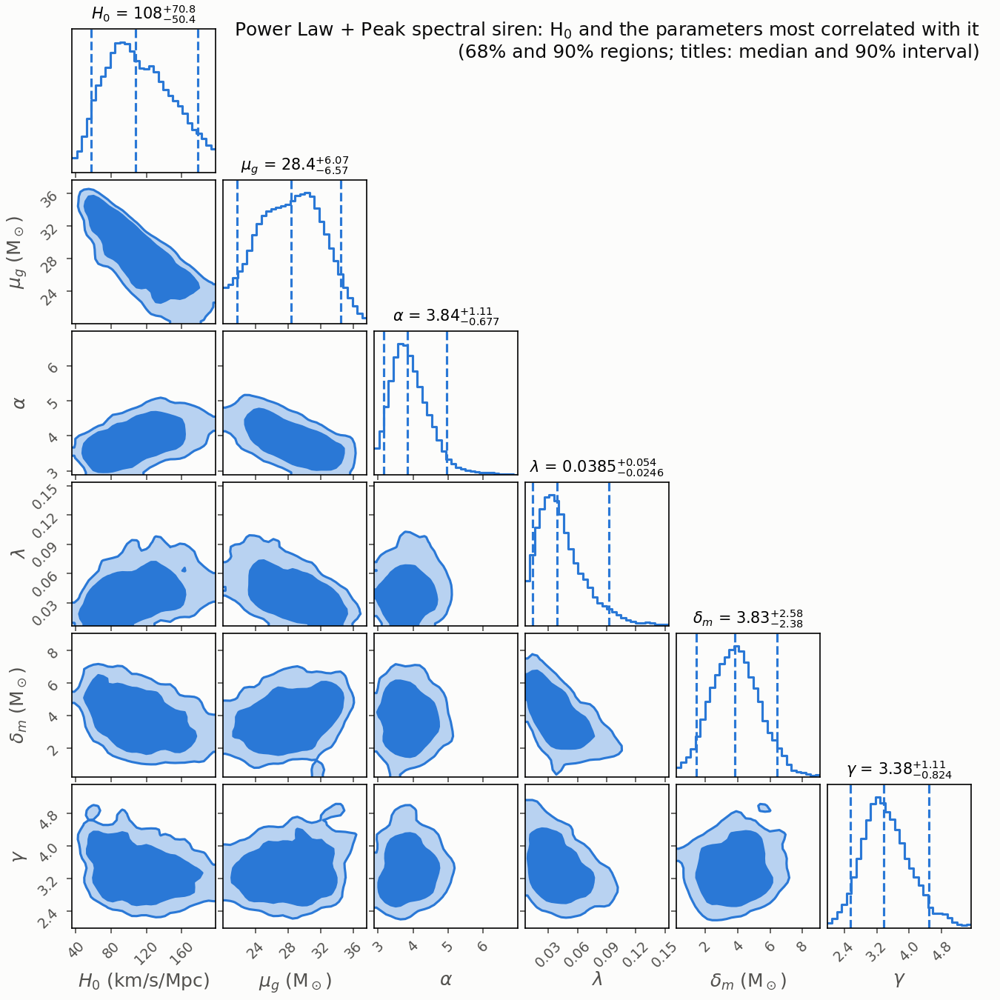
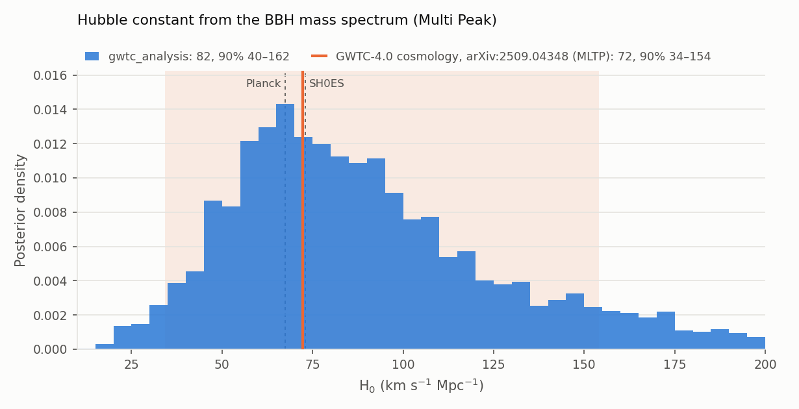
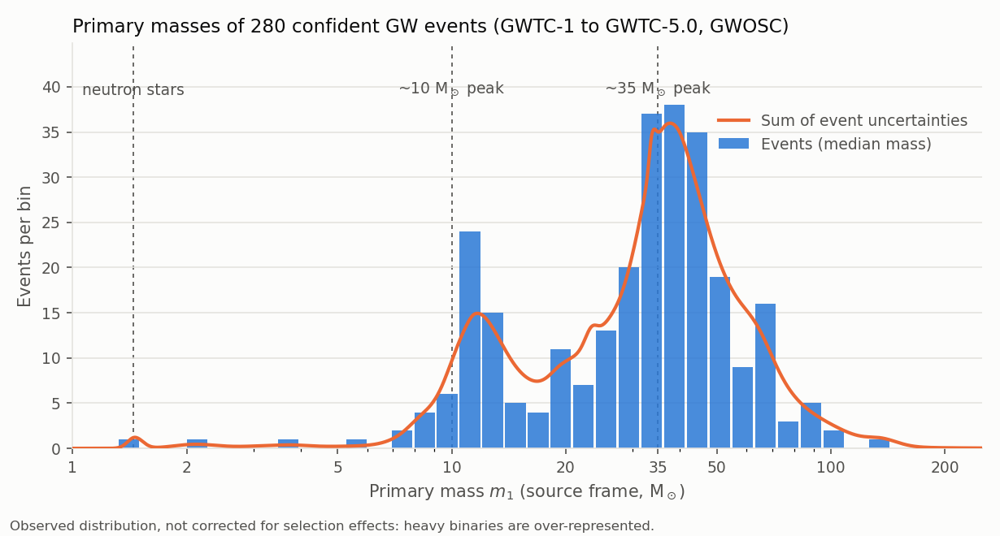
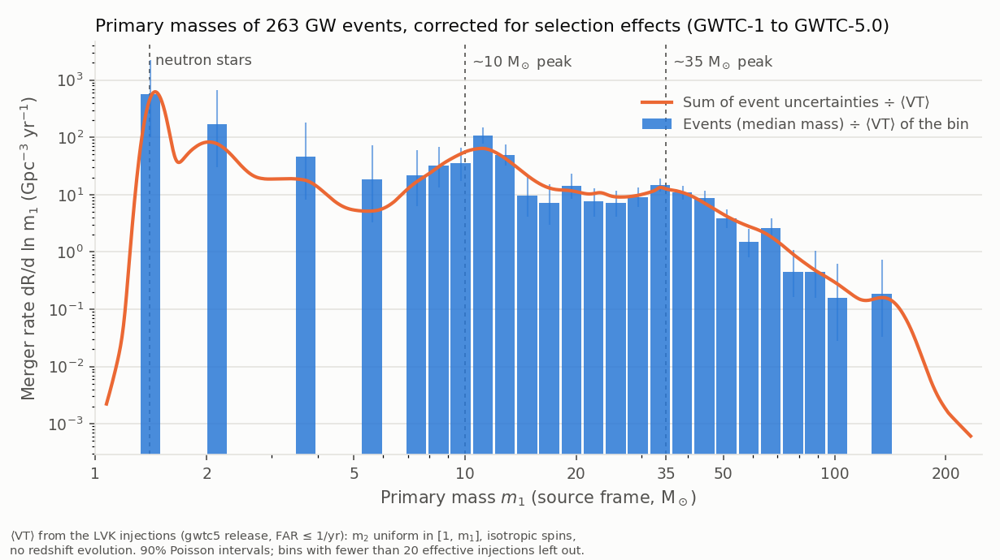
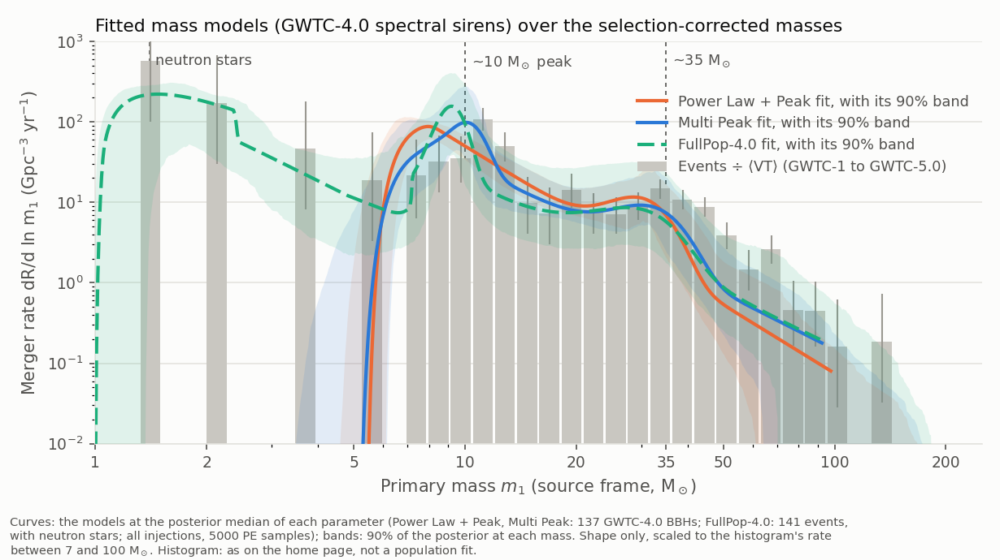

# Hubble constant from the BBH mass spectrum (spectral siren)

This page explains how the [`hubble_constant`](../modes/hubble-constant.md) mode measures the Hubble
constant from binary-black-hole (BBH) detections alone, without an electromagnetic counterpart or a
galaxy catalog, and how its result compares with the published LVK measurement.

## Result

The mode reproduces the *Power Law + Peak* (PLP) spectral-siren measurement of the GWTC-4.0
cosmology paper (LVK 2026 [\[29\]](../references.md#ref-29), published version v3), with the same event
selection, PE releases, injections, population model and priors (the paper does not state its number of PE
samples per event; the runs below use all 5000 of the releases, [below](#injection-subsets-and-reweighting)):

| Quantity | gwtc_analysis | GWTC-4.0 paper [\[29\]](../references.md#ref-29) |
|---|---|---|
| **PLP**, H₀ (km/s/Mpc, median and 68%) | **107.6 (+45.6 / −35.2)** | 105.5 (+46.4 / −35.8) |
| PLP, H₀ 90% interval | 57.0 – 178.4 | 50.5 – 176.1 |
| PLP, position of the mass peak μ_g (M☉) | 28.4 (+3.9 / −4.3) | 28.3 (+4.1 / −4.4) |
| **MLTP**, H₀ (km/s/Mpc, median and 68%) | **81.6 (+41.0 / −26.0)** | 72.3 (+42.5 / −25.6) |
| MLTP, H₀ 90% interval | 41.4 – 159.7 | 34.2 – 154.1 |
| BBH events | 137 | 137 |

Both results come from the paper's 137 events, 8 runs of 100 live points each (seeds 1–8), sampled with a 10% subset of the injections and 1500 PE samples
per event, then **reweighted** to all the found injections, as in the paper, and to all the 5000 PE samples
of each event ([below](#injection-subsets-and-reweighting)); the reweighting to 5000 PE samples was run after the
chain with the runner's `reweight` stage, which `--reweight-pe-samples 5000` puts in the chain. The reweighting keeps an effective sample size
of 68% (PLP) and 67% (MLTP) of the samples. The PLP median is 2.1 km/s/Mpc above the paper's (0.05σ) and the
90% intervals nearly coincide. The MLTP median is 9.3 km/s/Mpc above the paper's (0.3σ), with a 68%
interval of the same width ([differences](#reproduced-with-differences)). With 1500 PE samples per event the
results move by several km/s/Mpc, depending on which samples are kept
([comparison](#injection-subsets-and-reweighting)).

!!! note "Versions of the paper"
    The first two arXiv versions of the paper (v1 and v2, 2025) quoted PLP 112.7 (+51.0 / −35.9)
    km/s/Mpc, 90%: 57.6–186.7, with the peak at 28.6 (+3.9 / −4.9) M☉, MLTP 77.1 (+40.8 / −26.3) and
    FullPop-4.0 76.4 (+23.0 / −18.1); our PLP result agrees with those to about 0.15σ. The published
    version (v3, August 2026) revised all the spectral-siren values to those quoted here. The paper does
    not describe the changes between versions. Our PLP posterior with fewer injections or fewer PE
    samples lands near the v1–v2 value (114.6 with all the injections and 1500 PE samples); with all the
    injections and all the PE samples it matches v3.



H₀ is measured only broadly: values below about 60 km/s/Mpc are excluded, but the posterior still has
weight at 200 km/s/Mpc, the upper edge of the prior. This is not yet competitive with the cosmic
microwave background (Planck 2018 [\[33\]](../references.md#ref-33): 67.4 ± 0.5) or the distance
ladder (SH0ES 2022 [\[34\]](../references.md#ref-34): 73.0 ± 1.0). Richer mass models do better
([below](#other-mass-models-and-published-results)).

## The idea

A GW signal measures its luminosity distance \(D_L\) and its detector-frame masses
\(m_\text{det} = (1+z)\, m_\text{src}\), but not its redshift
([What a GW signal measures](gw-signals.md)). A heavy nearby binary and a lighter distant one look the
same.

The **spectral siren** takes the redshift from the population
(Taylor, Gair & Mandel 2012 [\[20\]](../references.md#ref-20);
Farr et al. 2019 [\[21\]](../references.md#ref-21);
Ezquiaga & Holz 2022 [\[22\]](../references.md#ref-22)). If source-frame BBH masses pile up at a fixed
value, such as the peak near 30 M☉, the detector-frame peak must move to higher masses with distance.
For each trial H₀:

1. convert every event's \(D_L\) into \(z\);
2. compute its source-frame masses \(m_\text{src} = m_\text{det}/(1+z)\);
3. check whether the whole catalog, near and far, then forms one mass distribution that does not change
   with distance.

With a wrong H₀ the peak drifts with distance, which the model does not allow. The mass distribution
and H₀ are therefore fitted **together**, which is the origin of the strong H₀–μ_g degeneracy: the
data fix \(\mu_g (1+z)\), and \(z\) depends on H₀. The population model matters: fixing its shape
gives a biased and falsely precise H₀ (Mastrogiovanni et al. 2021 [\[23\]](../references.md#ref-23)).

## The hierarchical likelihood

The question is: *if the Universe had this population of black holes and this H₀, how probable is the
set of signals actually recorded?* The problem has two levels, hence *hierarchical*
(Mandel, Farr & Gair 2019 [\[35\]](../references.md#ref-35);
Thrane & Talbot 2019 [\[36\]](../references.md#ref-36)):

```
 Λ, H₀            population and cosmology      (inferred)
   | generate
   v
 θ₁, θ₂, … θ_N    true masses and distances     (hidden)
   | produce, with noise
   v
 d₁, d₂, … d_N    strain data of the detectors  (observed)
```

### One event

The probability of the data of event \(i\) given the population integrates over its unknown true
parameters:

\[
p(d_i \mid \Lambda, H_0) = \int p(d_i \mid \theta)\; p_\text{pop}(\theta \mid \Lambda, H_0)\; d\theta ,
\]

where \(p(d_i \mid \theta)\) is the single-event GW likelihood (how well a binary \(\theta\) explains the
data) and \(p_\text{pop}\) how common such a binary is in the population. H₀ enters only through
\(p_\text{pop}\), which converts \(D_L\) into \(z\) and \(m_\text{det}\) into \(m_\text{src}\).

The integral is evaluated with the released PE samples \(\theta_{i,s}\), drawn from
\(p(d_i \mid \theta)\, \pi_\text{PE}(\theta)\): dividing out the PE prior \(\pi_\text{PE}\) and
averaging gives

\[
p(d_i \mid \Lambda, H_0) \approx \frac{1}{S} \sum_{s=1}^{S} \frac{p_\text{pop}(\theta_{i,s} \mid \Lambda, H_0)}{\pi_\text{PE}(\theta_{i,s})} .
\]

### Selection

Multiplying the event terms alone would favor a population full of heavy, nearby binaries, because
these are the ones detected. The right question is how probable each event is *among the events that
could have been detected*. Detections form a Poisson process: with a rate \(R\) and an observing time
\(T\),

\[
\mathcal{L} = e^{-N_\text{exp}} \prod_{i=1}^{N} R\, T\, p(d_i \mid \Lambda, H_0),
\qquad N_\text{exp} = R\, T\, \xi(\Lambda, H_0),
\]

where \(\xi\) is the detectable fraction of the population, computed with the
[injections](selection-effects.md#reweighting-one-set-of-injections-for-every-population).

### Removing the rate

With a scale-invariant prior \(p(R) \propto 1/R\), the rate integrates out analytically, and only the
shape of the population remains ("scale-free" likelihood):

\[
\mathcal{L}(\Lambda, H_0) \;\propto\; \frac{\prod_{i=1}^{N} p(d_i \mid \Lambda, H_0)}{\xi(\Lambda, H_0)^{N}} .
\]

The numerator rewards populations that put weight where the events are; the denominator turns
"probable in the population" into "probable among detectable events". The merger rate is therefore
not an input of the H₀ measurement, but the **shape** of the redshift distribution is, and it is fitted
together with H₀.

### The population in the detector frame

The data constrain \((m_{1,\text{det}}, m_{2,\text{det}}, D_L)\). The population is defined in the source
frame and, for each trial H₀, carried to the detector frame with the Jacobian of
\((m_{1,\text{src}}, m_{2,\text{src}}, z) \to (m_{1,\text{det}}, m_{2,\text{det}}, D_L)\):

\[
p_\text{pop}(m_{1,\text{det}}, m_{2,\text{det}}, D_L) =
\frac{p(m_{1,\text{src}})\; p(m_{2,\text{src}} \mid m_{1,\text{src}})\; p(z)}{(1+z)^2\, \frac{dD_L}{dz}} .
\]

**Masses: Power Law + Peak** (Talbot & Thrane 2018 [\[15\]](../references.md#ref-15); as defined in
GWTC-2 population [\[11\]](../references.md#ref-11), App. B):

\[
p(m_1) \propto \Big[(1-\lambda)\, \mathcal{P}(m_1 \mid -\alpha, m_\text{min}, m_\text{max})
+ \lambda\, \mathcal{G}(m_1 \mid \mu_g, \sigma_g)\Big]\, S(m_1 \mid m_\text{min}, \delta_m),
\]

\[
p(m_2 \mid m_1) \propto m_2^{\beta}\, S(m_2 \mid m_\text{min}, \delta_m), \qquad m_\text{min} \le m_2 \le m_1 ,
\]

where \(\mathcal{P}\) is a normalized power law, \(\mathcal{G}\) a Gaussian and \(S\) a smooth turn-on
of width \(\delta_m\) above \(m_\text{min}\):

\[
S(m) = \left[1 + \exp\!\left(\frac{\delta_m}{m'} + \frac{\delta_m}{m' - \delta_m}\right)\right]^{-1},
\quad m' = m - m_\text{min} \in (0, \delta_m),
\]

with \(S = 0\) below \(m_\text{min}\) and \(S = 1\) above \(m_\text{min} + \delta_m\).

**Redshift: Madau–Dickinson** shape (Madau & Dickinson 2014 [\[16\]](../references.md#ref-16)),
as implemented in icarogw:

\[
p(z) \propto \frac{dV_c}{dz}\, \frac{\psi(z)}{1+z}, \qquad
\psi(z) = \left[1 + (1+z_p)^{-\gamma-\kappa}\right] \frac{(1+z)^{\gamma}}{1 + \left(\frac{1+z}{1+z_p}\right)^{\gamma+\kappa}} ,
\]

which rises as \((1+z)^\gamma\), peaks near \(z_p\) and falls as \((1+z)^{-\kappa}\).

**Cosmology:** flat ΛCDM with H₀ free and \(\Omega_m = 0.3065\) fixed.

## Priors

Three kinds of priors enter, each set by a different rule.

### PE priors (fixed by the LVK, divided out)

| Parameter | PE prior |
|---|---|
| Masses | uniform in the detector-frame component masses |
| Spins | isotropic directions, magnitudes uniform in [0, 0.99] |
| Distance, O1–O3 | \(\pi(D_L) \propto D_L^2\) (uniform in Euclidean volume) |
| Distance, O4a | uniform in comoving volume and source-frame time, Planck15 cosmology (H₀ = 67.9, Ω_m = 0.3065): \(\pi(D_L) \propto \frac{dV_c/dz}{(1+z)\, dD_L/dz}\) |
| Sky position and orientation | isotropic |

They are read from each PESummary file (`prior:luminosity_distance`), with the catalog defaults when a
file does not record them. Using the wrong \(\pi_\text{PE}\) biases every event term. The injection
draw density \(p_\text{draw}\) plays the same role for the selection term.

### Hyperpriors (the analyst's choice)

Copied from the paper [\[29\]](../references.md#ref-29) (Tables 3 and 6), all uniform:

| Parameter | Meaning | Prior |
|---|---|---|
| H₀ | Hubble constant | 10 – 200 km/s/Mpc |
| α | power-law slope of m₁ | 1.5 – 12 |
| β | slope of the mass-ratio pairing | −4 – 12 |
| m_min | minimum BH mass | 2 – 10 M☉ |
| m_max | maximum BH mass of the power law | 50 – 200 M☉ |
| δ_m | width of the low-mass turn-on | 10⁻³ – 10 M☉ |
| μ_g | position of the Gaussian peak | 20 – 50 M☉ |
| σ_g | width of the Gaussian peak | 0.4 – 10 M☉ |
| λ | fraction of BBHs in the peak | 0 – 1 |
| γ | low-redshift slope of the rate | 0 – 12 |
| κ | high-redshift slope of the rate | 0 – 6 |
| z_p | redshift of the rate peak | 0 – 4 |

The principles: wide uniform ranges so that the data decide; physical bounds (m_min above the
neutron-star masses, λ a fraction); ranges that bracket the expected features without assuming their
position (μ_g around the known ~30 M☉ peak); numerical protection (σ_g ≥ 0.4 M☉ forbids an unresolvable,
infinitely narrow peak, which would collapse the effective sample sizes); Ω_m fixed because data at
z ≲ 1.5 barely constrain it.

### Rate prior

\(p(R) \propto 1/R\), which makes the rate marginalization analytic (above).

### What the priors mean for the result

Where the data are informative, the hyperprior does not matter: γ and μ_g are much narrower than their
priors. Where they are not, the posterior follows the prior: κ and z_p are not measured, and **the
upper part of the H₀ interval depends on the prior bound of 200 km/s/Mpc**. The lower limit near 60 is
set by the data.

## Implementation, step by step

1. **Events.** From the GWOSC confident and marginal lists of GWTC-1 to GWTC-4.0: events of O1–O4a with
   lowest FAR below 0.25 per year and both source-frame masses above 3 M☉ (the GWTC-4.0 criterion for
   potential neutron stars). GW231123, whose PE depends strongly on the waveform model
   (LVK 2025 [\[46\]](../references.md#ref-46)), and the NSBH GW200105 are left out, as in the paper;
   candidates of the engineering run ER15 fall outside the run windows. Result: **137 BBHs** (O1 3,
   O2 7, O3a 31, O3b 21, O4a 75), as in the paper. The FARs published by GWOSC are each event's lowest
   FAR over the search pipelines, rounded to two decimals, while the paper cuts at full precision:
   GW191127_050227 is listed at 0.25, so the rounded values are compared inclusively (FAR ≤ 0.25). The mass cut matters: with GW190814 (secondary of 2.6 M☉,
   LVK 2020 [\[43\]](../references.md#ref-43)), no PE sample overlaps the BBH model and the likelihood
   is zero everywhere.
2. **PE samples.** From the Zenodo PE releases (33 GB for 159 events): `C01:IMRPhenomXPHM`
   (Pratten et al. 2021 [\[51\]](../references.md#ref-51)) for O1–O3 and
   `C00:IMRPhenomXPHM-SpinTaylor` (Colleoni et al. 2024 [\[52\]](../references.md#ref-52)) for O4a,
   reduced to \((m_{1,\text{det}}, m_{2,\text{det}}, D_L)\), 1500 samples per event in the runs, all 5000
   after the reweighting.
3. **PE priors,** read from each file (above).
4. **Injections.** The GWTC-4.0 mixture of semi-analytic O1+O2 and real O3+O4a injections
   ([Zenodo 16740128](https://zenodo.org/records/16740128)); found when the semi-analytic SNR exceeds
   10 or the lowest search FAR is below 0.25 per year: 1 007 181 found injections, drawn from
   \(1.13 \times 10^9\) generated, over 2.12 years. Their draw density is carried to the detector
   frame, \(p_\text{draw}(m_{1,\text{det}}, m_{2,\text{det}}, D_L) = p_\text{draw}(m_1, m_2, z)/[(1+z)^2\, dD_L/dz]\);
   the spin part is divided out (the population spins are then the injected, isotropic ones, as in
   the PE prior), and the mixture weights applied. The runs use a random 10% subset, with
   \(N_\text{gen}\) scaled by the same factor, and their posterior is then reweighted to all the
   injections and all the PE samples ([below](#injection-subsets-and-reweighting)).
5. **Likelihood.** icarogw 2.0.3 (Mastrogiovanni et al. 2024 [\[57\]](../references.md#ref-57)):
   `CBC_vanilla_rate(FlatLambdaCDM_wrap, m1m2_conditioned_lowpass(massprior_PowerLawPeak), rateevolution_Madau, scale_free=True)`
   in `hierarchical_likelihood`.
6. **Sampling.** bilby (Ashton et al. 2019 [\[58\]](../references.md#ref-58)) with the dynesty nested
   sampler (Speagle 2020 [\[60\]](../references.md#ref-60)): 8 independent runs of 100 live points,
   seeds 1–8, 4–5 h each for PLP and 7–10 h for MLTP on 8 cores.
7. **Combination.** The runs are merged, weighted by their evidence (bilby `ResultList.combine`). Their
   evidences agree to within their errors, so all found the same posterior.

## Results in detail

Posterior of the PLP population parameters, reweighted to all the injections and 5000 PE samples (median
and 90% interval):

| Parameter | Value |
|---|---|
| α | 3.84 (3.15 – 4.95) |
| β | 1.53 (0.30 – 3.46) |
| m_min | 5.18 (4.14 – 5.90) M☉ |
| m_max | 100 (64 – 188) M☉ |
| δ_m | 3.83 (1.45 – 6.43) M☉ |
| μ_g | 28.4 (21.8 – 34.4) M☉ |
| σ_g | 5.6 (1.4 – 9.4) M☉ |
| λ | 0.039 (0.014 – 0.093) |
| γ | 3.38 (2.55 – 4.49) |
| κ | 3.0 (0.2 – 5.7), not measured |
| z_p | 2.8 (1.4 – 3.9), not measured |



*H₀ and the five population parameters most correlated with it (table below), with all the injections and 5000 PE
samples per event: 68% and 90% regions, and the median and 90% interval of each parameter. The other parameters
(β, m_min, m_max, σ_g, κ, z_p) are in the table above. Made by `docs/scripts/plp_corner.py` from the weights of the
reweighting stage.*

**Correlations with H₀** (correlation coefficients over the posterior):

| Parameter | Correlation | Why |
|---|---|---|
| μ_g | −0.80 | a higher H₀ gives larger redshifts, so lighter source masses and a lower peak |
| α | +0.51 | a steeper power law partly offsets the lighter source masses of a higher H₀ |
| λ | +0.37 | |
| δ_m | −0.33 | |
| γ | −0.27 | a slower rate growth partly offsets the larger redshifts of a higher H₀ |
| σ_g | +0.20 | |
| z_p | +0.16 | |
| m_max | +0.15 | |
| κ | −0.05 | |

The mass peak dominates the H₀ information; the power-law slope contributes, the redshift evolution
little.

**The redshift evolution.** γ is measured from how the detections are spread in distance. For each
trial population and H₀, the model predicts the distance distribution of the *detected* events,
\(\propto \frac{dV_c}{dz} (1+z)^{\gamma-1} P_\text{det}\, \frac{dz}{dD_L}\) at low redshift. With γ = 0
(a constant rate per comoving volume) it predicts too few distant events, many O3 and O4a BBHs being at
z ≈ 0.5–1; with a large γ, most mergers would be beyond the horizon, which the selection term
penalizes. The result, γ = 3.4 (2.6–4.5), is close to the low-redshift slope of the cosmic star-formation
rate, about 2.7. BBHs are detected only up to z ≈ 1–1.5, so only the rising part of the rate is seen:
z_p and κ stay at their priors.

**m_max** has only a lower bound (about 64 M☉): an analysis that fixes it, or the other shape
parameters, gives a much too narrow and biased H₀.

## Numerical stability

The per-event and selection sums are Monte Carlo estimates, checked by their effective sample sizes
([Selection effects](selection-effects.md#the-effective-number-of-injections)): icarogw requires at
least 4N effective injections (548 here) and, in this analysis, at least 10 effective PE samples per
event. Over the posterior of the runs with 10% of the injections, the effective number of injections
stays above 2 790 (PLP) and 3 170 (MLTP), well above the threshold. The smallest per-event value of
effective PE samples has a median of 37 (PLP) and 34 (MLTP) but approaches 10 at some posterior draws,
for the lightest BBHs (GW190924, GW231114 and other O4a events).

### Injection subsets and reweighting

A subset of the injections estimates the detectable fraction \(\xi\) without bias, but not the
posterior: the likelihood contains \(-N \ln \xi\) with N = 137, and the Monte Carlo noise of that term,
which varies smoothly across parameter space, tilts a broad posterior. The same holds for the PE samples of
each event, of which the runs use 1500 of the 5000 in each release. The effect is measured by reweighting the
posterior of the runs, sample by sample, to other Monte Carlo settings (weights
\(\exp(\ln \mathcal{L}_\text{new} - \ln \mathcal{L}_\text{runs})\)), on two independent sets of runs, both with
100 live points per run, 10% of the injections and 1500 PE samples per event:

- **runs A**, those of the [result](#result): 8 runs, the paper's 137 events;
- **runs B**: 10 runs, 136 events, sampled in September 2026 with an earlier version of the mode; the 137th event,
  GW191127, was added afterwards with the runner's `reweight --target-inputs` (`python h0_icarogw.py reweight`, an
  option the `gwtc_analysis` command does not expose).

**Injections: 10% against all** (H₀ in km/s/Mpc, median and 68%):

| Runs | Model | PE samples per event | 10% of the injections (the runs) | All the injections | Shift |
|---|---|---|---|---|---|
| A | PLP | 1500 | 128.0 (+42.4 / −39.1) | 114.6 (+43.0 / −39.4) | −13.4 |
| A | MLTP | 1500 | 94.3 (+43.9 / −29.6) | 83.7 (+44.7 / −27.0) | −10.6 |
| B | PLP | 1500 | 119.3 (+46.1 / −34.9) | 106.5 (+45.0 / −34.0) | −12.8 |
| B | PLP | 3000 | 125.1 (+44.9 / −38.0) | 111.4 (+44.9 / −36.2) | −13.7 |
| B | MLTP | 1500 | 89.1 (+39.0 / −28.1) | 78.5 (+38.7 / −26.7) | −10.6 |

The 10% subset shifts H₀ up by 13 km/s/Mpc for PLP (about 0.35σ) and 11 for MLTP, the same in both sets of runs
and for any number of PE samples.

**How the reweighting removes the shift.** The runs do not sample the posterior we want, but a neighbouring one:

1. **What the runs sample.** With 10% of the injections, the sampler explores
   \(P_\text{runs}(\theta) \propto \mathcal{L}_\text{10\%}(\theta)\, \pi(\theta)\), where θ is H₀ and the population
   parameters. Nested sampling needs some \(10^5\)–\(10^6\) likelihood evaluations, each about 4–5 times faster with
   the subset ([probe](../modes/hubble-constant.md#injection-subsets-probe-and-reweighting)).
2. **What the reweighting computes.** For each of the posterior samples \(\theta_i\) (about 2000), the likelihood
   is evaluated once more, exactly, with all the injections: \(\mathcal{L}_\text{all}(\theta_i)\). That is 2000
   slow evaluations instead of \(10^5\)–\(10^6\).
3. **Why the weighted samples are the right posterior.** Each sample gets the weight
   \(w_i = \mathcal{L}_\text{all}(\theta_i) / \mathcal{L}_\text{10\%}(\theta_i)\). The samples are distributed as
   \(\mathcal{L}_\text{10\%}\, \pi\); multiplied by \(w\), they are distributed as \(\mathcal{L}_\text{all}\, \pi\),
   the posterior with all the injections (importance sampling). Nothing is fitted or tuned: the weights are the
   ratio of the two likelihoods, and the medians and intervals are computed from the weighted samples.
4. **What the weights do here.** The subset's noise makes \(\ln \mathcal{L}\) too high at large H₀, by about 0.9
   per 100 km/s/Mpc. The weights undo exactly that tilt (runs A, PLP, all the injections, 1500 PE samples):

    | H₀ of the sample (km/s/Mpc) | 40–70 | 70–100 | 100–130 | 130–160 | 160–200 |
    |---|---|---|---|---|---|
    | samples | 110 | 340 | 475 | 438 | 429 |
    | mean weight (average 1) | 2.05 | 1.31 | 1.00 | 0.86 | 0.61 |

    The table bins the weights of the reweighting (`<workdir>/reweight/`) by H₀, a post-processing that the mode
    does not report. A sample near 55 km/s/Mpc now counts three times as much as one near 180: the median moves
    from 128.0 to 114.6.
    For MLTP the weights go from 1.47 (40–70) to 0.69 (160–200), and the median from 94.3 to 83.7.
5. **When it works.** The runs must already have samples wherever the target posterior lies: a shift of
   13 km/s/Mpc is small against a width of 40, so the weights stay moderate. The effective sample size
   \((\sum w)^2/\sum w^2\) measures it: 71% of the samples here (1275 of 1798). Below about 10%, a few samples
   would carry all the weight, and the runs must be redone with more injections; the probe chooses the subset to
   avoid that.

The same weights, with the likelihood evaluated with 5000 PE samples per event instead of 1500, correct the PE
subset too (below).

**PE samples: 1500 against 3000 and 5000** (all the injections; H₀ in km/s/Mpc, median and 68%):

| Runs | PE samples per event | PLP, H₀ | PLP, 90% | PLP, μ_g (M☉) | MLTP, H₀ | Effective sample size (PLP, MLTP) |
|---|---|---|---|---|---|---|
| A | 1500 | 114.6 (+43.0 / −39.4) | 58.3 – 181.6 | 27.8 | 83.7 (+44.7 / −27.0) | 71%, 66% |
| A | **5000 (the result)** | **107.6 (+45.6 / −35.2)** | **57.0 – 178.4** | **28.4** | **81.6 (+41.0 / −26.0)** | 68%, 67% |
| B | 1500 | 106.5 (+45.0 / −34.0) | 54.3 – 176.9 | 28.6 | 78.5 (+38.7 / −26.7) | 72%, 67% |
| B | 3000 | 111.4 (+44.9 / −36.2) | 55.4 – 179.4 | 28.1 | – | 77% |
| B + GW191127 | 1500 | 105.8 (+44.7 / −33.2) | 54.4 – 175.7 | 28.7 | 78.6 (+38.0 / −26.5) | 68%, 66% |
| paper [\[29\]](../references.md#ref-29) | not stated | 105.5 (+46.4 / −35.8) | 50.5 – 176.1 | 28.3 | 72.3 (+42.5 / −25.6) | – |

- With 1500 PE samples per event, the two sets of runs differ by 8 km/s/Mpc for PLP (114.6 against 106.5) and
  5 for MLTP, with the same settings otherwise; within each set the runs agree to a few km/s/Mpc (PLP medians
  126–135 for the 8 runs of A, with 10% of the injections), so the difference comes from the 1500 samples kept
  for each event.
- The shift from more PE samples has either sign: 1500 → 5000 lowers H₀ by 7.0 km/s/Mpc (PLP) and 2.1 (MLTP) in
  runs A; 1500 → 3000 raises it by 4.9 in runs B. With all 5000 samples there is no choice left; the dark sirens
  behave the same way ([hubble_constant](../modes/hubble-constant.md#validation-gwtc-40-power-law-peak-glade-k-band)).
- The 0.3 km/s/Mpc agreement of runs B with the paper at 1500 PE samples was partly chance.

This is why `hubble_constant` chooses its strategy automatically (`--inj-fraction auto`, the default):
a short probe measures the speed and accuracy of each subset, the runs sample with the fastest
reliable subset, and a `reweight` stage turns their posterior into the one with all the injections
([hubble_constant](../modes/hubble-constant.md#injection-subsets-probe-and-reweighting)).

## Other mass models and published results

The PLP model gives the least constraining result of the GWTC-4.0 paper [\[29\]](../references.md#ref-29). The more sharp
features the mass spectrum has, the better it pins the redshift. The table gives, for each analysis, the value
**reproduced by gwtc_analysis**, where a run exists, and the **published value** with its source (spectral sirens
alone unless stated; H₀ in km/s/Mpc and mass-peak positions in M☉, median and 68% unless stated):

| Analysis | gwtc_analysis | Published value |
|---|---|---|
| GWTC-4.0, PLP spectral siren | **107.6 (+45.6 / −35.2)** ([above](#result)) | 105.5 (+46.4 / −35.8), paper [\[29\]](../references.md#ref-29) |
| GWTC-4.0, MLTP spectral siren (power law with two peaks) | **81.6 (+41.0 / −26.0)** ([above](#result)) | 72.3 (+42.5 / −25.6), paper [\[29\]](../references.md#ref-29); 9.3 apart ([differences](#reproduced-with-differences)) |
| GWTC-4.0, FullPop-4.0 spectral siren (BNS, NSBH and BBH in one mass distribution) | **75.1 (+25.8 / −19.2)** ([mass models](../modes/hubble-constant.md#mass-models)) | 72.9 (+21.9 / −18.8), paper [\[29\]](../references.md#ref-29) |
| GWTC-4.0, PLP spectral siren: position of the mass peak μ_g (M☉) | **28.4 (+3.9 / −4.3)** ([above](#result)) | 28.3 (+4.1 / −4.4), paper [\[29\]](../references.md#ref-29) |
| GWTC-4.0, FullPop-4.0 spectral siren: position of the lower BBH mass peak (M☉) | **8.95 (+0.55 / −0.65)**, 90%: 7.6 – 26.8, the upper end from the 3% of samples where the two peaks swap ([below](#why-the-multi-peak-model-gives-a-tighter-and-lower-h0)) | 8.9 (+0.5 / −0.5), 90%: 8.1 – 9.9, paper [\[29\]](../references.md#ref-29) |
| GWTC-4.0, FullPop-4.0 spectral siren: position of the upper BBH mass peak (M☉) | **26.7 (+3.5 / −3.4)**, 90%: 20.5 – 32.9 | 26.6 (+2.9 / −2.8), 90%: 21.8 – 31.4, paper [\[29\]](../references.md#ref-29) |
| GWTC-4.0, PLP dark siren, GLADE+ K band | **114.6 (+41.5 / −33.8)**, 5000 PE samples ([validation](../modes/hubble-constant.md#validation-gwtc-40-power-law-peak-glade-k-band)) | 115.4 (+40.1 / −33.8), data release (icarogw) |
| GWTC-4.0, MLTP dark siren, GLADE+ K band | **86.8 (+39.8 / −26.1)**, 5000 PE samples ([validation](../modes/hubble-constant.md#validation-gwtc-40-multi-peak-glade-k-band)) | 86.3 (+41.3 / −26.3), data release (icarogw) |
| GWTC-4.0, FullPop-4.0 dark siren, GLADE+ K band | **82.0 (+21.0 / −16.4)**, 5000 PE samples ([validation](../modes/hubble-constant.md#validation-gwtc-40-fullpop-40-glade-k-band)) | 82.0 (+21.5 / −16.0), data release (icarogw) |
| GWTC-4.0, FullPop-4.0 dark siren + GW170817, the paper's headline | **76.7 (+13.4 / −8.9)**, product of the two posteriors | 75.4 (+12.8 / −9.1), paper [\[29\]](../references.md#ref-29) |
| GWTC-4.0, PLP spectral siren + GW170817 | **80.2 (+22.5 / −12.1)**, product of the two posteriors (`--method joint`, [below](#spectral-siren-and-gw170817)) | 80.6 (+21.8 / −13.2), paper [\[29\]](../references.md#ref-29) |
| GWTC-4.0, MLTP spectral siren + GW170817 | **75.4 (+17.5 / −9.1)**, product of the two posteriors ([below](#spectral-siren-and-gw170817)) | 73.6 (+15.5 / −9.2), paper [\[29\]](../references.md#ref-29) |
| GWTC-4.0, FullPop-4.0 spectral siren + GW170817 | **74.1 (+13.4 / −8.0)**, product of the two posteriors ([below](#spectral-siren-and-gw170817)) | 73.4 (+12.8 / −8.6), paper [\[29\]](../references.md#ref-29) |
| GWTC-5.0, spectral sirens + GW170817 + DES-Y6 galaxies | not run yet | 71.7 (+9.4 / −7.5), LVK 2026 [\[30\]](../references.md#ref-30) |
| GW170817 bright siren (maximum a posteriori, not median) | **69.8 (+23.6 / −8.2)**, GWTC-1 PE samples ([bright siren](../modes/hubble-constant-bright.md#results)) | 70 (+12 / −8), LVK 2017 [\[27\]](../references.md#ref-27) |
| Planck 2018 (cosmic microwave background) | not a GW measurement | 67.4 ± 0.5, Planck 2020 [\[33\]](../references.md#ref-33) |
| SH0ES (distance ladder) | not a GW measurement | 73.0 ± 1.0, Riess et al. 2022 [\[34\]](../references.md#ref-34) |

For the three dark sirens, the published values are the icarogw values of the GWTC-4.0 data release, which gwtc_analysis reproduces. Table 1 of
the paper, which combines icarogw and gwcosmo, quotes lower values for the same models and catalog: 110.6
(+42.5 / −34.7) for PLP, 81.6 (+41.2 / −27.6) for MLTP and 79.6 (+20.8 / −16.3) for FullPop-4.0, 4.8, 4.7 and
2.4 km/s/Mpc below the release. gwtc_analysis cannot compute those, as it uses icarogw only
([icarogw and gwcosmo](icarogw-gwcosmo.md)). For the spectral sirens too, gwcosmo's
release values are below icarogw's: icarogw gives 110.3 (PLP), 76.5 (MLTP) and 74.4 (FullPop-4.0), gwcosmo 100.8,
67.8 and 70.3.

gwtc_analysis implements PLP, MLTP (`--mass-model mltp`, with icarogw's `massprior_MultiPeak`) and FullPop-4.0:
81.6 (+41.0 / −26.0) km/s/Mpc for MLTP, against 72.3 (+42.5 / −25.6) in the paper, with the low-mass
peak at 10.1 (+21.3 / −1.3) M☉ (the long upper tail comes from the two peaks exchanging roles) and the
high-mass one at 29.6 (+4.9 / −7.1) M☉ (runs A, all the injections and 5000 PE samples). FullPop-4.0 (`--mass-model fullpop4`) adds the neutron-star events: 75.1
(+25.8 / −19.2) km/s/Mpc against 72.9 (+21.9 / −18.8), the same lower end (90%: 44.6 against 44.0) and a longer
upper tail (125.3 against 111.9). The paper's combination with gwcosmo explains part of the tail: the icarogw
release alone gives 74.4 (+22.2 / −18.2), 90%: 45.7 – 115.9, so ours is 0.7 above its median and 9.4 above its
upper bound. The rest is not explained yet. The number of PE samples is not the cause: 1500 and 5000 per event
give 74.4 and 75.1, with upper bounds 122.9 and 125.3 ([comparison](../modes/hubble-constant.md#mass-models)). Its 68% interval is 33% narrower than MLTP's, against 40% in the paper. The
three models are compared in [mass models](../modes/hubble-constant.md#mass-models).

### Spectral siren and GW170817

The spectral sirens combined with the GW170817 bright siren:

```
gwtc_analysis hubble_constant --method bright --event GW170817 --population fullpop4 --workdir h0_bright_GW170817_fp4
gwtc_analysis hubble_constant --method joint --inputs h0_spectral_fullpop4 h0_bright_GW170817_fp4
```

and the same with `h0_spectral_plp` or `h0_spectral_mltp` (the runs of the [result](#result)) in place of
`h0_spectral_fullpop4`. The GW170817 posterior is the same in the three joints: the paper also uses the FullPop-4.0
population for GW170817 with every mass model.

| H₀ (km/s/Mpc), median and 68% | PLP | MLTP | FullPop-4.0 |
|---|---|---|---|
| **Joint, gwtc_analysis** | **80.2 (+22.5 / −12.1)**, 90%: 63.6 – 124.5 | **75.4 (+17.5 / −9.1)**, 90%: 62.4 – 109.3 | **74.1 (+13.4 / −8.0)**, 90%: 62.3 – 100.9 |
| Joint, GWTC-4.0 paper [\[29\]](../references.md#ref-29) | 80.6 (+21.8 / −13.2) | 73.6 (+15.5 / −9.2) | 73.4 (+12.8 / −8.6) |

GW170817 dominates the three joints, so they agree with the paper better than the spectral sirens alone: the MLTP
spectral siren is 9.3 km/s/Mpc above the paper's, its joint 1.8. The FullPop-4.0 joint in detail:

| H₀ (km/s/Mpc) | Median and 68% | 90% |
|---|---|---|
| FullPop-4.0 spectral siren (141 events, GW170817 left out) | 75.3 (+27.4 / −20.0) | 43.5 – 128.2 |
| GW170817 bright siren, FullPop-4.0 population, low-spin PE samples | 78.5 (+25.6 / −11.4) | 62.7 – 130.5 |
| **Joint, gwtc_analysis** | **74.1 (+13.4 / −8.0)** | **62.3 – 100.9** |
| Joint, GWTC-4.0 paper [\[29\]](../references.md#ref-29) | 73.4 (+12.8 / −8.6) | |

The joint median is 0.7 km/s/Mpc above the paper's, with a 68% interval of nearly the same width. The difference
follows from the two inputs, each slightly above its published value (the spectral siren and GW170817 alone: 75.1
against 72.9, and 78.5 against 77.8). The spectral-siren row is the posterior as `--method joint` reads it, a kernel density
estimate of the samples; it differs by 0.2 km/s/Mpc from the 75.1 quoted above from the same run. With 1500 PE samples
per event instead of 5000, the joint is 74.0 (+13.2 / −7.8), 90%: 62.4 – 100.5. The paper fits GW170817 together with the
population; `--method joint` multiplies the two posteriors obtained separately, an approximation that holds here to
well within the uncertainties.

### Reproduced, with differences

These results were computed by gwtc_analysis, but do not match the published values:

- **The MLTP spectral siren:** 81.6 (+41.0 / −26.0) km/s/Mpc against 72.3 (+42.5 / −25.6) in the paper, 9.3 km/s/Mpc
  (0.3σ) apart, with intervals of the same width (90%: 41.4–159.7 against 34.2–154.1). The PLP run, with the same
  events, PE samples, injections and settings, agrees to 2.1 km/s/Mpc, so the difference is specific to the
  Multi Peak model. Its posterior is bimodal in the peak parameters (label switching, [below](#why-the-multi-peak-model-gives-a-tighter-and-lower-h0)),
  which 100 live points per run may sample unevenly. The paper combines icarogw and gwcosmo samples: the icarogw
  release alone gives 76.5 (+45.0 / −25.6), 90%: 37.8–161.4, so 5.1 km/s/Mpc remain unexplained. Runs B gave
  78.6 with 1500 PE samples ([comparison](#injection-subsets-and-reweighting)).
- **The upper tail of the FullPop-4.0 H₀ posterior:** the 90% upper bound is 125.3 km/s/Mpc against 115.9 in
  the icarogw release (111.9 in the paper), while the median is only 0.7 km/s/Mpc higher and the lower bound
  about the same (above).

### Out of reach of this version

These published results cannot be computed with gwtc_analysis as it is:

- **The dark sirens of the paper's Table 1** (110.6 for PLP, 81.6 for MLTP), and more generally every published
  result that combines the samples of icarogw and gwcosmo: gwtc_analysis uses icarogw only, and reproduces the
  icarogw values of the data release instead (above).
- **The GWTC-5.0 combination**, 71.7 (+9.4 / −7.5): it needs the DES-Y6 galaxy catalog, which this version
  cannot use, and the `gwtc5` release is not validated against a published result.



### Why the Multi Peak model gives a tighter and lower H₀

Only the primary-mass model changes: the events, PE samples, injections, secondary-mass power law,
low-mass smoothing, Madau–Dickinson redshift evolution and H₀ prior are the same.

The two figures below show what the models have to describe: the primary masses of the confident events as
detected, then corrected for selection effects.





*Top: the primary masses as detected, with two peaks near 10 and 35 M☉. Bottom: the same events divided by the
sensitive volume-time ⟨VT⟩ of each mass, from the LVK injections: a merger rate per ln m₁. Heavy binaries are seen
much farther, so the 35 M☉ peak of the detections is mostly a selection effect, and the 10 M☉ peak becomes the
strongest BBH feature. These figures use the events of GWTC-1 to GWTC-5.0 and are not population fits (m₂ uniform
in [1, m₁], no redshift evolution); the H₀ fits use the 137 BBHs of GWTC-4.0 and fit the population together with
H₀. Made by the scripts of [`docs/scripts`](https://github.com/danielsentenac/gwtc_analysis/tree/main/docs/scripts).*

The corrected spectrum explains the difference between the models. PLP has a single Gaussian, whose prior
(μ_g between 20 and 50 M☉) places it on the bump near 30 M☉ (the 35 M☉ peak of the detections, moved down once the
selection is modelled): the 10 M☉ peak can only be absorbed by the power law. MLTP has a Gaussian for each peak, and
the 10 M☉ one is narrow and populated by many events: a sharper ruler for the redshift.

The fitted models show it:



*The fitted primary-mass models of the three spectral sirens (PLP and MLTP: the runs of the [result](#result);
FullPop-4.0: 141 events, with the neutron stars): each model at the
posterior median of its parameters, with the 90% band of the posterior at each mass, over the selection-corrected
masses of the figure above. The fits carry no rate (the
likelihood is scale-free), so each curve is scaled to the rate of the histogram between 7 and 100 M☉. Made by
`docs/scripts/mass_models_fit.py` (icarogw's models evaluated on the posterior samples) and
`docs/scripts/mass_models_plot.py`.*

The PLP fit has a hump near 8 M☉ made by the smoothing of its power law above m_min (m_min ≈ 5 M☉,
δ_m ≈ 4 M☉), then a steep fall (α ≈ 3.8) that passes below the 10–12 M☉ bins; its Gaussian sits on the bump near
30 M☉. The MLTP fit puts a narrow peak at 10 M☉ (σ ≈ 1 M☉), on the highest bin of the corrected spectrum, and its
second Gaussian on the 30 M☉ bump. A narrow peak at a fixed source-frame mass is
what the spectral siren measures best: its detector-frame position fixes \((1+z)\) for the many light BBHs.

| | PLP | MLTP (Multi Peak) |
|---|---|---|
| \(p(m_1)\) | \((1-\lambda)\,\mathcal{P} + \lambda\, \mathcal{G}(\mu_g, \sigma_g)\) | \((1-\lambda_g)\,\mathcal{P} + \lambda_g \left[\lambda_\text{low}\, \mathcal{G}(\mu_\text{low}, \sigma_\text{low}) + (1-\lambda_\text{low})\, \mathcal{G}(\mu_\text{high}, \sigma_\text{high})\right]\) |
| Peak priors | μ_g ∈ U(20, 50), σ_g ∈ U(0.4, 10) M☉ | μ_low, μ_high ∈ U(5, 100); σ_low ∈ U(0.4, 5); σ_high ∈ U(0.4, 10) M☉; λ_low ∈ U(0, 1) |
| Mass parameters | 8 | 11 |
| Peaks found [\[29\]](../references.md#ref-29) | one, at 28.3 M☉ | 8.9 (+0.5 / −0.5) M☉ and 26.6 (+2.9 / −2.8) M☉, quoted for MLTP and FullPop-4.0 together |
| Peaks found, gwtc_analysis (medians and 90%) | one, at 28.4 M☉ | 10.1 (7.0–35.4) M☉, σ 1.0 M☉; 29.6 (11.5–45.0) M☉, σ 6.7 M☉ |

The paper's peak values are those of FullPop-4.0, as it states for the dark sirens ("values from the FULLPOP-4.0
mass model"; the GW170817 reanalysis also uses μ_low = 8.98 M☉ from the FullPop-4.0 spectral siren). The FullPop-4.0
run of gwtc_analysis reproduces them: 8.95 (+0.55 / −0.65) and 26.7 (+3.5 / −3.4) M☉
([table](#other-mass-models-and-published-results)). The MLTP run places its lower peak about 1 M☉ higher, with a
long upper tail (the fractions and correlations below, and the 3% of FullPop-4.0 samples whose peaks swap, are
computed from the posterior samples of the runs; the mode reports the medians and intervals only):

- in 18% of the samples the two Gaussians swap roles (label switching), and in 27% neither sits below
  15 M☉; this tail, not the position of the peak, makes the MLTP intervals wide;
- the lower peak moves with H₀, as a source-frame mass should (correlation −0.46 over the samples where it is
  below 15 M☉): 10.2 M☉ for H₀ between 40 and 60 km/s/Mpc, 9.7 between 65 and 75, 8.3 above 120. Restricting
  the samples to the paper's H₀ therefore does not bring the MLTP peak down to 8.9.

1. **The BBH mass spectrum has a peak near 9–10 M☉,** its strongest feature once selection effects are
   removed ([Merger rates](merger-rates.md#selection-corrected-mass-distribution)). PLP cannot represent
   it: its single Gaussian goes to the ~28 M☉ bump, and the power law bends (α, m_min, δ_m) to mimic the
   low-mass excess.
2. **A sharp feature gives a sharp redshift.** The spectral siren measures the shift of a feature by
   \(1+z\); the precision grows as the feature narrows relative to its position and as more events
   populate it. The 9–10 M☉ peak has σ/μ ≈ 10%, the 28 M☉ bump ≈ 20%, and light BBHs are numerous.
   In the run the two Gaussians sometimes swap roles (label switching): the lower peak's 90% interval
   reaches 35 M☉ when its Gaussian takes the upper feature. The medians describe the dominant mode.
3. **Two rulers at different distances.** Light BBHs are detected nearby, heavy ones far away: the two
   peaks anchor the distance–redshift relation over two redshift ranges.
4. **PLP is pulled high.** In the PLP posterior α is correlated with H₀ (+0.51,
   [above](#results-in-detail)): when the power law steepens to absorb the low-mass excess, H₀ goes up.
   The paper finds the same ("a single peak is unable to fit the complex low-mass structure"). The
   evidences barely separate the two models: log₁₀ B (MLTP over PLP) = 0.08 in runs A and 0.46 in runs B,
   both with 10% of the injections and 1500 PE samples ([runs](#injection-subsets-and-reweighting)) ([mass models](../modes/hubble-constant.md#mass-models)).

FullPop-4.0 goes further (72.9 (+21.9 / −18.8) in the paper, 75.1 (+25.8 / −19.2) reproduced): it adds the neutron-star events (141 events) and models
the gap between neutron stars and black holes, whose edges are further sharp features at known masses
([mass models](../modes/hubble-constant.md#mass-models)). In the figure above (dashed), it follows the neutron-star
bins, drops into the dip of the gap (edges at 2.3 and 7.2 M☉, posterior medians, as in the paper; depth 0.57), and
has the sharpest peak of the three at 9 M☉; above, it agrees with MLTP.

## Limitations

- **One code:** the published results mix the samples of icarogw and gwcosmo, while `gwtc_analysis`
  uses icarogw only ([icarogw and gwcosmo](icarogw-gwcosmo.md)).

- **Monte Carlo approximations:** 1500 PE samples per event and 100 live points per run; with 1500 PE
  samples, the choice of the samples moves H₀ by up to about 8 km/s/Mpc. The injection subset and the PE
  subset of the runs are corrected by the reweighting (all the injections, all 5000 PE samples).
- **Prior dependence** of the upper part of the H₀ interval.
- **`gwtc5` release** (O1–O4b) not yet validated against a published result.
